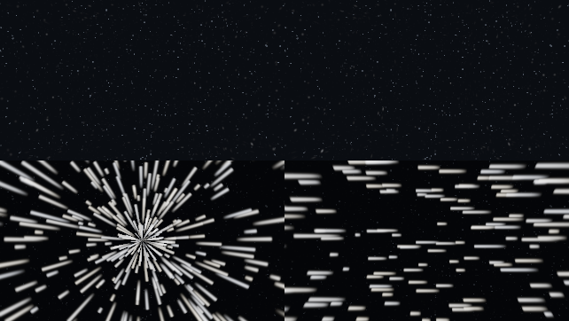

# Flight direction, stars and arrivals

A ship flies through space but its cabin is a fixed, upright room, and the player walks around inside it. This document explains how the game decides which way is forward, how the sky shows motion, and how the screen changes between places. It covers `model/flight` (`ShipHeading`, `FlightDynamics`, `TransitFade`, `TravelVisuals`), the star shader, and the boarding view conversion.

*Top row: stationary and translated views. Bottom row: looking along the FTL axis and looking perpendicular to it. The comparison tone-maps raw GPU radiance captures for inspection.*

## Which way is forward

Players build ships from blocks, and place the Ship Controller wherever it fits. If forward were defined by the controller, moving it to a side wall would silently rotate every control. So **the engines define the bow** (`ShipHeading`).

- Each connected engine has an exhaust facing. The bow is the direction *opposite* the largest group of exhausts that share a horizontal direction.
- All connected engines count, including switched-off ones, so toggling machinery never changes steering.
- If two directions tie, the bow is chosen in a fixed order (north, south, east, west). Block iteration order can never flip the controls.
- A ship with no engines falls back to north.

Controller Details shows the resulting bow direction, and the pilot camera starts behind that same bow. The server sends the bow with each ship's scene entry so that every client agrees with it.

## Orientation in space

A ship has a yaw, pitch and roll in the space simulation (`FlightDynamics`). That is the *rendered* orientation of the whole ship relative to the stars. Crew inside always keep an upright physical cabin; the sky moves around the windows, not the floor.

Arriving in a new region gives the ship a fresh random orientation and altitude (`Jumps.randomizeArrival`): so does investigating a signal and launching from a planet into space. Resuming a paused journey keeps the orientation. The reason is practical: a fixed compass heading would put every arrival looking at the same patch of sky, and different ships arriving at the same place would line up.

Arrival positions come from a spiral of 160-block cells (`Jumps.arrivalOrigin`). The first cell with no other ship within 160 blocks and no planet within its radius is used, so arriving ships do not overlap, and arrival near a crowded station falls through to the next free cell.

## What the sky shows

- **Distant stars** are always present in space.
- **Nearby glints** are a sparse extra layer with real parallax, so motion is visible when the ship moves, including during docking approaches. They stay still when the ship and camera are still. The layer is drawn only in the space dimension and not in a planet's sky (`StarParallax` in the compute shader).
- **FTL streaks** radiate from the *forward* direction of the ship (the bow, rotated by the ship's orientation) toward the rear. Turning the camera sideways shows sideways streaks, because the streaks belong to the world and are not attached to the screen. Brightness ramps in over the first two seconds of a journey and out over the last two (`TravelVisuals.streaks`, a smoothstep at each end), and the nearby glints fade out as the streaks come in.

The visuals are cosmetic. They never change journey duration, fuel charges or the destination the player chose. Landing remains the explicit **Land** action after arrival.

## Moving between places on screen

Changing region or dimension needs the client to discard one scene and load another. The fade hides this (`TransitFade`):

- Region and dimension transfers fade out over **0.4 seconds**, switch, and fade back in once the destination is ready.
- Walking through a docking door (boarding) uses a shorter **0.12-second** fade.
- The curve is a smoothstep from the clock, not from frames or loading time, so it looks the same on a slow load.
- Physical transfers also wait for the player's terrain section to be compiled before revealing, and the existing scene readiness and arrival acknowledgements still protect loading (see [independent ship actions](independent-ship-actions.md)).

## Docking without power

A captured tunnel stays usable if either ship loses power. **Undock** needs controls, engine power and fuel on the *departing* ship (`NavigationService.propulsion`); the ship it was docked to may be dead or unpowered throughout. A ship with no propulsion of its own gets an explicit message instead of starting departure. Crew and tunnel clearance checks still apply, and the doors seal before backing away.

## Looking through a docking port

Two docked ships have different orientations in space. When a passenger steps through a port, `BoardingView.between` converts their look direction from the source ship's frame into the destination ship's frame. Walking forward through opposing ports leaves the player looking into the receiving cabin, while deliberate sideways looks and head tilt are kept. The return trip uses the same conversion, and the saved reconnect target stores the corrected angles, so logging out in the middle of boarding is safe.

## Where this is tested

Pure unit tests cover heading selection, tie-breaking, fade timing and the FTL ramp (`ShipHeadingTest`, `TransitFadeTest`, `TravelVisualsTest`). Native tests cover every ship template's bow, orientation over a jump, powerless-target undocking, and refusing to depart without the departing ship's own power. A real-GPU test compares stationary, translated, forward-FTL and side-view renders and checks that FTL animates between frames. The graphical navigation journeys exercise investigating, resuming, landing and launch.
