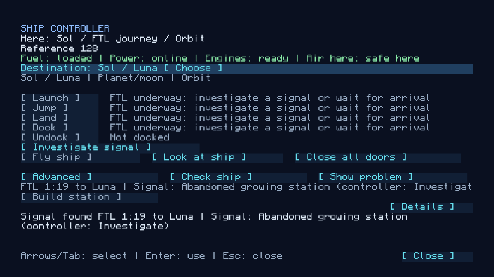
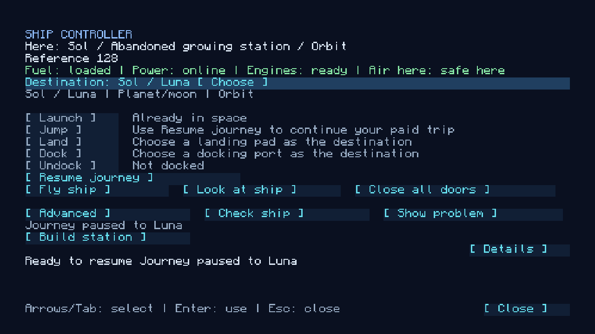

# FTL journeys and signals

A jump between places in space is not a loading screen. It is a **journey**: a timed trip during which the crew keep playing aboard their ship, and partway through which a *signal* may appear that can be investigated. This document explains how a journey works and why it is built this way. The code is [`gameplay/navigation`](../../src/main/java/com/nullandkale/nullspace/gameplay/navigation) ([`Jumps`](../../src/main/java/com/nullandkale/nullspace/gameplay/navigation/Jumps.java), [`JourneyService`](../../src/main/java/com/nullandkale/nullspace/gameplay/navigation/JourneyService.java)), `model/galaxy/JourneyPlan`, and [`worldgen/encounters`](../../src/main/java/com/nullandkale/nullspace/worldgen/encounters) ([`EncounterSites`](../../src/main/java/com/nullandkale/nullspace/worldgen/encounters/EncounterSites.java), [`SiteThreats`](../../src/main/java/com/nullandkale/nullspace/worldgen/encounters/SiteThreats.java)). How the map and ranges work is in [the galaxy](star-systems.md); how the ship looks and steers while cruising is in [flight motion](flight-motion-and-transitions.md).

 

## The idea

Space travel should take time that the player can use. A short loading screen would make jumping feel like a menu action. Instead, the loading screen only covers the one moment the ship changes region, and the journey itself runs as ordinary gameplay: walking the cabin, crafting, tending machines, building. Because the journey has duration, it also has room for something to happen in it.

## Player walkthrough

1. At the Ship Controller choose a destination and press **Jump**. The destination can be a region, a landing pad or a docking port; the same choice covers all three. The Details panel shows the fuel cost and estimated time before departing.
2. The ship enters the journey. The HUD shows the destination and remaining time, and the controller shows the same journey. Normal movement, inventories and ship controls stay available.
3. Partway through, a **signal** may be announced in chat. Ignore it and keep travelling, or open **Trip** and press **Visit signal (optional)**.
4. Investigating pauses the trip and takes the ship to the signal's own space, with its docking port already selected. The ship begins docking automatically; after capture, open the docking door and walk through. Take supplies, repair access with ordinary blocks and tools, or salvage equipment.
5. Return aboard and press **Continue journey** in **Trip**. The ship undocks and resumes automatically. The original destination and the time already spent are kept, and the jump fee already paid is not charged again.
6. Arrival happens automatically when the remaining time runs out. **Land** or **Dock** works for the final pad or port, as it always did.

## Controller states and actions

The Trip page uses current journey, docking and course records. The last button response remains feedback, but does not decide the displayed state. Trip and Manual steps stay in the same controller; encounters remain optional.

| State | What the player sees and does |
| --- | --- |
| Ready | Choose a destination and Engage. |
| Preparing | Launch, landing, docking or FTL preparation; wait without clicking again. |
| Synchronizing | Entering, resuming or leaving FTL; the existing view handshake completes automatically. |
| Cruising | Remaining time and automatic arrival; the crew can move around. |
| Arrival ready | Return everyone to safe cabins, or wait for a current transfer. Arrival retries automatically. |
| Signal available | The same countdown, plus Visit signal (optional). Ignoring it continues the trip. |
| Signal resolving | Keep travelling, or wait until Visit signal becomes available. |
| Approaching | Automatic alignment and docking capture. |
| Securing connection | The collar is being saved; wait before boarding. |
| Docked at a signal | Open the dock door to visit. Return aboard and Continue journey. |
| Paused | Continue journey resumes the paid trip; show any blocker beside the action. |
| Departing | Automatic undocking or safe stopping; wait for completion. |
| Arrived | The selected course is complete. Select the next destination to travel onward. |

Engage seals exterior doors. Interior doors may stay open so air can circulate; an exterior breach or unsafe crew position still blocks departure. Close all doors remains available. Each intersystem hop remains a player decision. Automatic routes, new motion effects and replacing the view handshake are deferred features.

## What a journey is, in the data

Each ship saves a `journey` record: the destination, the region it left, the original destination selection, a private *corridor* region (the FTL space it travels through), the signal's site id, the encounter kind and seed, the total duration, ticks elapsed, the fuel paid and whether the signal was visited. The state is `CRUISE` while travelling and paused otherwise. Because it is part of the ship's saved record, a restart changes nothing.

[`JourneyService.tick`](../../src/main/java/com/nullandkale/nullspace/gameplay/navigation/JourneyService.java) runs once a second. For every ship with a journey and crew in space it adds a second to `elapsed`, announces the signal when its time comes, and arrives the ship when the duration is up. Two rules keep it fair:

- **An empty ship does not travel.** Progress pauses while the crew are offline; another crew member can keep it going.
- **Arrival is already paid.** It does not need the pilot at the helm or engine power, so a ship that loses power mid-journey still arrives. If crew are outside a safe cabin, arrival waits until they return ("Arrival ready: return crew to safe cabins").

Cruising also cancels any thrust or autopilot ([`Piloting.stop`](../../src/main/java/com/nullandkale/nullspace/gameplay/navigation/Piloting.java)); manual piloting, landing and docking become available again after investigating or arriving.

## Time and fuel

Duration comes from the route ([`JourneyPlan`](../../src/main/java/com/nullandkale/nullspace/model/galaxy/JourneyPlan.java)):

- within a system, 45 to 90 seconds;
- between systems, 60 seconds plus 4 per light-year, plus 0 to 20 seconds that depend on the route;
- scaled by the engine: `4 / (4 + tier)` for upgrade tiers 0 to 3, and never below 20 seconds.

Fuel is charged once, on departure. A jump inside a system costs 0.5 fuel, and between systems 1 plus 0.1 per light-year. The best active engine's tier reduces it, as `(base * 4 + 3 + tier) / (4 + tier)`. Ranges per tier, hop routes and the map are covered in [the galaxy](star-systems.md). Investigating, resuming and arriving cost nothing more. Generators keep burning fuel for electricity throughout, and local docking maneuvers use ordinary fuel.

## Signals

A journey's *length* comes from its route, but its *signal* comes from a random nonce rolled at departure. About one in four eligible trips offers a signal. Announcing one starts a five-minute cooldown for that vessel; trips started during the cooldown stay quiet. A new nonce keeps repeated routes from selecting a predictable site. (The route itself still gives stable quotes: the preview in the controller uses a fixed signal derived from the route.) A route has at most one signal.

The signal arrives between a quarter and a half of the way through the trip. Its kind decides what is found:

| Kind | What is there |
| --- | --- |
| Abandoned growing station | A sealed arrival room and a lit growing room with mature wheat, hydrated farmland and contained water, in one of three hull palettes. A barrel holds bread, seeds, an iron hoe and coal |
| Damaged freighter | One of the three manufacturer freighters. The dock works, and the interior cargo door is blocked by two cobblestone blocks. Engineering fuel, galley food, repair supplies and cargo are in separate room containers |
| Salvage ship | One of the six smaller manufacturer ships, uncrewed. Its machinery, furnishings and hull can be recovered, and it carries System Upgrades, iron, redstone, coal and food |
| Drifting cargo | A small sealed pod, adrift with no power or air: one dock, a core and a few crates, one of which holds the treasure |

These are real vessels built from the ship catalog (see [the ship generator](ship-generator.md)), with real inventories. Items are ordinary Minecraft items, machinery has real fuel, crops grow normally, and containers never refill. Depleted supplies stay depleted.

### Danger

Places have a danger level from 0 to 3 ([`StarSystems.danger`](../../src/main/java/com/nullandkale/nullspace/gameplay/navigation/StarSystems.java)); a signal is as dangerous as the more dangerous end of the trip, and trips of danger 2 or more announce freighters and salvage ships as "Distress call". When a player first reaches a salvage site (once, and persistently), [`SiteThreats`](../../src/main/java/com/nullandkale/nullspace/worldgen/encounters/SiteThreats.java) places defenders in the ship's own floor spots:

| Danger | Lost crew (zombies) | Skeletons | Repair bots |
| --- | --- | --- | --- |
| 0 | 0 | 0 | 0 |
| 1 | 2 | 0 | 0 |
| 2 | 2 | 1 | 1 |
| 3 | 3 | 2 | 2 |

Lost crew wear spacesuits, and repair bots are a custom hostile entity. Threats do not respawn, which is the other half of "supplies do not refill".

### How a signal exists

A signal is a vessel built on demand by the same machinery as [orbital population](space-world-generation.md): the plan is saved first, the blocks are queued as an ambient build, and the signal says "resolving" until the vessel is complete. Two crews with the same signal reach the same object.

Signals **fade**. Once no ship's journey refers to a signal and no other ship is in its region, its vessel is disposed of and the region forgotten ([`EncounterSites.vanish`](../../src/main/java/com/nullandkale/nullspace/worldgen/encounters/EncounterSites.java)). A site a player has claimed is their ship and stays. Old FTL corridors left by finished journeys are forgotten the same way. This keeps a long-lived world from collecting wrecks.

Ordinary orbital population is excluded from corridors and encounter regions, and encounters do not create extra dimensions or planetary terrain.

## Rules around landing and recovery

- A ship cannot land while cruising: "Finish the FTL journey before landing".
- The loading handshake is deliberately separate from journey time. It exists only to synchronize the region change on the clients.
- Landing through an authorized surface [recall](ship-recall.md) clears the journey instead of leaving a surface ship travelling.
- The encounter itself has no NPC crews, trading or combat AI beyond the threats above.

## Where this is tested

[`JourneyPlanTest`](../../src/test/java/com/nullandkale/nullspace/model/galaxy/JourneyPlanTest.java) covers duration, contact timing and distinct nonces. [`JourneyGameTest`](../../src/gametest/java/com/nullandkale/nullspace/gameplay/navigation/JourneyGameTest.java) exercises all four signal types with their real templates, safe entrances, reachable rewards, offline progress, shared signals, disk reload, docking, boarding, return, undocking, resume and arrival. [`NavigationClientGameTest`](../../src/gametest/java/com/nullandkale/nullspace/gameplay/navigation/NavigationClientGameTest.java) uses the real controller clicks for Jump, Investigate and Resume.

Tests shorten a journey by setting `nextJourneySeconds` on the ship's saved record before the jump (and fix the signal with `nextSignalNonce`), so waiting through a real cruise stays cheap. Production has no way to set these.
