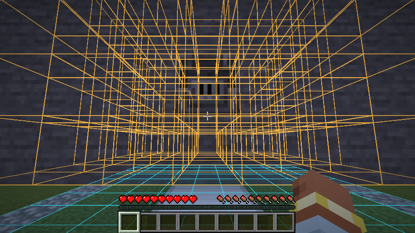

# Pad discovery, build previews, and hatches

Implemented October 25, 2026. This extends the [ship plan](../history/ship-and-space-plan.md) and [systems plan](ship-systems-and-viewports.md).

## Pad computers

Place the computer **on top of any cobblestone ring block**, including a corner. Its facing only controls the screen direction. You can stand outside the pad when placing it. The scanner checks grass or dirt beside the supporting ring, validates the full rectangle, and requires an interior no larger than 32 x 32. It scans the layer directly beneath the computer; it cannot fall through to a lower pad. A computer touching two valid pads asks you to move it to an unambiguous outer edge.

Pads at different heights may share a footprint. A ship belongs to the nearest registered floor below its ship controller, rather than the first registration in the file. Prelaunch ownership and preview allocations end below the next registered overlapping pad. Adding a higher pad updates existing lower allocations. **Vertical launch and landing still require a clear column to the sky**: a stacked pad overhead is an obstruction, not an elevator or permission to fly through it. Same-height rings still cannot overlap.

## Previews

Open the pad computer and select **Pad preview** or **Ship preview** with arrows and Enter, or click the action. Select again to turn that mode off. Both modes can be active together, including before registration. Close the terminal to inspect the highlights.

- Cyan highlights show the pad interior and cobblestone ring.
- Amber outlines show blocks connected to a ship controller or ship computer within the pad's build allocation. Disconnected blocks are excluded. Invalid machinery remains visible for repair; a preview is not travel approval. Multiple ship controllers are shown if present, while launch still requires exactly one.
- Highlights remain visible through the hull and fade over approximately 30 seconds. Geometry refreshes after block edits, at most twice per second, without restarting the fade. Each mode requires another explicit activation after expiration.
- Previews belong to the requesting player. Closing the terminal leaves them on; disconnecting, dying, changing dimensions, removing the computer, invalidating the pad, or moving more than 160 blocks away clears them.

The server supplies bounded block positions through a typed, session-authorized payload. Clients use Minecraft's native batched gizmos, with no extra framebuffer or terrain simulation. Ordinary background ticks do no block scans when previews are inactive. Geometry is limited to the existing maximum 32-cube ship allocation. Surface filtering avoids drawing completely enclosed ship blocks.

## Doors and trapdoor hatches

Wooden and iron trapdoors participate in pressure sealing, ship discovery, stable door device IDs, engineering groups, individual operations, and open/close-all batches. A closed, dry trapdoor seals a **floor or ceiling opening with a full solid block on each of its four horizontal sides**. Top- and bottom-half placements are supported. An open or unframed hatch leaks. Pressure rebuilding and finite room air use the actual block state, so opening a hatch into vacuum vents the connected compartment.

A high roof hatch needs a usable ladder route; putting an unreachable hatch in a ceiling does not satisfy the exit requirement. Player clearance, half-block steps, stairs, and ladder segments are checked together. A floor hatch may serve as a downward exit. Native redstone keeps working, and a powered remote close operation cannot override an active redstone signal. Framed normal doors retain their existing behavior.

Trapdoors used as decorative upright panels do not become airtight walls. The initial hatch model deliberately requires the four-sided floor/ceiling frame.

## Cargo and diagnostics

Furnaces, blast furnaces, and smokers now travel with inventory, fuel, and cooking state, alongside the previously supported chest, barrel, shulker box, and sign block entities. Live block-entity ticks pause during transfer arrival quarantine and resume afterward; a client taking longer to load must not consume extra furnace fuel or cook through a snapshot boundary.

Unsupported machines remain blocked by preflight. The error names the block, gives its block-entity registry type, identifies the location, and tells the player what to remove or repair. Unsupported passengers likewise report their entity type and a specific remedy. Validation failures keep their world highlight; unexpected internal exceptions are logged and show a readable retry message rather than Java exception text.

**World 5 was inspected read-only.** Its saved ship has a furnace at **883, 66, -76** (`minecraft:furnace`), which explains the former generic unsupported-block-entity error. Two nearby chests were already supported. No unsupported passenger was found in the saved pad entity chunks. No player save was opened in Minecraft or modified for this inspection. This identifies the old rejection; it does not certify that every other launch requirement in that save is satisfied.

## Verification

New regression coverage includes all ring edges/corners and controller facings, exact-layer scanning, ambiguous rings, stacked ownership, upper allocation boundaries, independent preview toggles, invalid-machine previews, friendly type-specific errors, wooden/iron hatch sealing, missing frames, ladder-only exits, stable hatch group IDs, redstone override, and all three furnace types. The existing interruption/round-trip test now also checks furnace inventory and cooking NBT after rollback at every pre-commit transfer stage, after launch, and after landing.

The graphical scenario places the computer from outside in Survival, drives both preview actions through the actual terminal and network protocol, checks rendered highlight pixels, edits connected hull geometry, checks fade preservation and expiration, and transfers running furnaces through an arrival held by a second passenger. The loopback two-client scenario additionally checks that one player's highlights and terminal actions never leak to the other client. Final run results are recorded in [local verification](../development/local-verification.md).

Later on October 25, [expanded block support](ship-block-support.md) enabled the broader workshop and decorative set, garden soil in the ship/preview mask, and unframed decorative trapdoors. That guide and the generated catalog supersede the earlier limited cargo whitelist and decorative-panel restriction in this record.
