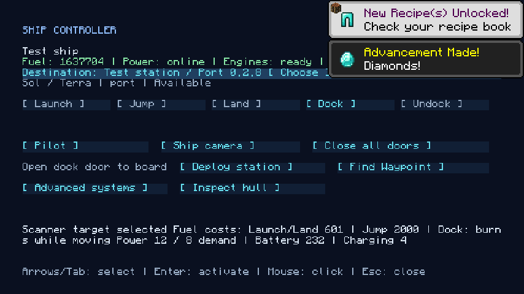
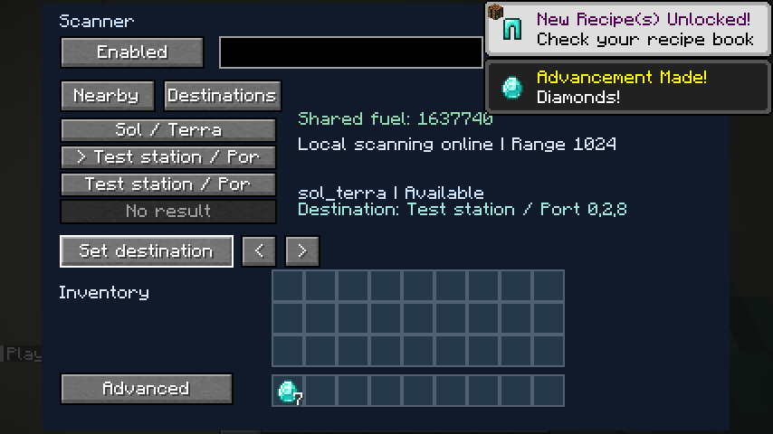
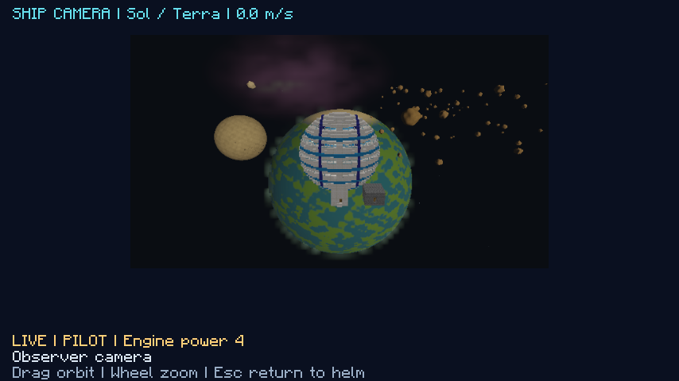
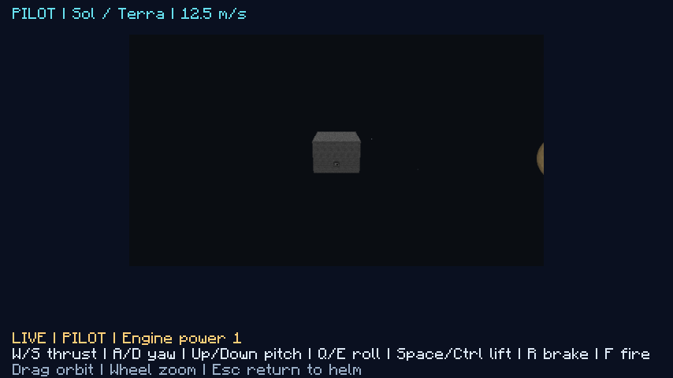
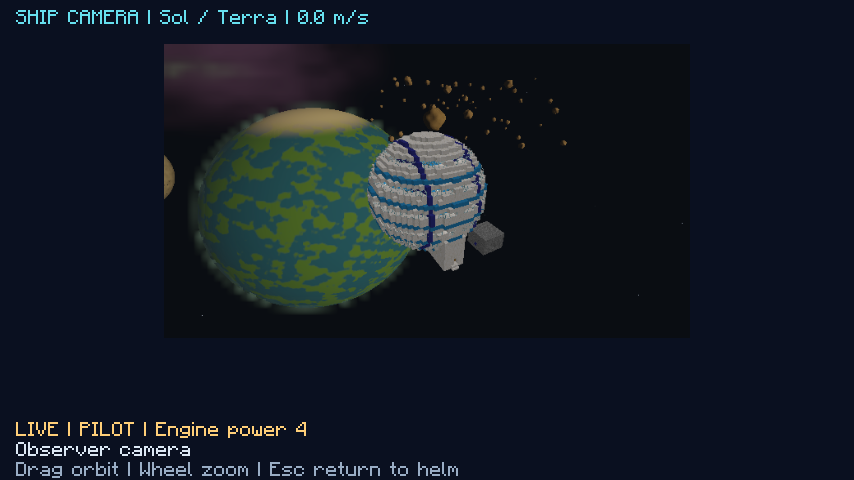
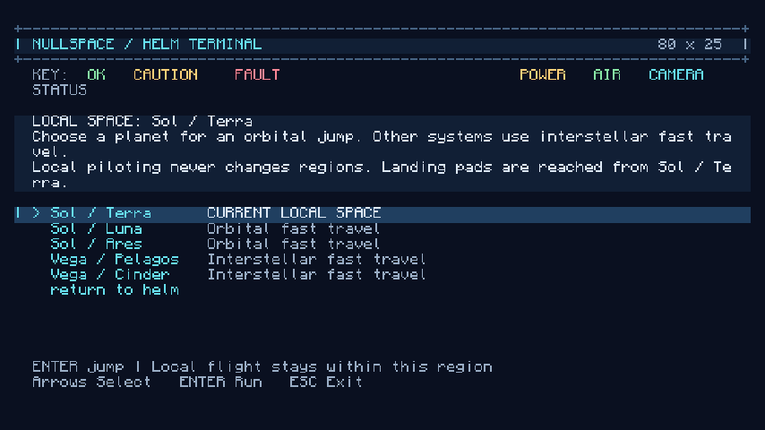

# Ship controller, local flight and cameras

A ship has a position and orientation in space, but its blocks stay put. This document explains how a ship is controlled from its Ship Controller, how hand flight works and why it is built the way it is, and how the camera views relate to the physical ship. The code is [`gameplay/navigation`](../../src/main/java/com/nullandkale/nullspace/gameplay/navigation) ([`ControllerScreen`](../../src/main/java/com/nullandkale/nullspace/gameplay/navigation/ControllerScreen.java), [`ShipControl`](../../src/main/java/com/nullandkale/nullspace/gameplay/navigation/ShipControl.java), [`NavigationService`](../../src/main/java/com/nullandkale/nullspace/gameplay/navigation/NavigationService.java), [`Piloting`](../../src/main/java/com/nullandkale/nullspace/gameplay/navigation/Piloting.java), [`Jumps`](../../src/main/java/com/nullandkale/nullspace/gameplay/navigation/Jumps.java)), `model/flight/FlightDynamics`, [`gameplay/scene`](../../src/main/java/com/nullandkale/nullspace/gameplay/scene) and the client's [`ShipPilotScreen`](../../src/client/java/com/nullandkale/nullspace/ui/screen/ShipPilotScreen.java).

## Two coordinate systems

A ship's hull, rooms, cargo and crew live in a fixed axis-aligned **storage slot** in the shared `nullspace:space` dimension. Players walk on real blocks, and nothing about piloting moves those blocks. What moves is the ship's **simulated pose**: a position and orientation inside a named *local space* (a region of a planet's or star's orbit). The simulated pose determines what the windows, monitors, third-person camera and weapons see. Moving the ship, or turning it, changes the sky and the other ships around it, not the floor under the crew.

Two ships in different regions can have identical simulated coordinates, because their storage slots stay distinct. Backgrounds, monitors, cameras, weapon targets and explosion fan-out all filter by region.

This split is why hand flight is cheap and safe: a ship can fly, spin and roll without any block transfer, and a crash in the middle of a maneuver cannot damage the world. The only physical transfers are launch, landing and recall (see [independent ship actions](independent-ship-actions.md)). Moving between regions is a [journey](ftl-journeys.md) that changes only metadata.

## The Ship Controller

Right-clicking a Ship Controller (or Ship Computer) opens it. It holds **one saved destination**, and its main tab, **Trip**, shows the planned steps and one primary action, **Engage**, with **Stop** beside it. Choosing a destination never starts travel, and a disabled action says what is missing. The separation matters: players kept starting actions they did not mean to when choosing and acting were one click.

**Engage runs a whole trip** ([`CourseService`](../../src/main/java/com/nullandkale/nullspace/gameplay/navigation/CourseService.java)). The controller previews it ("Trip: Undock -> Launch -> Interstellar jump -> Dock", from whichever of undock, launch, local travel or jump, and land, dock or hold in orbit apply), then saves a *course* on the ship and steps through the phases on the server tick, using the same services as the manual buttons, so each phase keeps its own checks and reservations. It closes doors first and stops with the reason if one will not close. The course pauses if the pilot leaves the ship ("Engage again aboard") and if the destination moves or becomes unavailable. **Stop** (disengage) finishes the current indivisible transfer or backs away from a dock safely, then halts. Changing the destination mid-course is refused until the course is stopped. A journey signal is *investigate*: the player consents to the approach, and the course continues into docking.

The **Manual steps** tab has the individual **Launch**, **Jump**, **Land**, **Dock** and **Undock** buttons for troubleshooting and for doing a single phase. The **More** tab has Loose blocks, Check ship, Locate problem, Details and Advanced. Fly manually, View ship and Close all doors are on every tab, and Investigate signal and Resume journey appear when they apply.

- **Pilot** opens the external ship camera and acquires exclusive flight control.
- **Ship camera** opens an independent observer camera without control. Another crew member can use it while the pilot flies.
- **Destination** is a single searchable list of regions, registered landing pads and available docking ports. Filter by type, select, then **Set destination**.
- **Inspect hull**, **Close all doors** and **Deploy station** are direct controls, and **Advanced systems** opens engineering (see [ship block UI](ship-block-ui-design.md)).

To reach a remote pad or port: select it once and press **Engage**, or do it phase by phase (**Launch** if grounded, **Jump** to its region, then **Land** or **Dock**). Every phase and reopening the controller keeps that final selection. A region on its own supports Jump only, because landing and docking need an actual pad or port. An unavailable destination stays selected, so the ship never silently switches targets. Powered scanners use the same list and set the same destination. The Scanner shows the current region, and a System Upgrade adds the other regions. Listing never loads remote terrain.

## Hand flight

| Input | Action |
| --- | --- |
| W / S | Forward and reverse thrust toward the ship's bow (the direction set by the engines, see [flight motion](flight-motion-and-transitions.md)) |
| A / D | Yaw left and right |
| Up / Down | Pitch up and down |
| Q / E | Roll left and right |
| Space / Ctrl | Thrust up and down relative to the ship |
| R | Brake |
| F | Fire the mounted weapon, under its own power and cooldown rules |
| Mouse drag | Orbit the third-person camera independently of steering |
| Mouse wheel | Zoom |
| H | Toggle the controls overlay |
| Escape | Release control and return to the cabin |

The server integrates flight at 20 Hz in [`FlightDynamics.step`](../../src/main/java/com/nullandkale/nullspace/model/flight/FlightDynamics.java):

- **Steering** rotates about the ship's own axes (2.25° per tick of yaw or roll, 1.75° of pitch), so a ship turns the same way whichever way its controller faces.
- **Thrust** combines the held directions and is normalized, so flying diagonally is no faster. It adds `power × 0.6` of acceleration, with velocity decaying by 2.5% a tick, or by 35% when braking. The speed limit is `12 + 8 × power` blocks per second, where *power* (0 to 8) comes from the engines.
- **Engine power** ([`NavigationService.propulsion`](../../src/main/java/com/nullandkale/nullspace/gameplay/navigation/NavigationService.java)) counts engines that are switched on and have a clear exhaust (each worth one plus its upgrade tier), capped at 8, and limited by the power delivered to the engines and controls. A ship with no fuel, no clear engine, or no control power has no power. Its velocity drops to zero and steering is locked. The camera still works and says why: "NO CONTROL / ENGINE POWER".
- **Fuel.** Any flight input except firing (thrust, steering or braking) burns fuel from the shared generator supply on each tick it is held, and a ship that cannot pay stops responding.
- **Crew safety.** Flight stops, with "CREW EVA / CABIN UNSAFE - FLIGHT STOPPED", while online crew are outside a breathable cabin, including after a breach.
- **Range and collision.** The simulated position stays within an 8,192-block radius of the region's center. Swept conservative bounds stop translation into explicit celestial bodies and into other ships in the same local space. This avoids collisions and does not simulate them: there is no impact damage or rigid-body response, and asteroid-field instances are visual obstacles for now. Weapon fire traces the actual hull geometry and explicit celestial shapes.

### Who holds the controls

Input is a bounded button mask tied to the owning player, ship controller, ship and a random session token, and each message carries a sequence number so a replay is rejected. Only one pilot controls a ship; an observer's non-zero input is ignored. A lease needs a heartbeat: it expires after 80 ticks (four seconds) without one. Control is released, and the ship stops, when the pilot leaves controller range, changes dimension, loses the controller, dies, disconnects, stops sending heartbeats or closes the screen. Window focus loss clears held keys, so a ship does not keep thrusting in the background.

Cancelling a pilot's control also clears any saved velocity that no pilot is holding, so a ship that was left moving does not drift when someone reopens its controls.

## Cameras and snapshots

The chase camera starts behind the bow, aims at the bounds of the connected hull, and sizes its distance from the hull. A modest camera fill light keeps an unlit hull readable. It affects presentation only and changes neither world light nor equipment power. It renders ordinary textured blocks and crew through the same independent scene renderer, with the same compute-rendered celestial surfaces and gas as cockpit and monitor views. Pilot and observer cameras fill the screen with aspect-correct targets and compact status overlays.

The server sends scene snapshots at 10 Hz while piloting, and all client views share bounded interpolation of position and orientation. Geometry is shared between views, and a pose change does not rebake the hull model. The motion cache holds at most 64 ship and region entries and clears on disconnect. Poses are saved periodically while piloting and when control is released, so a process crash can lose the latest unsaved movement.

   

## Regions and jumping

Every destination region has a stable server address and a saved definition (id, seed, bodies, gas, asteroid fields, epoch). Local thrust never changes a ship's region, even at the edge of the space. Only **Jump**, [investigating a signal](ftl-journeys.md), launching and landing do. The chart of regions is described in [the galaxy](star-systems.md), and landing pads in [pads and hatches](pad-previews-and-hatches.md).

A jump validates the route, the ship and its cargo, a sealed occupied cabin, powered propulsion and recalled EVA crew. It refuses the current region, and any unresolved queued weapon impacts. It closes pilot leases, locks the hull and crew using the transit protections, and shows the loading screen to everyone aboard. After every client acknowledges, the server rechecks the ship and saves the new region and arrival pose in one step. **No blocks or entities are transferred.** A failed save restores the old metadata. The loading screen waits for the new region's definition and a prepared scene before acknowledging arrival, and a wrong or early acknowledgement cannot release the crew. A timeout or a pilot disconnect cancels before commit, and a client that fails to synchronize after commit must reconnect. Jumps and physical launches serialize against each other so whole-store recovery snapshots stay consistent.

Arrival chooses a clear pose (see [flight motion](flight-motion-and-transitions.md)), and the journey, not an instant jump, decides how long the trip takes. Player facing, block facing and physical crew positions are unchanged by a jump.

## Where this is tested

[`FlightDynamicsTest`](../../src/test/java/com/nullandkale/nullspace/model/flight/FlightDynamicsTest.java) covers every controller facing, steering directions, diagonal thrust, speed bounds, opposing inputs, braking, power loss, invalid input and repeated rotations. Terminal tests cover the flight actions and stable route selection. Native navigation tests cover saved region definitions, catalog validation, arrival placement, exclusive ownership, stolen and replayed input, and stopping on release. [`NavigationClientGameTest`](../../src/gametest/java/com/nullandkale/nullspace/gameplay/navigation/NavigationClientGameTest.java) drives the real typed terminal and input packets, checks movement with stationary crew, opens the observer camera, and flies a multi-region route with destination-scene readiness. The two-client test adds exclusive piloting, a simultaneous crew camera and shared-region round trips.
