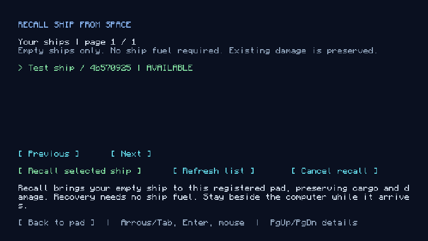

# Ship ownership, storage and recall

A ship is a world object that survives its pilot. Players die, log out and leave ships parked in odd places, and a server cannot ask them to come back. This document describes how a ship is claimed, how access is remembered, and how a ship is brought back to a landing pad (**Deploy**) or put away (**Store**) from a Pad Computer. The code is in [`gameplay/ownership`](../../src/main/java/com/nullandkale/nullspace/gameplay/ownership).

## The rule behind all of it

**Moving a ship never needs the ship's own systems.** Recall works with no fuel, dead engines and no working controller, because its purpose is to rescue a ship whose crew have lost all of those. It uses the same durable transfer journal as flight (see [independent ship actions](independent-ship-actions.md) and `gameplay/travel/ShipTransfer`), so an interrupted recall restores the original ship and never leaves a second copy on the pad.

Two things are real and are not "recovered" by recall: hull damage and missing blocks. A recalled ship arrives with the same cargo, machine inventories, upgrade items and remaining fuel, and the same damage. Recall is transport, not repair.

## Who may move a ship

Each ship record stores an `owner` and a `recallUsers` set.

- **Claiming a derelict** ([`Claims`](../../src/main/java/com/nullandkale/nullspace/gameplay/ownership/Claims.java)) makes the claimant the owner. Only an unclaimed salvage vessel from an encounter can be claimed, and public service stations never can. The vessel keeps its identity, blocks and depleted supplies, so claiming never refills fuel, hull or cargo and never produces a fresh copy from its generation site. A derelict whose controller was destroyed can be claimed by placing a Ship Controller aboard it and opening it.
- **Flying or being delivered a ship** adds the player to `recallUsers` ([`CrewRelease.authorize`](../../src/main/java/com/nullandkale/nullspace/gameplay/ownership/CrewRelease.java)). The right is saved on the ship, so it survives the player dying. Dying aboard a station or another vessel also remembers the ship you came from.
- **Ownership** is separate from crew access. Only the owner may store the ship, issue titles, or sign it over.

The My ships list shows ships in space that the player owns or has recall rights to, plus ships standing on the pad that the player owns. Stations and debris never appear.

## Ship titles

The **Ship Title** is a physical item that authorizes one ship. It matters when a stored ship is deployed by someone who is not its owner.

- The server keeps the ship. The paper carries only the ship id and an *authorization number*. A title is valid only while its number equals the ship's current `titleAuth`.
- Issuing a new title advances the number. Every earlier paper becomes void, and is relabelled "Void Ship Title" the next time it is used, so a stale copy is never mistaken for the real one. A copy of the item grants nothing.
- The owner never needs the paper. Anyone else who has recall rights must carry the current title to deploy a stored ship.
- **Handing a ship over** takes two steps, on purpose. The owner right-clicks the title to sign it over. Whoever then holds the signed title right-clicks it to take ownership. A found or stolen unsigned title does nothing. On transfer, the new owner's title is reissued and the old ones die. Signing again cancels. Handover is refused while the ship is moving.

## Deploy

At a registered landing pad, open the Pad Computer and choose **My ships**, then **Deploy** on a ship. Stay within 8 blocks of the computer.

A request is checked before it is accepted, and again every tick while it waits:

| Check | Why |
| --- | --- |
| Player is alive, on the surface, within 8 blocks, may interact | Recall is a service of the pad, not a remote command |
| Pad is registered and not reserved by another ship | One ship per pad column |
| Ship is in space and is not a station or debris | Only ships can be recalled |
| Ship is not docked, building a station, travelling or boarding | Moving it would tear a link or a transfer |
| No player is inside the hull | A transfer cannot carry a standing player safely |
| No one else is already recalling it | One job per ship |
| Stored ships need the title for non-owners | See above |

Offline crew do not block recall. They are removed from the ship's crew list and get a respawn target at Terra Harbor, so they log back in somewhere sensible instead of inside a ship that is no longer there.

A job waits for the ship's chunks to load, then runs the transfer. It is cancelled if the player leaves the computer, and times out after 600 ticks (30 seconds) of loading. **Cancel** cancels only your own request. Closing the screen does not cancel it, and neither request ever cancels another player's. Blocked recovery names the obstruction and its coordinates, and a queued piston or door action on the hull defers the move rather than corrupting it.

The destination column is the pad's footprint, 32 blocks up. The ship must fit inside it with a clear landing column.

## Store

**Store** on a ship standing on the pad moves it, with no fuel and no controller, into its own private space slot through the same journal, and clears the pad. Only the capture inside the pad column is taken, never neighbouring terrain or builds. The owner receives the ship's title. A ship already in space is marked stored where it is. Stored ships are listed as `STORED` and can be deployed again from any pad by anyone holding the title.

A crew member storing a ship does not void the owner's title, because only the owner is ever issued one.

### Abandoned ships

A ship left on a pad blocks everyone else's pad. After its owner and all its crew have been offline for an in-game day (24,000 ticks, tracked from join and disconnect times), the ship counts as **abandoned**. Anyone at the pad may then store it. It is moved into its owner's storage and stays the owner's ship. The pad is cleared and nothing is destroyed.

## Old saves

Saves from before recall rights existed have ships with no owner. For these, the single-player world owner or a server administrator may recover an unclaimed ship at its saved home pad. This exception never exposes another player's claimed ship. In a multiplayer save with no remaining crew association, ask an administrator.

## Where this is tested

[`ShipStorageGameTest`](../../src/gametest/java/com/nullandkale/nullspace/gameplay/ownership/ShipStorageGameTest.java) covers deploying and storing, titles, abandonment and refusal cases; [`ShipStorageClientGameTest`](../../src/gametest/java/com/nullandkale/nullspace/gameplay/ownership/ShipStorageClientGameTest.java) drives the terminal through the real UI. [`ConcurrentShipActionsGameTest`](../../src/gametest/java/com/nullandkale/nullspace/gameplay/travel/ConcurrentShipActionsGameTest.java) checks that a recall does not block other players' actions and that rollback preserves ships that already moved.
