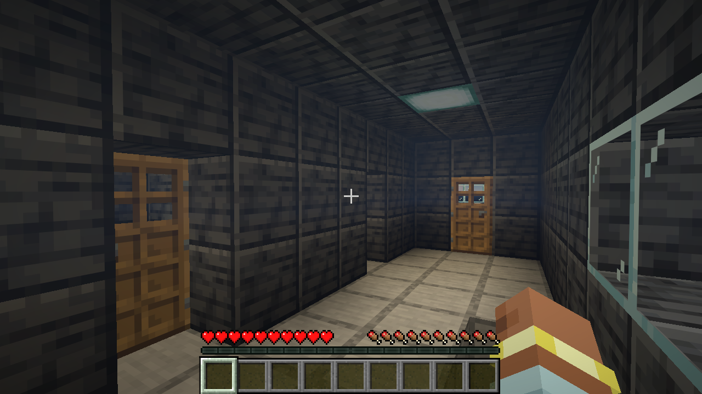

# Ship rooms and resources

Rooms should tell the player where to go and what to look for. A ship needs recognizable places to live and work, with different sizes, furniture and walking routes, and finding a useful room should help the next expedition. This document explains how rooms define a ship's interior, and how the same rooms decide what a derelict contains. The layout rules are in [the ship generator](ship-generator.md); the code is `worldgen/blueprint/ShipRooms`, `worldgen/shipgen/RoomUse`, and [`worldgen/encounters`](../../src/main/java/com/nullandkale/nullspace/worldgen/encounters) ([`EncounterSites.stock`](../../src/main/java/com/nullandkale/nullspace/worldgen/encounters/EncounterSites.java), [`SiteLoot`](../../src/main/java/com/nullandkale/nullspace/worldgen/encounters/SiteLoot.java), [`SitePoints`](../../src/main/java/com/nullandkale/nullspace/worldgen/encounters/SitePoints.java)) with the loot tables under [`data/nullspace/loot_table/site/`](../../src/main/resources/data/nullspace/loot_table/site).

## Rooms are the unit of a ship

Every ship in the catalog is generated from a recipe and is made of rooms, each with one purpose (bridge, engineering, cargo hold, galley and so on, listed in [`RoomUse`](../../src/main/java/com/nullandkale/nullspace/worldgen/shipgen/RoomUse.java)). A room holds everything its task needs and nothing from another task. That is deliberate: a player who walks into a room should be able to tell what it is for and what is in it, and the game can say the same thing to its own systems.

Each design has a list of room *landmarks*: a name, a use, a standing spot inside the room (`walk`) and the container that holds its supplies, if any (`supplies`). A generated ship reports these from its own layout, and a hand-edited design lists them in [`catalog/ships.json`](../../src/main/resources/data/nullspace/catalog/ships.json). Landmarks serve two systems:

- **Walking checks.** Tests use the standing spot to confirm a real walking route from the dock to every room.
- **Supplies.** The container position is where a derelict's loot goes.

Beds, workstations and furniture are ordinary Minecraft blocks. Specialty rooms add no passive bonuses: a sickbay does not heal and a lab does not research. Beds in the space dimension do not set spawn or let the player sleep. They remain recognizable bunks and recoverable furniture.

## Which rooms a ship gets

The role chooses the wish list, and the seed varies the rest.

| Role | Tends to have |
| --- | --- |
| Scout | Bridge, bunks, a store and engineering, in a small hull |
| Freighter | Bridge, a cargo hold, engineering and crew space, with cargo holds filling the lower deck |
| Explorer | Workshops, labs, a lounge, hydroponics, bunks and a viewing room, over several decks |

Maker (Rivet Works, Halcyon Aerospace, Bastion Shipbuilding) changes materials and accents, not the room rules. The shipyard descriptions name the interiors, so a buyer can choose by what is inside and not only by the hull.

## Searching a derelict

A derelict from an [encounter](ftl-journeys.md) or [orbital population](space-world-generation.md) is a real catalog ship with its controller replaced by a station core. Its supplies are stored in **real containers placed in the rooms**, and each room's contents follow what that room is:

| Room | Loot table | Typical contents |
| --- | --- | --- |
| Engineering | `engineering` | Coal, charcoal, redstone, circuit boards, machine casings |
| Galley | `galley` | Bread, carrots, potatoes, apples, cooked beef |
| Workshop or lab | `workshop` | Iron, redstone, circuit boards, air canisters, System Upgrades |
| Cargo | `cargo` | Coal, charcoal, copper, iron, glass, string, paper |
| Crew quarters and other rooms | `crew` | Paper, wool, books, leather, a compass, a clock |
| Growing station | `garden` | Bread, seeds, bone meal, coal |

One container in each site is its **treasure**. It is the cargo hold's container if there is one, otherwise the workshop's or lab's, otherwise any supply room. Treasure scales with the zone's [danger](star-systems.md#danger):

| Danger | Treasure table | Adds to the everyday supplies |
| --- | --- | --- |
| 0 | `treasure_0` | Nothing special: a few extra materials |
| 1 | `treasure_1` | Books, golden apples, diamonds, shulker shells, System Upgrades, some armor trim templates |
| 2 | `treasure_2` | More trim templates and amethyst |
| 3 | `treasure_3` | Echo shards, totems, netherite upgrade templates, enchanted golden apples, music discs, netherite scrap |
| Pulsar or black hole | `treasure_singularity` | The danger 3 set, plus elytra and a nether star |

These are ordinary Minecraft loot tables, which means a pack author can change the contents without touching code.

**Loot rolls when a player first opens the container**, using the container's saved seed, so a site is stable between visits: returning does not reroll or restock anything, and emptied lockers stay empty. Each container has a title naming its room ("Engineering supplies"). The stock happens only during the site's inaccessible initial construction, and before its ready marker is saved. Nobody can open a half-built site, and a restart cannot stock it twice.

Supplies are real items to carry home: feed coal to the generator, plant the carrots, or install the upgrades. Normal delivered ships get ordinary starting provisions instead, never encounter loot.

Sites built from kit pieces (see [generation infrastructure](generation-infrastructure.md)) mark their containers with named `loot` points. [`SitePoints`](../../src/main/java/com/nullandkale/nullspace/worldgen/encounters/SitePoints.java) saves these with the site, and the first container gets the treasure while the others take the table named in their point.

## The freighter's blocked door

The abandoned freighter's interior cargo doorway is blocked with two cobblestone blocks, while its docking entrance works. Clearing it takes an ordinary pickaxe. The point is a small, physical bit of effort between the player and the reward, with no puzzle or key.

## Player story the design aims at

1. I notice my generator is running low.
2. I investigate a freighter signal, dock and walk in through the normal door.
3. I use a pickaxe to open the blocked cargo doorway.
4. I find fuel beside the generators, then check the galley and workroom for food and parts.
5. I carry the finds home, load the coal and put the rest where it belongs.
6. I return later and find the same ship with my changes and empty lockers still there.

The field guide's **Already on a ship** chapter teaches the room-search rule.

## Existing worlds

Newly delivered ships and newly constructed sites use the current interiors. Ships and sites that already exist keep their blocks, inventories and player edits. A site saved while still under construction keeps its saved hull plan and is not rebuilt into a new layout.

## Where this is tested

[`RoomKitTest`](../../src/test/java/com/nullandkale/nullspace/worldgen/shipgen/RoomKitTest.java) (unit) runs the walking, light and one-task rules on every room kit and writes breaks to `build/room-kit-audit.txt`. [`JourneyGameTest`](../../src/gametest/java/com/nullandkale/nullspace/gameplay/navigation/JourneyGameTest.java) and the station tests check that stocked containers are reachable and that a site is not stocked twice.
