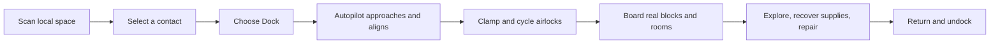

# Space encounters, stations and docking

Status: the station/docking loop includes Waypoint, player construction directly in space, room kits, doorway graphs, automatic docking/undocking, walk-through boarding and stations spanning several simulation sections. See the [playable guide](stations.md). [Timed FTL journeys](ftl-journeys.md) now schedule persistent growing-station, damaged-freighter and salvage-ship encounters along routes. Remaining sections retain broader proposals for traffic, missions and active NPC vessels.

Accepted decisions: docking is fully automatic after the player selects a destination and chooses Dock. Players never have to fly into position, match speed or align ports themselves. Ship docks use a normal framed door on a Docking Base. Players can build persistent space stations and dock their ships to them. Station construction starts directly in space, rather than requiring a surface build and launch. Boarding initially uses a short transfer between airlocks. The first encounters emphasize exploration: stations, neutral ships and derelicts. Active hostile ships and combat AI come later. Rendering iteration is covered in the companion [rendering workshop proposal](space-rendering-workshop.md).

The [station modules and systems design](station-modules-and-systems.md) adds a ready-built Waypoint Station, reusable room pieces and doorway connector nodes. Their graph supports fixed layouts, later procedural generation and runtime route diagnostics; actual blocks remain authoritative for pressure and equipment.

## The play loop

Sensors should give us somewhere interesting to go, rather than merely printing a list. A local contact can be a station, survey vessel, cargo ship, wreck or signal source. Selecting it exposes range, identification confidence, last reading and available actions. A station or ship has a real editable interior, inventories, atmosphere and damaged machinery. Visiting the same object returns to the same state.

Proposed first examples:

| Encounter | What the player finds | Reason to board |
| --- | --- | --- |
| Waypoint Station | Completed modular station with two docking airlocks, arrival lounge, workshop/storage, habitation/observation and engineering | A ready destination for automatic docking and a construction example |
| Survey vessel | Parked neutral ship with instruments and a ship log | Learn about another contact or nearby region |
| Damaged freighter | Some pressurized rooms, failed equipment, ordinary cargo | Repair doors/power and recover supplies |
| Derelict | Breached hull, dark rooms, emergency entrance | Suit-and-oxygen exploration and salvage |
| Distress beacon | Unidentified signal that resolves into a vessel on approach | A small authored problem using existing ship systems |

These are encounter templates, not a promise of NPC dialogue, trading or autonomous traffic in the first implementation. Neutral vessels can be parked and uncrewed. Hull damage and vacuum already provide hazards without combat AI. Initial supplies use existing materials and items.

Existing player weapons, TNT and hull damage retain their rules. The first encounter generator simply does not introduce actively hostile AI.

## What exists and what must change

Ships and stations have stable IDs, separate physical storage slots and simulated poses within a local region. Sensors enumerate registered vessels and five planet addresses; they do not run a random encounter scheduler. Scene views show up to four subjects, prioritizing docking partners. Normal flight retains conservative collision bounds; automatic docking adds a checked route and voxel clearance during final approach.

An apparent neighboring hull is a remote rendering, with no native collision or interaction at that apparent location. Boarding must move the player to the target's actual storage region. Our chosen first version makes that transition explicit at an airlock; hull blocks remain in their original regions.

## Persistent space objects

Introduce a common object record with `id`, `kind`, `region`, simulated pose, lifecycle, template version and physical module references. Kinds distinguish player ships, generated ships, stations and wrecks. Keep existing ship IDs and records through an additive migration.

Stations use the existing rooms, damage, power, computers and camera paths. A station is anchored and does not require engines, a planetary pad or successful launch inspection to exist. A wreck remains discoverable after losing its ship controller or pressure seal. Ship launch/landing menus must reject stationary objects explicitly rather than treating every record as a flyable ship.

Start with 32 x 32 x 32 construction modules, matching the current scanner, atmosphere and snapshot bounds. A player builds their station from ordinary blocks inside a registered module; generated stations can use prefabs in the same bounds. The first station fits one module. Give station identity and module identity separate fields so larger stations can later combine modules without increasing every ship grid or pretending several modules share one native room. Large stations and their inter-module travel remain a later extension.

Distinguish a 32-cube simulation section from a reusable room piece. Waypoint uses four 16-cube room pieces inside one simulation section, with paired doorway nodes and a single section atmosphere. Its room graph does not require cross-section boarding or resource sharing.

Generate real hulls only when a contact needs its interior or detailed nearby view. Reserve physical slots through one shared allocator used by launch and encounter generation. Persist the reservation and placement intent before writing blocks; generation has an idempotent recovery record and readiness checks. Scanning a signal must not allocate a whole dimension or synchronously build every encounter.

## Player-built space stations

Player-built stations are part of the first docking loop. A player chooses where to establish a station in the current local region, builds its rooms and equipment, and returns to the same saved construction. Generated waystations are additional destinations, not the only stations ships can use.

### Starting construction in space

Proposed starting flow:

1. Carry a crafted Station Core aboard a ship with a working docking airlock. Bring building materials, a complete suit and a usable oxygen source.
2. Choose **Start station** at the ship controller. Show a candidate site and its construction boundary in the ship camera. The server checks separation from bodies, other objects and reserved approach corridors; the player confirms the site without flying into a precise position.
3. Reserve the station identity, simulated location and physical module slot. Deploy the core with a small work platform and temporary construction berth. These parts are the contents of the crafted core kit; deployment does not generate a completed station, free cabin air or free station power.
4. Autopilot connects the ship to that construction berth. Open the ship's dock door and walk through to transfer to a checked standing position on the platform.
5. Build the station with ordinary blocks: hull, sealed rooms, power, air supplies and permanent docking airlocks. Use the core's Inspect action to check the construction and its ports.
6. Enable a completed permanent port. Ships can then select the station and Dock through the same automatic approach, capture and boarding sequence used for other destinations.

The temporary berth solves access before a player-built airlock exists. It is a distinct construction fixture with an exposed, explicitly vacuum-only arrival anchor, not a completed Docking Port or an exception that makes arbitrary broken airlocks boardable. Access is restricted to the owner and invited builders. The source ship still needs a valid airlock, and the suited transfer must check destination space and oxygen before moving anyone. The small platform provides the first standing surface; subsequent construction uses normal block placement in the station's actual world region.

Construction access also needs an explicit suit tether back to the connected ship's real oxygen source. Account for its gas consumption and range, and preserve the return route. The current distance-based tether cannot be assumed to work across separate physical storage slots; this link is required new behavior. It supplies the builder's suit, not the station's atmosphere or power bus. If the source cannot supply oxygen, reject entry or warn and require a separately supported usable oxygen source. Never silently grant vacuum immunity.

Use the same checked passenger-transfer and reconnect rules for entering and leaving the site as for boarding. Ordinary undocking is blocked while builders or pending transfers depend on the construction berth. Keep the temporary berth until a permanent port and a safe return route work. Removing it is an explicit owner action after those checks. A deployed core can be incomplete, unpowered or breached and still remain a persistent construction site.

### Station equipment and operation

| Part | Station behavior |
| --- | --- |
| Station Core | Registers the station's name, owner, local-space location and construction bounds; exposes Inspect, builder access and docking permissions |
| Hull and rooms | Built and edited from ordinary blocks, with the same seal and support rules as ship interiors |
| Station Core | Runs the station's shared power allocation and equipment diagnostics |
| Power and air | Use existing generators, batteries and powered air supplies; each compartment retains its actual gas quantity |
| Permanent dock | Uses the same standard door on a Docking Base as a ship as a ship |
| Multiple berths | Each permanent port has its own chamber, identity, reservation and clear approach; several ships can dock if their routes and occupied hulls do not conflict |
| Storage and equipment | Normal inventories, workshops, terminals, scanners, cameras and monitors remain editable and persistent |

A station needs no engines, ship controller, surface landing pad or launch inspection. The station core handles station actions; ship movement actions reject station records. Its simulated pose is anchored. Docked ships retain their own inventories, power and atmosphere. Building a station does not introduce automatic resource sharing, trading or a ship-spawning service.

The owner can name the station, invite builders and set docking permission to private, invited or public. Public docking grants arrival access, not ownership or permission to edit protected station blocks. Enforce those choices on the server, including normal block/container interactions where protected access applies. Claiming, deployment and ownership changes must not take over another player's structure or slot.

Edits update room topology, equipment, docking clearance and the rendered hull. Completing a new port makes it discoverable without redeploying the station. Construction that blocks an approach makes that berth unavailable; edits affecting an active clamp or boarding chamber must invalidate readiness and preserve a safe return route. Damage and loss of power use the same checks as player edits.

Persist the station independently of its core block so breaking the core never deletes the hull, contents, occupants or docking records. Replacing a core requires recovery of the existing station identity and owner authorization. Save deployment as a recoverable intent with the kit inventory transaction, reserved slot and block placement; interruption or a repeated request cannot consume the kit twice or create two stations. Player stations have their own bounded server quota, separate from the generated-encounter cap, and are never automatically retired as random encounters.

Initial construction stays within one 32 x 32 x 32 module and can expand freely inside it. The long-term expansion path is additional registered modules under the same station identity, with explicit room boundaries and travel between modules. Do not silently capture arbitrary blocks outside the module or advertise unlimited station size before that extension exists.

## Randomness, discovery and persistence

Use two sources of encounters:

- Seeded regional sites: stable stations and wreck locations derived from world seed, region ID, generation version and site index.
- Occasional signals: a server-owned persisted regional event sequence and eligible-play cooldown. Events draw from weighted templates and reserve a clear simulated location.

Repeated scanning reveals the same existing signals. Closing a screen, reconnecting or jumping away and back does not reroll loot or create another freighter. Once generated, blocks and inventories are authoritative; updating a template never repairs or refills an existing encounter. Different players discover the same regional objects, rather than overlapping private copies.

Proposed initial tuning, exposed in server configuration rather than hard-coded into UI:

| Control | Starting proposal |
| --- | --- |
| Seeded sites | One station and two exploration contacts per region |
| Occasional signal cooldown | 8–15 eligible minutes, persisted and shared per region |
| Active generated signals | At most four per region |
| Saved generated modules | At most 64 across the server initially; defer new hull generation at capacity |
| First exploration contact | Place an introductory contact within local scan range of an arrival area |
| Search work | At most sixteen placement candidates per scheduling attempt; defer if obstructed |
| Hull generation | One bounded placement job at a time, with measured work per tick |

Only regions with participating players advance the occasional-event clock. Menus, scans and computer polls do not advance it. Ordinary scanning does not force-load undiscovered hulls. Nearby previews use bounded loading-only sources; actual players aboard provide normal simulation. A contact must not claim its oxygen, furnaces or NPCs have simulated while its physical world was dormant.

Do not automatically delete a visited or edited hull. Occupants, offline return anchors, docking reservations, cargo, player edits and pending damage all prevent retirement. Completed signal records can be compacted while retaining IDs, claimed rewards and generation history. At the generated-module cap, postpone creation and explain the limit to operators; preserve existing encounters. Persistent discovered sites need an explicit retention policy, not an infinite sequence of disposable loot ships.

## Sensors and routes

Keep the two sensor roles:

| Scanner | New information and actions |
| --- | --- |
| Local | Contacts in this encounter region; identify, track, inspect signal, select as docking target |
| Long-range | Planet routes and selected broadcast sites/signals associated with other regions |

Discovery belongs to the ship's shared crew record. Contact packets expose authorized public metadata, not full interiors or all regional encounter records. Loss of scanner power leaves labeled, timestamped last-known information; it cannot keep updating live contacts. Sort by range with stable IDs and retain a selected target when paginating the bounded list.

Keep planet address and encounter identity separate. A route to a distant station is `(regionId, contactId)`, not a new planet address. Inter-region travel still uses the ship controller's loading-screen jump. It arrives at a checked stand-off point near the contact, not inside its docking port. Choosing Dock then starts the automatic local approach; no manual positioning is required between arrival and docking. Selecting a sensor contact alone never moves the ship or grants boarding access.

For the initial UI, the scanner shows contacts and the ship controller owns Dock, Cancel docking and Undock actions. The system selects a compatible available berth and the ship's primary port; an optional port selector handles ships or stations with several choices. Port controllers report their build validation and connection status when clicked. Proposed script APIs are `ship.contacts()`, `ship.target(id)`, `ship.dock(portId)` and `ship.undock()` through the existing validated native dispatcher. Script docking starts the same autopilot sequence as the ship controller. These additions must extend structured contact data without breaking existing scripts.

## Ports and docking

### Building a dock into a ship

Build a framed standard door directly above a Docking Base, with the door facing outward. The lintel and side frame use solid hull blocks. Leave two-block-high walking space inside and a clear approach outside. Wooden and iron doors both work; a second door, separate chamber and dedicated pump are optional.

Keep the base connected to the ship hull and inside its allocation. Docking needs controller and door power, normal fuel and breathable cabins. Select the destination port and choose Dock; autopilot aligns and mates the bases. Open the normal door and walk through to board. Undock closes the doors before separation.

Ordinary internal framed doors create graph nodes automatically. Station berths use the same compact construction. Block edits update readiness; Inspect reports missing doors, broken frames, blocked anchors and unavailable power. Loading older saves replaces removed hardware with solid iron blocks; fit current equipment where needed.

### Automatic approach and capture

Proposed state machine:

`AVAILABLE -> RESERVED -> APPROACHING -> CLAMPED -> CYCLING -> BOARDABLE`

`BOARDABLE -> SEALING -> UNDOCKING -> AVAILABLE`

Power loss, damage and stale requests produce explicit blocked/fault states. Reservations expire before clamping; a clamped connection persists across saves. Each connection names both object IDs and both port IDs. A server reservation prevents two ships claiming the same berth.

The player selects a discovered destination and chooses Dock at the ship controller. The server validates the ships, ports, region, consent, equipment, power, travel state and a clear route, then reserves the berth. NPC stations can accept by policy; another player's vessel must explicitly accept a request. The initial target must be stationary and remain under a docking movement lock during approach; following a freely maneuvering target is later work. A mobile ship can have several installed ports but one active connection.

Autopilot owns the entire local docking maneuver: brake, travel to a clear stand-off point, rotate to match the port, approach slowly and clamp. Relative speed and alignment are conditions the autopilot achieves, never a request for the player to take over. Proposed final-approach gates are port separation within 12 simulated blocks, relative speed below 1 block/second and forward/up alignment within 10 degrees. Clamping itself requires the mating faces to meet within a much smaller positional and angular tolerance. These are tuning proposals, not implemented constants. Compute mating transforms from port poses; support differently placed ports and arbitrary simulated ship orientation.

Show Approaching, Aligning, Connecting and Cycling airlock as progress, with a clear reason if docking cannot continue. The player can remain in the cabin or watch the ship camera. Manual thrust and steering are suspended during docking. Cancel docking brakes the ship, releases an unclamped reservation and returns control only after stopping safely. Power loss or a new obstacle stops the maneuver safely; it never falls back to manual docking. Mechanical capture locks the relative simulated pose. Once clamped, neither ship can thrust, jump or land until undocked. Undock closes and checks the airlocks, releases the clamp and automatically backs away to a clear stand-off point before returning flight control.

The existing conservative collision rule needs a docking-specific path. Keep normal collision avoidance until a valid port reserves a corridor. Validate the swept hull through translation and rotation, not just the port centerline. During final approach, check actual nearby hull occupancy and the connector clearance; exempt only the intended mating faces. Do not disable target collision for an entire approach or allow a path through a wing. If no bounded safe route is found, report that the approach is blocked. Pin the dock target and partner in scene selection so the four-subject limit cannot hide them.

A powered port can request and cycle docking; the mechanical clamp remains latched through a blackout. An emergency release closes surviving local hatches and checks occupants before separating. Wrecks may offer a marked EVA entrance if their docking hardware cannot operate.

## Airlocks and boarding

Mechanical docking does not merge the two atmosphere grids, power buses, inventories or redstone networks. Each airlock cycles using its real local gas supply and doors. There is no free refill when connecting ships. Cross-ship utility sharing and conservative gas transfer across linked grids are later mechanics.

To board, enter the source chamber and choose **Board** on its controller. Close and verify both chambers' doors, check the destination arrival space and wait for its chamber to become safe. The outer doors stay sealed during this initial passenger transfer because there is no native walkable bridge between the separately stored hulls. After arrival, open the destination inner door only when its cabin/chamber pressure permits. Outer doors remain available for ordinary EVA when undocked. Queue passengers if the destination chamber has only one safe standing position.

An unsafe destination requires an equipped suit with usable oxygen and an explicit vacuum warning. Damaged or unpowered machinery cannot silently declare an airlock pressurized. Redstone-opened hatches and breaches invalidate readiness; normal atmosphere rules continue to apply.

The transfer moves the player and their carried inventory through Minecraft's normal entity path. It does not copy inventory, rebuild the hull or instantiate a temporary clone of the target. A short transition hides the storage-coordinate jump while destination chunks and the scene become ready. Transform the local entrance offset and look direction into the destination frame; clear accidental inherited motion and place the player at a checked safe anchor. Native players have yaw/pitch but no body-roll field, so preserve the transformed look direction, not an unsupported full three-axis head attitude.

Persist a small boarding intent keyed by player UUID and transfer ID. Validate before commit and again immediately before movement. Reuse the established readiness-token and reconnect concepts; do not reuse the whole-hull snapshot operation for a passenger-only move. Coordinate commits with launch, landing and region jumps so recovery of an older whole-store snapshot cannot erase newer docking/encounter state. Repeated acknowledgments cannot move a passenger twice. After commit, a disconnect resumes at the destination; it must not duplicate cargo or return a second copy to the source.

A player can explore while their own ship remains docked. Ordinary undocking rejects pending boarders or crew still on the other vessel. An explicit leave-crew-behind action is a separate future decision. Offline crew retain stable return anchors; destroying a port must not strand a login at an invalid block. Losing a connector requests closure of surviving hatches and clears the docking relationship, while preserving both hulls and ordinary damage/oxygen consequences. Redstone overrides or damaged hatches remain real failures; emergency closure cannot claim a seal it did not achieve.

## Acceptance checks

| Area | Required evidence |
| --- | --- |
| Station construction | Start directly in space, kit accounting and interrupted deployment, unique slot/identity, suited construction entry, oxygen tether, reconnect and return before the first permanent port exists |
| Station operation | Player edits persist, no engine/ship controller/pad requirement, ownership and builder permissions, several independent berths, obstructed approaches, core loss/recovery and station quota |
| Modular example | Ready-built Waypoint layout, compatible doorway nodes, joint ownership, sealed unused sockets, graph/physical route agreement and sufficient commissioned systems |
| Generation | Same seed/version yields the same sites; restart/scan/revisit never duplicate hulls or loot; interrupted placement resumes safely |
| Discovery | Two clients share object identity but see only authorized discoveries; stale/unpowered sensor readings stay labeled |
| Placement | No hull/body overlap; bounded search defers cleanly; storage reservations cannot collide with launch slots |
| Port construction | Compact and widened chambers, curved hull retrofit, all four horizontal facings, missing/misplaced doors, ambiguous chamber, bounds, edits and controller replacement |
| Docking | Entire approach and departure without manual flight, swept translation/rotation clearance, different ship controller facings, reservation races, replayed packets, cancellation, blackout, damage and reconnect |
| Airlocks | Real pressure/supply, blocked anchors, redstone override, breached chambers, suited vacuum arrival and power loss during cycling |
| Boarding | Two real clients on different hulls, inventory retained exactly once, orientation, disconnect at each stage, crash/recovery around commit |
| Departure | Launch/jump/thrust blocked while clamped; no accidental crew abandonment; destroyed ports preserve usable return behavior |
| Rendering | Dock target/partner retained in bounded views; station and ship poses agree from both interiors and external cameras |

Start by validating the player-built port and airlock on a small ship and a curved hull. Assemble the completed Waypoint Station from the fixed room graph and use it to verify automatic docking, boarding, return and undocking. Complete the player-station loop as part of the same first feature: deploy a core directly in space, enter the construction site, build a powered station and permanent airlock, then dock a second ship. Add a damaged vessel and procedural station layouts using the validated doorway-node kit. Expand encounter templates, the persisted random scheduler and stations spanning several simulation sections afterward. The [rendering workshop](space-rendering-workshop.md) should provide fixed docking/encounter shots alongside its celestial scenes.
