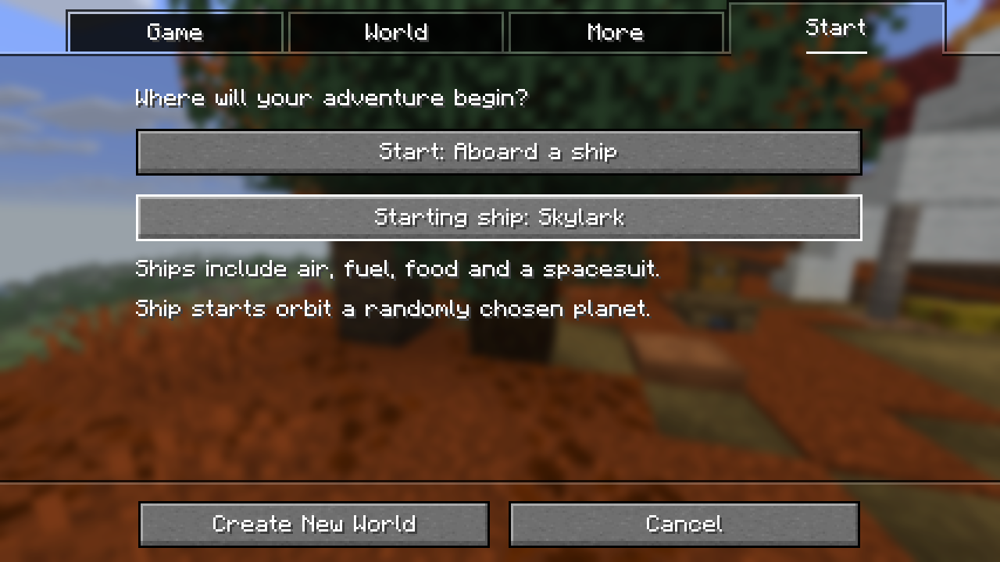

# Starting in space

In **Singleplayer → Create New World → Start**, change **Start: On a planet** to **Start: Aboard a ship**. Click **Starting ship** to choose a design, then create the world normally. Rivet Bolt is the default; all ships in the Ship Beacon catalog are available. Game mode, difficulty, seed and world generation remain the ordinary Minecraft choices.



You begin inside your ship above a randomly chosen landable planet. The cabin has air, the generators contain coal, and you have food, spare fuel, basic tools, building blocks, a spacesuit and the field guide. Use the Ship Controller to explore. Changing the start back to **On a planet** gives the ordinary Minecraft opening.

## Dedicated servers

Stop the server and add these lines to its `server.properties`:

```properties
nullspace-space-start=true
nullspace-starting-ship=rivet_bolt
```

Restart the server. Each **new player** receives their own ship in a separate space allocation, in orbit above a randomly chosen planet. Different players can start above different planets; moons are excluded. Omit the options, or set `nullspace-space-start=false`, for ordinary Minecraft starts.

The ship option accepts the catalog IDs: `rivet_bolt`, `halcyon_swift`, `bastion_ward`, `rivet_hauler`, `rivet_ranger`, `halcyon_courier`, `halcyon_horizon`, `bastion_tender`, and `bastion_pioneer`. An invalid ID is reported during startup.

Existing players keep their location and progress when the option is enabled. Rejoining, dying, or changing the server's starting ship does not grant another ship or refill supplies. Death follows the existing Minecraft respawn and ship-recovery rules.

The singleplayer choice is stored in that world's `nullspace/world-start.properties`. Ship identities, construction progress and completed starts are saved with the world's ship metadata. Interrupted construction resumes the same ship; it does not reroll the planet or replace conflicting player blocks.

Verification: 517 unit tests, 165 mod server tests plus one native smoke fixture, and all 24 graphical scenarios passed. The graphical start test creates a world through the actual menu, waits for the visible cabin, quits, and reopens the same ship. Native checks cover independent players, old player backups and interrupted setup. The launch/return fixture now waits for an interactive destination world before opening its controller. Generated test worlds were cleaned after verification; logs and screenshots remain.
