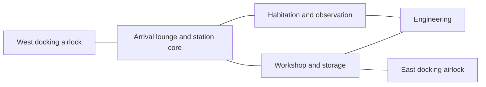

# Station modules, doorway nodes and systems

Status: the initial four-room station, doorway graph, player-built rooms, deterministic generator and docking loop are implemented. Stations can expand to 128 x 32 x 128, with 64 room tiles and a 28-room, eight-berth ring preset. The [playable guide](stations.md) records current controls and limits. This document also retains proposed extensions to the module kit and generation rules.

Build one complete station from reusable room modules first, then use the same modules and doorway graph for procedural generation and player construction. A room module is a collection of ordinary Minecraft blocks with declared connections. Players can edit its hull, rooms, doors and equipment after placement.

The [manufacturer generation plan](procedural-ships.md#one-station-per-manufacturer) proposes three additional reference stations: Rivet Exchange, Halcyon Observatory and Bastion Watchpost. Each shares its manufacturer's ship design habits and includes a multi-ship harbor: cargo piers, a docking ring or separated docking arms. The runtime now supports larger build areas and render sections; manufacturer-specific piers, rings and docking arms still need their own layouts. These are planned additions; existing stations remain intact.

The implemented **Manufacturer Showcase** is a compact review station with Rivet, Halcyon and Bastion rooms and two opposite berths. It fits one 32-block section. New regions populate it automatically as a Manufacturer Exchange; the controller discovers its ports. See the [current review set](procedural-ships.md#current-review-set).

## Ready-built example: Waypoint Station

Waypoint is a completed, anchored station with working systems and two permanent docking airlocks. It is the first fixed destination for testing automatic docking, boarding and returning to a ship. It can exist alongside stations built by players directly in space.

The initial layout fits four 16 x 16 x 16 room modules into one 32 x 16 x 32 footprint, inside the existing 32-cube simulation boundary. Room modules are prefab pieces. The expanded station keeps one identity, a continuous atmosphere grid and one power accounting system; 32-block sections divide rendering only.

| Room module | Local origin | Built contents |
| --- | --- | --- |
| Arrival | 0, 0, 0 | West docking airlock, station core, terminal, signs, seating and station status display |
| Workshop | 16, 0, 0 | East docking airlock, labeled storage, crafting/furnace equipment and maintenance supplies |
| Habitation | 0, 0, 16 | Observation windows, furnished crew space, suit storage and local air supply |
| Engineering | 16, 0, 16 | Generators, batteries, air equipment and service access |

All four internal connections have framed bulkhead doors. Each new exterior port uses one door on a Docking Base; a mated joint preserves finite cabin air. The loop gives an alternate walking route if one internal bulkhead is closed. It does not guarantee a safe route after a breach; actual pressure and clearance still matter.

Installed equipment: two fueled generators and two batteries in engineering, one air supply per main room, two compact docking bases, one Scanner, a terminal and camera/monitor. The Station Core provides control power and bulkhead commands. Decorative lights retain their native Minecraft behavior.

The initial preset has sealed, pressurized rooms, charged batteries and a documented starter inventory initialized once at creation. Each new generator receives one finite starter stack of coal. Existing stations need fuel loaded into their real generator slots, by hand or hopper. Revisiting, reconnecting, scanning or updating a template never restocks inventories, repairs damage, refills gas or recharges batteries. A public station has explicit ownership and visitor permissions, not implicit permission to take every stored item or edit its hull.

The machine-readable [layout example](../examples/waypoint-station-layout.json) specifies room pieces, exposed doorway nodes and connections. Runtime placement uses `StationLayout` and `StationBlueprint`; the JSON is a reference layout rather than a loaded structure asset. Recipes and native commissioning/boarding checks accompany the implementation.

## The room kit

The implemented kit contains arrival/docking, habitation, storage/workshop and engineering. Modules can contain several compartments, especially a room with a separate docking chamber. Dedicated straight corridor, corner and junction kits are proposed extensions; those spaces can already be built by hand with ordinary blocks and framed doors. The generator varies room roles and connections inside the first section.

Mating geometry uses a level floor, a 1 x 2 doorway, a sealing frame and a consistent doorway height. Initial kit placement uses a fixed 16-block horizontal grid. Rotated kit placement and smaller corridor pieces remain later extensions; hand-built docking ports support all horizontal facings. Templates declare their actual occupied blocks and clearance bounds; a tile boundary alone does not prove a collision-free joint.

Players can either build rooms and framed doors by hand, or place an available module kit. A kit must preview its footprint, reserve its area, account for its materials and preserve existing blocks/inventories. It does not grant free prefab buildings. A hand-built room uses the same doorway validation and runtime systems after registration; it does not have to match a catalog template.

## Doorway nodes and the connection graph

Every ordinary framed door creates a doorway node automatically. Exterior doors on Docking Bases add docking capabilities. Generation and inspection use these real blocks; internal doors need no extra hardware.

Each doorway node records:

| Field | Meaning |
| --- | --- |
| Identity | Stable station, section, room-piece and doorway IDs |
| Pose | Local threshold position, outward direction and up direction |
| Interface | Doorway size/profile and type: internal passage, ship dock or sealed expansion socket |
| Door ownership | The actual door blocks and their controlling ship or station |
| Interior association | Validated compartment and standing anchor behind the doorway |
| State | Connected, capped, obstructed, damaged or unavailable, with a revision |

Every doorway is a graph node. A module declares internal paths between its own door nodes. Joining two compatible module sockets creates a connection edge between their nodes. For room selection and a simple station map, collapse those internal paths into a room-to-room graph. Keep the doorway-level representation for exact entrances, door state and route instructions.

Two sockets pair only when their profiles match, their normals oppose, their up directions agree and their threshold planes coincide. The joint must also have an unobstructed floor/headroom and a valid seal. Facing nearby connectors do not create a walkable corridor across empty space.

A joint owns one physical doorway and one operating state. Both participating sockets reference it. Assemble the joint once, replacing only the two templates' declared connection masks; do not place two conflicting doors or carve an unrestricted tunnel between modules. Unused sockets receive real sealing end caps. An unconnected docking port stays an exterior airlock rather than being capped as an internal room socket.

The design graph describes intended connections. The runtime graph is validated against placed blocks. Breaking a door, wall, base or floor updates the affected links; building an opening elsewhere changes the actual compartment topology even if no connector marks it. Missing nodes must not make an unmarked breach airtight. Recompute local paths after relevant edits instead of assuming every pair of doors in a room is still reachable.

Door nodes and graph edges do not spawn or refill rooms. Block placement, inventories, gas and power have independent saved state. Stable node IDs survive a reload; replacing a connector creates a new node and invalidates references to its predecessor.

## How station systems use the layout

| System | Initial behavior |
| --- | --- |
| Station core | Owns station identity, permissions, map and diagnostics; stores no magical replacement hull |
| Electricity | One shared bus per connected station section, using the existing generator/battery/allocation model |
| Life support | Pumps supply actual compartments; opening doors permits local gas exchange and breaches vent real gas |
| Doors | Doorway nodes identify controlled bulkheads; power and ownership determine who can cycle them |
| Docking | External nodes expose compatible berths and approach clearances; all ship maneuvering remains automatic |
| Navigation | The validated doorway graph finds routes; blocked doors, permission, pressure and suit needs constrain a usable route |
| Damage | Block edits and explosions update physical connectivity, compartment topology, equipment and affected route edges |
| Cargo and workshops | Existing native inventories and machine rules; graph adjacency does not transfer items |

Keep traversal, pressure and electricity as distinct views of the same station. A closed bulkhead blocks gas and walking through its aperture but does not sever a power bus carried by the surrounding structure. Opening a door does not connect two electrical supplies. Destroying the structural connection can isolate equipment even when the old room graph still lists an edge. Docking two vessels adds a controlled boarding connection; it does not merge their air or power systems.

For the first 32-cube section, use the existing cell-based atmosphere as the authority. A prefab room is not necessarily one gas compartment, and a graph node is not a fixed air quantity. Door cycling checks the measured compartments on each side. Expanded stations use one finite power bus and a continuous air grid. Gas crosses a render-section boundary by the same conservative face flux as any other cell boundary; it is never copied between separate station records.

Controls, life support and door operation receive a commissioning profile suited to a stationary station; propulsion has no demand. Expose generation, battery reserve, delivered allocations, room pressure, damaged connections and berth availability at engineering. A loss of electricity disables powered actions according to real equipment state; mechanical clamps stay latched. Emergency bulkhead commands request closure, verify the result and report blocked or overridden doors rather than declaring the station sealed.

## Generation from the graph

1. Start with a versioned seed, bounds, room budget and required functions: arrival dock, engineering, habitation and storage. Generate a connected graph of room instances and doorway nodes with a route from arrival to every required room.
2. Select compatible templates and solve their placement/rotation from mating socket transforms. Check occupied volumes, connector clearance, docking approach reservations and the section boundary. Limit retries and backtracking; discard or defer an unsatisfied plan before placing blocks.
3. Prefer at least one loop for the starter station. Extra branches can terminate in observation rooms or capped expansion sockets. Reachability alone is insufficient: every required function must have the expected space and equipment.
4. Pair socket nodes, choose each physical joint once and cap unused internal sockets. Validate the complete assembly for walking clearance, hull seals, atmosphere compartments, powered equipment and usable docking chambers.
5. Reserve the station and section, save the generation intent, then place the validated assembly with bounded server work. Keep it unavailable to docking until placement, inventories, systems and collision data are committed.
6. Persist the resulting layout, template versions, node IDs, joint ownership and creation ledger. Thereafter the placed world is authoritative. Loading rebuilds caches from saved records and blocks, not from a new random layout.

Use the fixed Waypoint layout first to test the module contract. Random generation must reproduce the same plan from a seed/version, but saved stations must continue to load even after their source templates change. The generator may keep a record of original room roles without restoring player edits.

## Initial acceptance checks

- The fixed Waypoint layout places once, passes commissioning, accepts automatic docking at both exterior ports when approach clearance permits, and supports boarding/return with preserved inventories.
- Every connected socket pair mates under each supported rotation; incompatible profiles, height mismatches, overlaps and duplicate doorway ownership are rejected.
- The graph and actual blocks agree on required walking paths. Closed, locked, removed and obstructed doors update usable routes without inventing seals or electricity links.
- Every unused internal socket has a sealing cap. Opening a cap vents according to actual cell pressure; it does not create a phantom room connection.
- Disconnecting a module, breaching a docking chamber or overriding a door invalidates the affected systems while retaining stable identity and safe passenger recovery.
- Bounded generation terminates on impossible layouts. Interrupted placement resumes without duplicate hulls, equipment or contents, and repeated visits preserve edits and resource quantities.
- Hand-built rooms with valid connectors work without a prefab ID. Stations larger than one simulation section remain unavailable until cross-section simulation and travel are implemented.
