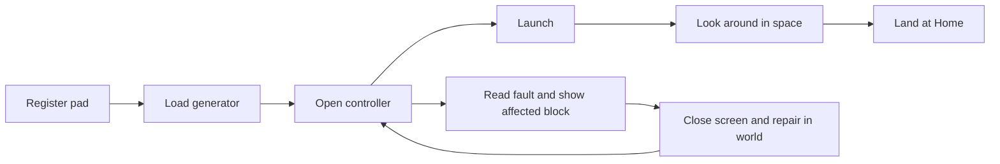

# UI design: rules and screen contracts

This is the design for how ship, station and computer screens behave, and why. The [block UI reference](ship-block-ui-design.md) describes each block's screen as built, and the [UI audit](ui-audit-notes.md) records the problems that led to these rules. The rules below are implemented and also guide playtesting and new screens.

The goal is to keep the game's rules and make each choice, result and way to fix a problem clear. Start with the shared rules and the first trip below. The screen contracts apply the same design to every other task without redesigning them one by one.

## Decisions to carry through every screen

1. **Design around a task.** Fuel loading, choosing a destination and building a room each have a clear beginning and a visible result. A smaller button count is not the goal.
2. **Keep the chosen interfaces.** Controller, Pad Computer and Station Core stay terminals. Machines keep graphical controls and native item slots. Programming stays a shell. A terminal can still have clear buttons, editable fields and visible selection.
3. **Keep one destination, one trip action and the individual steps.** A single saved destination feeds an **Engage** button that runs the whole trip, and Launch, Jump, Land, Dock and Undock stay directly visible in fixed positions under Manual steps. No action-category menus.
4. **Separate looking from doing.** Opening, inspecting and selecting a row never start travel, spend construction items or deliver a ship. Existing automatic systems initialization stays; opening must not introduce new charges or toggle equipment.
5. **Put the remedy with the problem.** Ordinary fuel, power and door faults do not send a player into Advanced. Advanced keeps allocation overrides, commands and detailed diagnostics.
6. **Use the world where it helps.** Repair a highlighted block, put coal in slots, open a dock door and walk through. No extra confirmation screen for each ordinary Minecraft action.
7. **Show the truth.** Loading is not zero, local air is not whole-ship safety, stored fuel is not a guaranteed round trip, and a request is not a completed action.

## Shared interaction rules

These are behavior requirements for existing screens, not a proposal for a new menu framework.

| Rule | Design |
| --- | --- |
| U1: Read the screen | Title identifies the block. Its main area shows its job and current state. The useful controls follow. Optional names and diagnostics do not dominate a fuel or charge display. |
| U2: Know what a click does | Use verbs for actions and labeled state for switches: `Electricity: On`, `Visitors: Allowed`, `Save name`. Clicking a switch changes that named state; the server acknowledgment changes its displayed value. |
| U3: Understand a blocker | Show a short cause, repair and affected object beside the action or slot. Example: `Launch blocked: engine exit covered. Remove the cobblestone behind this engine.` Offer Show problem when a real location is available. |
| U4: Select safely | A saved value and a highlighted candidate are different. Candidates use stable IDs, never list indexes. Set destination names the candidate; success updates the ship's single saved destination. |
| U5: Get a result | After activation, show waiting, then success or a specific refusal. While pending, prevent repeating the same consequential request. Unrelated live readings continue. An unexpected failure preserves the player's choice and gives a retry path after authoritative refresh. |
| U6: Go back predictably | A block opened from the world closes to the world. A picker or Advanced returns to its parent. Fullscreen camera/flight returns to the originating controls when still valid. Restore search/page/draft, not a closed server inventory. |
| U7: Use familiar input | Left-click is the normal action. Text fields support caret placement, selection, Ctrl+A, paste and deletion. Typing affects the focused field. Escape leaves a picker without applying it; no typing is required for a first launch. |
| U8: Keep inventory familiar | Preserve normal pickup, drag, split and shift-click. Mark fuel, empty-container and upgrade slots by purpose. Rejected upgrade removal explains the actual capacity limit at the slot. |
| U9: Keep controls honest | Hit areas match visible controls. Hover/focus helps, but is not the only place to read a fault. Color supplements words and shape. Unavailable core actions remain visible; contextual request/cancel controls appear only when useful. |
| U10: Keep feedback useful | Show a short result where the action happened. Persistent faults remain visible. Optional Details contains exact rates, IDs and full reports. Log consequential blocked actions and failures clearly, without per-tick duplicates. |

### Selection and refresh, precisely

- Opening a picker may highlight the saved value if it is visible. Otherwise no candidate is selected. Opening never overwrites the saved value.
- A user page/filter/search change clears a candidate that is no longer visible. Disable Set destination until a visible choice is selected. Never select a different place merely because it inherited the same row number.
- During live updates, preserve candidate identity while it remains visible. If it disappears or moves off-page, clear the candidate and explain that the list changed. Keep the page stable where possible; no unsolicited jump to another page.
- A selected candidate can remain visible but become occupied or unavailable. Setting a destination and being able to travel there are separate rules: retain existing server selection permissions and show the travel blocker honestly.
- Set destination stays pending until the server accepts or rejects that exact ID. The controller picker returns on success; the scanner stays open and shows `Destination set: [name]`. Rejection leaves the picker open.
- A monitor camera row applies immediately, as today. Highlight the server's active camera, with a pending marker for a requested change. Do not add a redundant Apply button.

### Action and error states

| State | What the player sees | What activation does |
| --- | --- | --- |
| Loading / checking | `Checking ship...` or `Getting destinations...`; unknown readings shown as unknown | No mutation based on missing data. Close remains available outside a committed transfer. |
| Available | Named action and its purpose/cost | Sends the existing action for server validation. |
| Blocked | Named action, immediate reason and repair | Cannot execute. Clicking/focusing may highlight its explanation; the explanation is already visible. |
| Pending | `Starting launch...`, `Saving name...` or the actual active stage | Repeated activation does not start duplicate work. Cancel appears only for operations that support it. |
| Complete | `Pad registered: Home`, `Destination set: Home`, or actual arrival | Shows the resulting authoritative state. No required Continue click. |
| Refused / failed | Specific reason, affected object and next step | Keeps valid input/selection; allows a deliberate retry when eligible. Never silently substitutes another target. |

Availability is not proof that a full preflight has passed. Current controller availability checks are cheaper than launch/landing validation. Keep complete validation on execution; use `Launch checks your ship before leaving` rather than an unconditional safety guarantee. A discovered hull fault stays visible until a relevant recheck resolves it. Ordinary refresh must not replace it with a misleading Ready message.

Use typed state already supplied by services; add missing state fields where necessary. Do not infer permissions, success, empty lists or faults by parsing display text. Keep client hints and server execution consistent, with the server authoritative. Reuse existing operations; these rules do not require a generic workflow engine.

Expected refusals such as no fuel, an occupied dock or an invalid pad return an explicit blocked result, not an exception used as a branch. Unexpected faults keep their diagnostic logs and present a readable failure. A click already waiting for a response must not be silently discarded by an edit cooldown; acknowledge it or make it unavailable before sending.

Opening an unfinished ship must still produce an understandable controller screen. If there is no registered pad or the ship cannot yet be resolved, show the specific setup fault with unavailable travel controls, Check ship and Close. Do not fall back into a different compatibility workflow. Missing power/air data stays unknown, and diagnostic inspection must not invent a working ship record. Likewise, a generator can accept fuel before the controller has discovered it: show `Fuel stored here; not yet connected` rather than losing the inventory's meaning.

### Feedback tied to real changes

| Moment | Useful feedback |
| --- | --- |
| Fuel inserted / module installed | Normal Minecraft item movement, then actual reserve/tier/benefit updates. No separate Fuel accepted dialog. |
| Machine switched on | Button acknowledgment plus the real device state. On can still mean Idle; a working/active indication follows actual output, not the click. |
| Departure / arrival | Existing world/ship transition plus a short named stage/result. Any sound occurs at the confirmed stage, not every refresh. |
| Dock captured | Actual clamps/connection state and the door/walkway hint. A safe crossing is communicated only when the connection exists. |
| Action blocked | Persistent cause and repair, with a matching location highlight when requested. No decorative alert that hides the explanation. |

This is where presentation gains life: make the player's action and its consequence perceptible. Use existing Minecraft sounds/visual language where suitable; do not add a notification, sound or animation to every reading tick.

## First complete task: launch and return Home

Note: the steps below were written around the five direct travel buttons. In the current controller the same trip can be made with **Engage**, and the individual **Launch** and **Land** buttons are on the **Manual steps** tab. The task, its failure designs and its finish line are unchanged.

This is the first UI implementation slice because the [exact build](../player/first-ship-walkthrough.md) already has a verified material/layout/transfer baseline. It does not settle the separate space-start food/resource opportunity in A1-A3 of the [player stories](player-stories.md).

**Entry:** the player has built the walkthrough pad and sealed ship, has furnace fuel, and stands at an unregistered Pad Computer. **Finish:** the same ship and belongings are back on that pad. Include one fuel shortage and one covered engine exhaust before calling the task complete.



| Step | Visible design and clicks | Result / way out |
| --- | --- | --- |
| 1. Register | Open Pad Computer. Read detected size and outline state. A valid unregistered pad has a suggested name and Register pad. Click Register pad; no name entry or Inspect prerequisite. | Server confirms saved name. Invalid pad shows the exact ring/floor fault and Show problem. Stay here to repair/recheck. |
| 2. Fuel | Open generator. Fuel slots and Empty containers are the dominant inventory controls. Move ordinary furnace fuel into a fuel slot. | Actual item stack and stored fuel update. Electricity may be Idle until the ship is initialized or needs power; do not label that a failure. Close normally. |
| 3. Understand | Open controller from inside the ship. See Here, Destination, local air and power, then the five travel actions. Home is already selected by the existing home-pad behavior when no destination was saved. | Launch has its purpose and known blocker visible. Check ship is optional; Launch performs full preflight itself. |
| 4. Leave | Click Launch. | Show actual checking/transit stages. A refusal stays readable and points to a repair. Committed transfer retains its existing input lock and has no invented Cancel. |
| 5. Appreciate arrival | Actual arrival reports `In orbit: [place]`. Look at ship opens the external camera. Escape returns to the originating controller when it can be reopened legitimately. | No forced camera, reward popup or acknowledgment. Closing controls is always clear. |
| 6. Return | Home remains Destination. Click Land. If the player deliberately changed it, use Choose destination to select Home again. | Existing full landing validation runs. Arrival names Home; open the ordinary door and step outside. No routine destination reselection. |

Suggested pad names are proposals: `Home` if unused, then `Landing pad 2`, `Landing pad 3`, and so on, checked against existing world-wide name uniqueness. Only an unnamed registration uses the suggestion. Existing names/IDs and ship home references stay intact. On a concurrent collision, offer a fresh suggestion without overwriting a typed name or registering twice.

### Pad Computer: one short terminal

```text
PAD COMPUTER
Pad: 5 x 5                  State: Not registered
Name: [Home                         ]
[Register pad]

Build a ship above this pad; the ground stays here.
[Show pad area]  [Show ship area]
Problem: <cause and repair, when present>
[Show problem]  [Check pad]

[Bring back my ship]  [Advanced]  [Close]
```

After registration, show `Registered: Home`; Save name replaces Register only when the name draft changes. Check pad repeats inspection but is never an extra required step. Registration does not promise an empty landing column or a flightworthy ship. Bringing back a ship opens the existing recovery list.

### Generator: fuel first, upgrades second

```text
GENERATOR                          Electricity: [On]
State: Idle - no electricity needed
Fuel stored here: <actual reserve>
Fuel  [ ][ ][ ][ ][ ][ ]   Empty containers [ ]

Ship electricity: <generated> / <needed>
Upgrades: [ ][ ][ ]   0/3   <actual benefit>
Problem: <cause and repair, when present>
[Restart ship supply]       <only for that fault>

<normal player inventory>
[Edit name]  [Details]  [Advanced]  [Close]
```

Respect Minecraft slot geometry when laying this out; this is an information order, not final pixel coordinates. Details is an inline expansion for exact rates/reserves. Edit name reveals its field and Save name inline, without a settings page. Camera/dock names remain more prominent because players use them to choose a place/feed.

Distinguish **this generator's inventory/reserve** from **fuel available across the ship**. Slots belong to this actual block, including hopper changes. Electricity Off does not mean engines lose access to its fuel. Say so beside that switch. Restart ship supply invokes the existing supply/control recovery, with its ship-wide scope visible; it never grants fuel or charge. Container-return blockage points at the actual slot.

### Ship Controller: a trip action, and the steps behind it

```text
SHIP CONTROLLER                 Here: Earth / Surface
Power: On   Air here: Safe       Fuel: <actual amount>
Destination: Home                             [Choose]
Home / Earth / Landing pad

[Launch]  Leave this planet       <available/blocker>
[Jump]    Go to another region    <available/blocker>
[Land]    Land at Home            <available/blocker>
[Dock]    Connect to chosen dock  <available/blocker>
[Undock]  Leave connected dock    <available/blocker>

[Fly ship]  [Look at ship]  [Close all doors]
Problem/result: <short cause and next step>
[Show problem]  [Check ship]
<incoming request OR approach/connection status>

[Build station]  [Details]  [Advanced]  [Close]
```

Give each travel action its own line so its purpose and immediate blocker have room. Keep positions fixed rather than shuffling buttons as context changes. Show a short `Next: Launch` / `Next: Jump` / `Next: Land` / `Next: Dock` hint only when the existing location/destination state supports it. The hint is not a new action, and never changes the saved destination. Jump's target details name the actual planet/moon/system; the region concept remains available where needed.

For a remote Home pad, explain `Jump to Earth first` beside Land; Jump and then Land use that same saved Home destination. A planet-only destination is a place to jump to, not a promise of a landing pad. Docked boarding text appears only for an established connection. Air here means the player's current room; Check ship retains full occupant/cabin diagnostics. Exact action costs stay in action details, and insufficient fuel shows available versus required values without pretending to know a whole trip's cost.

### Two required failure designs

| Failure | What appears | Recovery and proof |
| --- | --- | --- |
| Not enough launch fuel | `Launch needs more fuel. Put furnace fuel in a generator.` Show available/required and Show generator when a connected target is known. | Close, load fuel, reopen. Eligibility changes from actual fuel, with no Advanced, manual supply allocation or repeated registration. If no generator is connected, identify that distinct build problem instead. |
| Engine exit covered | `Launch blocked: engine exit covered by cobblestone.` `Remove the highlighted block behind the engine.` Show problem points at the offending block, not merely the controller. | Close, remove that block, reopen/recheck or retry Launch. Full validation runs again; only the repaired state permits departure. Keep coordinates in Details and the failure log. |

## Apply the design to the other tasks

Each row is a screen contract: purpose, normal actions, important states and return. Use U1-U10 throughout. A native inventory, value picker or external view is not a category-launcher menu.

| Task / screen | Normal design | Failures, permissions and return |
| --- | --- | --- |
| Choose a place: destination picker + scanner | Labeled search with Clear; All, Planets & moons, Landing pads, Docking ports; readable place name and system/world. Selected details show full dock identity. Set destination is the only commit; do not start travel. Scanner keeps modules and capability visible. | Distinguish Loading, no search matches, no known places, device Off, disconnected, no power and upgrade-limited capability. Show the actual remedy; no fabricated Rescan. Use U4 for paging/refresh. Controller returns after success; scanner shows success in place. |
| Improve a machine: upgrades | Same three native module slots on supported blocks, `0/3` to `3/3`, with a tier set by the count and the best grade installed. Show current benefit and next supported benefit, derived from the actual block's tier rules. | Removing a battery module names the required charge threshold at that slot. No refilling, hidden apply step or modules for unsupported blocks. Invalid drops keep native behavior. |
| Check an engine | Ready/Running, thrust, fuel source and clear/blocked exit. Electricity/control faults distinct from fuel shortage. On/Off affects this engine; Show engine exit is an orientation aid and Show problem marks a fault. | `Load fuel in a generator` rather than an invented engine inventory. Connected generator location offered only when known. Close to world; Advanced returns here. |
| Check a battery | Large stored/capacity bar, Charging/Discharging/Idle/Full and three modules. Actual transfer rate in Details. Local On/Off names its scope. | Explain removal refusal at the affected upgrade slot. Do not call a healthy idle battery broken. Return as for other machines. |
| Keep a room breathable: Air Supply | Cabin air and Pumping/Idle, with outlet/room condition. On/Off plus direct Show air opening / Show problem. | Separate leaking room, blocked opening, no power and switched off. A healthy device says No leak when asked, without requiring leak inspection every visit. |
| Connect and board: controller + Docking Base | Name the chosen port and actual approach stage. Show requesting ship beside Allow docking / Decline request; Cancel docking only during a cancellable approach. Docked state names partner; open the physical door and walk through. | Read-only visitors see the permission reason. Captured tunnel/traversal persists through power loss. Undock shows crew/passage blockers. Emergency release stays in Advanced with consequences visible before its final action. No new everyday Board button. |
| Choose/view a camera: Camera + Monitor | Keep name field/Save name, mounted direction, preview and On/Off. Monitor has a named camera list, actual active-feed marker and whole-wall size/scope. Fullscreen goes straight to the view. | Separate waiting, missing camera and power faults. Feed loss never selects a different camera silently. Escape returns through a fresh validated open; if the block is gone/out of reach, close to world with a reason. Preserve feed/selection draft where valid. |
| Fly / inspect the ship; Ship Cannon | Fly ship and Look at ship have distinct entry labels. Basic steering, Brake, Fire readiness/key and Close/Back hints visible on entry. Mouse drag says Look around; it does not promise steering. Cannon inspection shows readiness and barrel exit; it never fires. | Observer view explicitly cannot pilot. Input/lease releases on close or focus loss. Full help remains optional; preserve flight mechanics and server-validated shots. Return to originating controls only when a fresh server validation permits it. |
| Build and manage a station: Station Core | Keep one terminal with a small section map and four room tiles. Show the named piece choices directly (entrance, workshop, bedroom, power room, tunnels, garden and observation domes). Selected tile + room + kit cost sit beside Build room. Occupied tile is information, not a fake build button. | Whole-station construction says it needs an empty station, shows full footprint and cost. Expanding the build area is distinct from building rooms. Visitors Allowed/Not allowed shows current docking access. Builder lists use named IDs; Invite uses an online-player value picker. Remove names the selected person's access. Construction return appears when valid. |
| Bring back a ship: Pad Computer recovery | Named ship rows with location and live eligibility; destination pad is explicit. `Bring back [name]` starts the existing recovery. Active progress and Cancel recall appear when supported. | Actual crew, docking, pad or recovery blocker beside the action. No restore of player inventory. List updates automatically. Back and Escape return to Pad Computer when valid. |
| Get a delivered ship: Ship Beacon | Preserve one catalog: choose design, inspect preview/specification, Deliver ship or Resume delivery. Readiness beside the action, Free delivery stated under current rules. | Selecting does not buy/deliver. Missing clearance identifies obstruction/occupant. Close does not cancel active delivery. Preserve matching resumed job; never create a duplicate on repeated clicks. |
| Learn/craft: guide and Computer Base | Task-first contents for both starts plus equipment reference. Left-click craftable ingredients follows the recipe; right-click remains optional. A visible Back returns from a component recipe to the previous recipe/instruction. Keep native page controls and output counts. | Raw ingredients have no fake recipe link. Show accepted ingredient family and stable hover information. No free item on output click. Computer Base explains its crafting role instead of opening an empty UI. Discovery of the guide itself remains a progression question. |
| Engineering / programming | Advanced is scoped to the originating ship/block. Display current allocation and explicit increase/decrease or direct choices, not an unexplained cycle. Preserve commands and the programmable shell. | Existing recovery remedies also appear on normal fault panels. Compatibility operations do not become a second ordinary travel workflow. Shell keeps program Escape; visible Close terminal and accurate Shift+Escape help leave the screen without discarding saved work. |
| Travel overlay / graphics options | Transit names destination and actual stage; completion is automatic. Graphics retains presets, current selection and On/Off effects, with technical sampling controls under Advanced graphics. | Keep committed-transfer input handling. Options change presentation, not cabin air or world rules. Ordinary ship tasks never require a renderer setting. |

## How the screens were built

The work was done one slice at a time, verifying each against real play before spreading the pattern, and in this order: reliable interactions first (scanner candidate ids and paging, recipe click and history behaviour, honest exit labels and validated returns, silent refusals), then the first trip, then exploring and docking, then maintaining and improving machines, then building, recovery and cameras, then the supporting controls (guide history, expert controls, settings). It was UI work only, with no change to supplies, crafting or balance. State, ownership, costs and duplicate prevention are checked with native and server tests, and hit targets, slot use, selection, feedback and returns are checked with focused graphical tests that use real clicks.

Every interaction group in the click inventory (165 groups, from the pad computer through the guide and settings) is covered by the shared rules U1 to U10 plus one screen contract above, which is how the rules are kept consistent and how a new screen is checked: find the nearest contract, then apply U1 to U10.

## How we decide a fix helped

Play the same task before and after. Record where someone hesitates, tries the wrong control, needs a verbal explanation, cannot find the result or cannot recover. Count required menu changes and forced typing, including the return path; fewer clicks alone is not proof of clarity.

For the first trip, the target is specific: **no required typing, no Advanced, no duplicate inspection, no reselecting an unchanged Home, no hidden fault explanation**. The player can identify the generator fuel slots, predict Launch versus Land, recognize arrival and repair either designed failure without a developer translating it. Test at supported GUI scales with mouse and keyboard. A child playtest is still needed; automated checks cannot establish that a seven-year-old understands the screen.

