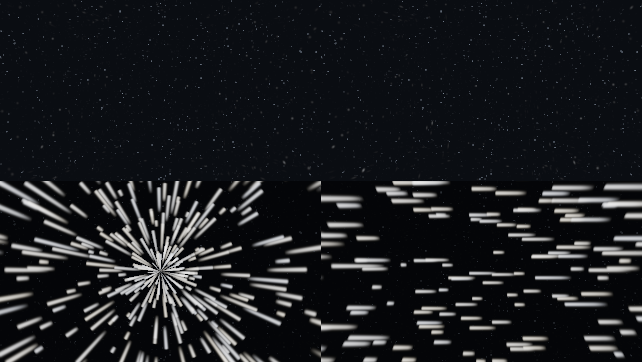

# Flight direction, stars and arrivals

The ship's main engines define its bow. The direction opposite the largest group of engine exhausts is forward; placing a controller on a side wall no longer changes steering. All connected engines count, including switched-off engines. Equal groups use a fixed compass order (north, south, east, west), so toggling machinery cannot flip the controls. Ships without engines fall back to north. Controller Details shows the resulting bow direction. The pilot camera starts behind that same bow.

## What the player sees

- Normal space retains distant stars. Sparse nearby navigation glints have parallax when the ship moves, including during docking approaches. They stay still when the camera and ship are stationary. Ground skies do not gain this nearby layer.
- FTL streaks flow from the forward travel direction toward the rear. Turning the camera sideways shows sideways streaks; they are not attached to the screen. Their brightness ramps over two seconds at departure and arrival.
- Jumping, investigating a signal, resuming and arriving preserve the ship's orientation. Region changes no longer reset the ship to a compass heading.
- Region and dimension transfers fade out over 0.4 seconds before switching, then fade back in after the destination is ready. Physical transfers also wait for the player's terrain section to compile. Door traversal uses a shorter 0.12-second fade. Existing scene readiness and arrival acknowledgements still protect loading.

FTL visuals do not change travel duration, fuel charges or the player's selected destination. Landing remains the explicit **Land** action after reaching the destination region.

## Docking without target power

A captured tunnel remains usable when either vessel loses power. **Undock** needs controls, engine power and fuel on the departing ship; the other ship can remain unpowered throughout departure. Crew and tunnel clearance checks still apply, and doors seal before backing away. A ship without its own propulsion receives an explicit blocker instead of starting departure.

Boarding converts the passenger's look direction from the source ship's orientation into the destination ship's orientation. Walking forward through opposing ports therefore leaves the player looking into the receiving cabin, while preserving deliberate sideways looks and head tilt. The return trip uses the same conversion, and reconnect targets store the corrected angles.

## Validation and updating

Pure tests cover heading selection and fade/FTL timing. Native tests cover every delivery template's bow, orientation on jump, powerless-target undocking and rejecting departure without the departing ship's own power. A real GPU test compares stationary, translated, forward-FTL and side-view renders and checks that FTL animates between frames. Existing graphical journeys exercise investigation, resuming, planet landing and launch.

Top row: stationary and translated views. Bottom row: looking along the FTL axis and looking perpendicular to it. This comparison tone-maps raw GPU radiance captures for inspection; it is not a mockup.

The [verification receipt](flight-motion-verification.json) records the passing full run: 526 unit tests, 177 mod server tests plus one native smoke test, and all 24 graphical entrypoints, in 7 minutes 4.5 seconds. Source and packaged-JAR hashes matched after completion. Disposable test worlds were removed; player worlds were retained.

Restart `dev.ps1`, or restart the multiplayer server and both clients together. The travel packet gained a transition kind. Existing worlds and ships do not need to be reset.
