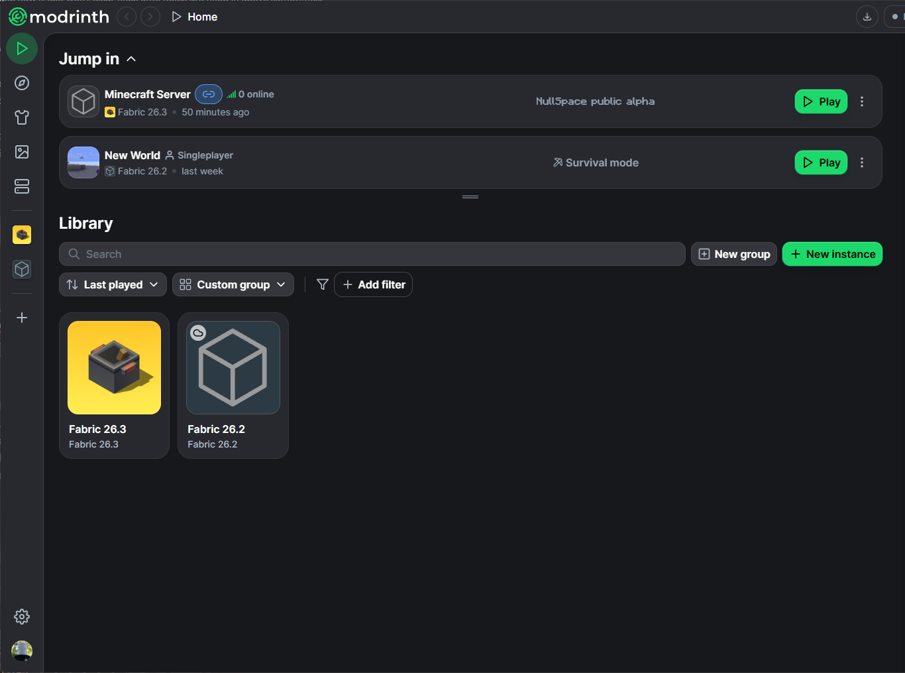
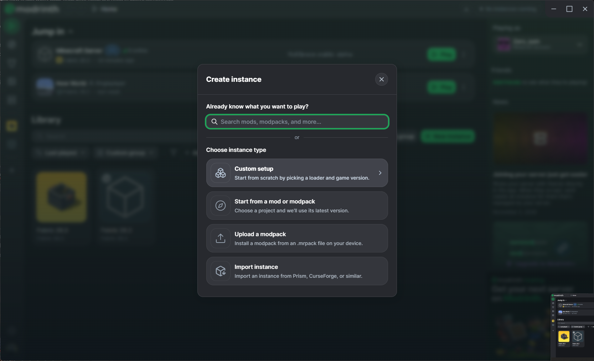
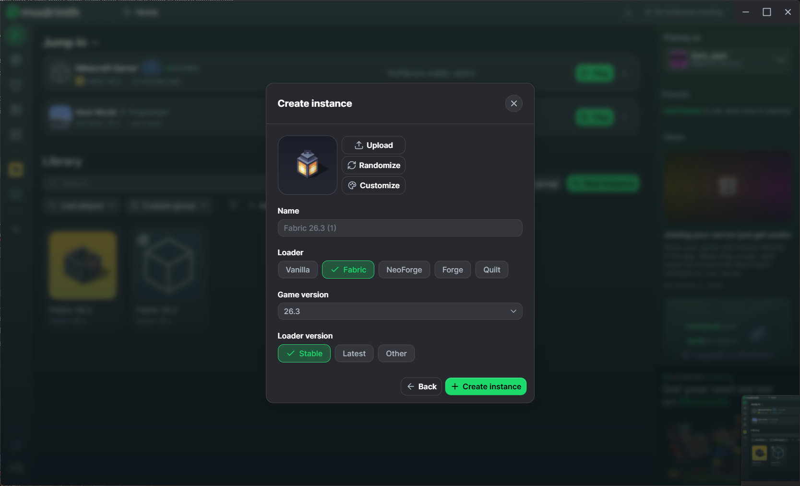
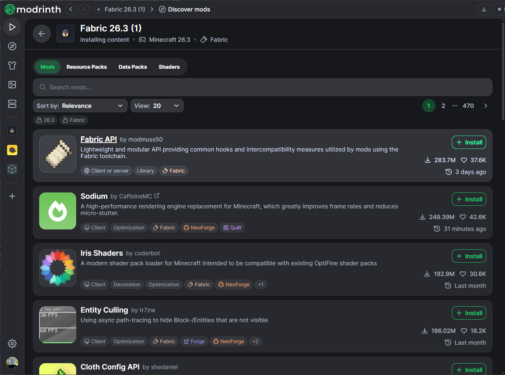
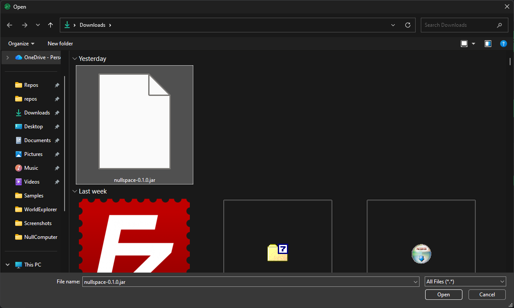

# How to set up NullSpace

This gets you from nothing to playing on the NullSpace server. It takes about ten minutes. You need a Minecraft Java Edition account.

**Latest NullSpace build:** [github.com/NullandKale/NullSpace-Mod/releases/latest](https://github.com/NullandKale/NullSpace-Mod/releases/latest). This link always opens the newest release; download the `nullspace-<version>.jar` file listed under Assets.

## 1. Install the Modrinth App

Download the Modrinth App from [modrinth.com/app](https://modrinth.com/app), install it, and sign in with your Minecraft account. The app downloads the right Java version for you.

## 2. Create a Fabric 26.3 instance

In the Library, click **New instance**.

Choose **Custom setup**.

Set it up exactly like this, then click **Create instance**:

- **Loader:** Fabric
- **Game version:** 26.3
- **Loader version:** Stable

The name can be anything.

## 3. Install Fabric API

Open your new instance and add content. In **Mods**, find **Fabric API** (it is usually the first result) and click **Install**. NullSpace will not start without it.

## 4. Add the NullSpace mod

1. Download the `nullspace-<version>.jar` from the [latest release](https://github.com/NullandKale/NullSpace-Mod/releases/latest).
2. In your instance, choose to add content from a file, then pick the JAR you downloaded.

The mod list should now show both **Fabric API** and **NullSpace**.

## 5. Join the server

1. Click **Play** on your instance.
2. Choose **Multiplayer**, then **Add Server**.
3. Enter the server address the host gave you and join.

## Updating

When a new NullSpace version comes out, download the new JAR, remove the old `nullspace-...jar` from your instance's mods, and add the new one. Your version must match the server's, or the server will turn you away.

## If something goes wrong

- **The game will not start:** check that the instance is Fabric 26.3 and that Fabric API is installed.
- **The server says your mods do not match:** you have an older or newer NullSpace than the server. Install the version from the releases page.
