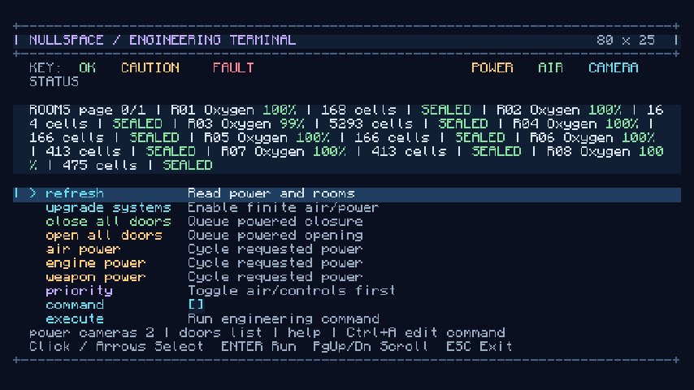

# Extended improvement pass

The user authorized autonomous improvements to tests, performance, features, and design. Existing prepared worlds and player builds must be preserved. This record tracks completed work and evidence; it does not replace the acceptance gates in the ship/space and systems/viewport plans.

## Work queue

- Measure atmosphere rebuilding and ticking before changing them. Reduce allocation and cover difficult room edits, compression, breaches, and gas accounting.
- Audit cache lifetimes, block-change invalidation, and camera snapshot/network work. Verify that stationary feeds reuse work and that edits, lighting, permissions, reconnects, and reloads remain correct.
- Improve ship systems information and safety controls where the current gameplay leaves the player guessing. Keep local equipment panels compact and put detailed information in engineering.
- Expand server, graphical, and local multiplayer coverage for the resulting changes. Add reusable diagnostics or benchmarks where they help reproduce a performance problem.
- Address further plan gaps that can be completed and verified within this pass. Record any behavior changes and remaining limits explicitly.

## Baseline

The starting build has 43 unit cases, 26 server GameTests, six graphical scenarios, nineteen shaped recipes, and an additive recipe-chest gallery. Prior multiplayer and transfer-crash evidence is documented in `local-verification.md`.

The first audit found boxed atmosphere flood fills, repeated neighbor-array allocation, and displacement that only reaches immediately adjacent surviving air cells. Camera sources also rebuild static block/light snapshots every capture interval. These are targets for measurement and regression tests, not claims that an optimization has already succeeded.

## Completed changes

### Atmosphere

The 32-cube flood fill now uses primitive queues, precomputed neighbor masks, and one room lookup. Air sources and occupants are aggregated by room instead of looking up boxed map entries for every cell. Planetary ticking reuses the topology instead of cloning room lists.

Construction now transfers gas through a connected cluster of newly filled air cells. A thick wall no longer silently loses the gas from its middle cells. Old solid bulkheads still block redistribution. **If construction fills every air cell in a compartment and no surviving air volume can receive its gas, that gas is removed and recorded as construction loss.** Reopening the space starts empty. This is an explicit rule added in this pass; there is no gas stored invisibly inside blocks.

Tests cover thick walls, complete compartment removal/reopening, old bulkhead isolation, grid boundaries, fully open/solid volumes, room lookup/leak faces, large rates, invalid rates/times/indices, zero-duration ticks, planetary consumption, and 250 seeded randomized construction edits with gas accounting.

The opt-in `benchmarkSystems` task warms up 40 operations and measures 160 rebuild/tick operations per scenario on Java 25.0.2. Thread allocation comes from the JVM allocation counter. Timing is a local observation, never a build threshold.

| Scenario | Median before → after | p95 before → after | Allocated bytes/op before → after |
| --- | --- | --- | --- |
| Sealed cabin | 1.5966 → 0.6745 ms | 4.8575 → 1.7245 ms | 4,554,881 → 448,473 |
| Multiple decks | 1.3121 → 0.6718 ms | 1.4255 → 0.7969 ms | 4,263,032 → 442,680 |
| Breached cabin | 1.7694 → 0.9061 ms | 2.7421 → 1.0365 ms | 5,894,704 → 448,472 |

These are isolated atmosphere costs, not whole-game frame-time measurements. Raw results are retained in [performance/atmosphere-baseline.json](performance/atmosphere-baseline.json) and [performance/atmosphere-primitive.json](performance/atmosphere-primitive.json). Reproduce with `./scripts/Invoke-Gradle.ps1 benchmarkSystems -PbenchmarkLabel=current`.

### Remote sources and protocol

- Server sources reuse immutable block/light snapshots until a successful block edit, native lighting update, chunk readiness change, or sky-darkness change invalidates them. Light propagation from outside the captured cube is included. No-op block writes do not churn engineering revisions or camera geometry.
- Source caches hold at most 64 entries per level. Idle entries expire after 300 ticks, including their chunk watches/tickets. Cameras use their own nonpersistent, load-only ticket type: they do not simulate source entities or block entities and do not keep an otherwise idle dimension active.
- Block states use a validated palette and packed indices, with a raw fallback when smaller compression is impossible. Lighting uses uniform or packed-nibble encoding. Frames still contain a self-contained geometry payload; this does **not** implement acknowledgement-dependent deltas or eliminate all repeated network bytes.
- All client frame channels share a 64-entry decoded geometry cache. Unchanged revisions reuse the same arrays. Old revisions cannot replace newer cached geometry. Disconnect clears it. Each viewport drops mesh entries for subjects no longer present.
- Added tests for codec boundaries and malformed data, live edits, no-op edits, external lamp addition/removal, no block rescans for light-only changes, array reuse, late revisions, cache bounds, expiry, and load-only ticket flags. Existing native GPU pixel assertions remain in use; graphical coverage also checks real frame-channel reuse and subject-cache bounds.

### Engineering controls and telemetry

Use the systems controller's command entry:

| Command | Result |
| --- | --- |
| `rooms` / `rooms 1` | Eight rooms per page: oxygen percentage, volume, sealed state/leak-face count. Pages start at zero. |
| `room here` | The compartment at your eye position and whether the air there is breathable. |
| `air audit` | Total stored gas, last construction displacement, and cumulative construction loss. |
| `profiles` | Explain the three presets. |
| `profile cruise` | Request controls 1, air 2, doors 1, engines 3, cameras 1, weapons 0. |
| `profile combat` | Request controls 1, air 2, doors 1, engines 1, cameras 1, weapons 2. |
| `profile emergency` | Prioritize controls and doors, request up to six air power, and cut engines/cameras/weapons. |

Presets change requests/priorities, not physical hardware, charge, or individual device switches. Hardware capacity and available power still cap delivery. Manual allocations mark the profile `custom`. Existing ships load without a profile field and display `custom`; no migration overwrites their settings. Room numbers describe the current topology and can change after splits/merges.

Read commands remain available during a control blackout and tolerate a stale editing revision. Writes retain current-revision, power, session, permission, range, and controller checks. Telemetry does not save metadata, change allocations, increment the editing revision, replace the shared operation result, or take ownership of another player's door queue. Each viewer retains an independent live query page through automatic updates; changing back to system status or editing resets that page. A topology edit that removes the watched page produces a page-range message instead of failing the server tick.

Power grants refresh immediately after allocations, switches, and real hardware changes. The preview is side-effect-free: repeated reads do not charge/discharge a battery. Only normal systems ticks change stored energy. Equipment membership checks use a packed-position index; sorted battery membership is cached until topology changes. Recent door results in the summary are bounded to six rather than concatenating the entire batch on every update.

## Verification

The atmosphere/cache stages passed 64 unit cases and all 30 required native server cases (`improvement-native-caches.log`). The first graphical follow-up passed all six scenarios (`improvement-scenes-client2.log`). The final engineering/package run passed **69 unit cases, all 33 required native server cases, and all six graphical scenarios** (`improvement-final.log`). This adds 26 unit cases and seven server cases to the starting baseline.

The new engineering native tests verify passive telemetry against an unchanged metadata snapshot and a durability-write counter, independent viewer pages, blackout reads versus writes, stale read/write authorization, profile grants and hardware caps, switch preservation, repeated grant reads without energy changes, and a second viewer closing their terminal without cancelling the first player's door queue. The supply-destruction regression now checks legitimate charged-battery fallback as well as immediate grant revocation after all supplies are destroyed.

`build/libs/nullspace-0.1.0.jar` is packaged with the new systems/scene code and nineteen recipes. Archive inspection confirms native/graphical test classes are excluded.

The loopback dedicated-server scenario passed with both independent graphical clients exiting cleanly: `improvement-multiplayer.log` and `build/local-multiplayer/20261024-090039-d4300f/passed`. It verifies separate live room/profile pages across automatic updates, shared authoritative allocations, stale-edit rejection, session ownership, late updates, launch/return, offline crew arrival, reconnect tracking, actual distant GPU feeds outside both normal client chunk ranges, and non-ticking TNT/furnaces in camera-only chunks. Both client stderr logs are empty. The seven-stage physical JVM-halt matrix was not repeated for this pass; native round-trip and interrupted-transfer recovery assertions passed in the 33-case server suite. Earlier physical-crash evidence remains documented in `local-verification.md`.

## Remaining limits

This pass does not complete every acceptance gate in the main plans. Camera block/entity rendering still has the limitations listed there. Moving views still transform/upload geometry on the CPU; static GPU geometry is a future optimization. Network frames are compressed full snapshots, not source deltas. Arbitrary populated-world frame-time percentiles, broad multiplayer load, and GPU-memory profiling remain unmeasured. Full orbital/navigation simulation, reactor fuel/heat, computer operating systems, docking, and combat crash durability remain separate work. The existing development saves and player builds are preserved; verification uses disposable worlds.
