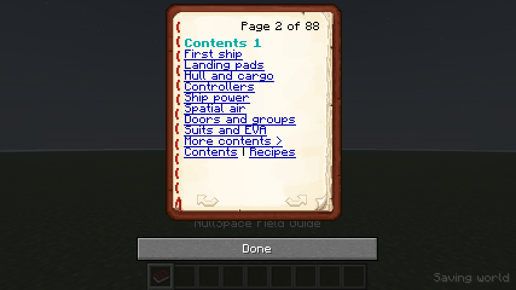

# In-game field guide

The **NullSpace Field Guide** is a written book using Minecraft's normal reader. It has clickable chapter and recipe indexes, return links on every page, 22 feature chapters and all 23 shaped recipes. Recipe pages show a real 3 x 3 grid of Minecraft item icons, an output slot and batch quantities. Hover for item names; click a crafted ingredient to open its recipe. Tag ingredients cycle through every alternative accepted by the server. It currently contains 88 pages.

Get one with **`/nullspace guide`**, available to ordinary players without operator permission. Repeating the command keeps an existing inventory copy. If the inventory is full, the guide drops at the player's feet. Right-click the book to read it.

In Survival, put a **normal book above a copper ingot** in a crafting grid:

```text
Book
Copper
```

The recipe unlocks when obtaining a book. The guide can be placed on a vanilla lectern or stored in a chiseled bookshelf. Its item ID is `nullspace:field_guide`.

The manual covers the first ship, pads/previews, hull and cargo restrictions, controllers, shared power, spatial air, doors/groups, suits/EVA, launch/landing, piloting, free ship beacons/the preset shipyard, planets, scanners, cameras/monitors, NullOS, shell/scripts, native automation, weapons/damage, graphics, troubleshooting and crafting. Planned stations, docking, encounters and the rendering workshop are explicitly identified as future work.

Prepared development worlds and lab visits supply a copy if the player does not carry one. Newly created gallery supply barrels and the recipe annex also include the guide. Existing galleries retain their saved layout and edits; use the command or recipe to obtain the book there.

Chapter text lives in `src/main/resources/data/nullspace/guide/chapters.json`. The default book derives recipe pages and a persistent `nullspace:guide_recipes` item component from bundled recipe JSON. The client uses Minecraft's item renderer, including resource-pack models, on both held books and lecterns. Each book access keeps its own recipe data; ordinary books are unaffected. On crafting/opening a held guide, recipe patterns, all accepted ingredient alternatives, output item IDs and counts refresh from the server's loaded shaped recipes. A missing or non-shaped recipe is labeled unavailable. After updating the mod, open a held guide once to refresh it. Take older lectern copies into your hand, open them, then replace them. A guide already resting on a lectern is a snapshot; take it into your hand and open it to refresh recipes after a data-pack change.

All book links navigate between pages. The guide does not execute commands or scripts through links. Native tests verify recipe agreement, page targets, item packet round-trip, obtaining a copy and lectern placement. A graphical test opens the actual book, checks every page against the native 114 x 128 text area, and captures contents and a recipe page.




The [cover](images/field-guide-cover.png) and [recipe page](images/field-guide-recipe.png) show the native book UI. Exact validation and artifact details are in the [verification manifest](field-guide-verification.json).
