# Local verification

Note (November 7): many of the older `docs/*-verification.json` receipts below cite logs and screenshots under `build/` that were deleted to free disk space. The JSON files remain as the record of what passed; the cited `build/` paths no longer exist.

The [World 5 story review](world5-story-verification.json) passed 522 unit tests with zero skips, 176 mod server tests, the Minecraft smoke test and all 24 graphical cases on one build. It also created/reopened a native Horizon space start and reopened it through ordinary quick-play without the test mod before installing it. Reset path/lock checks and backup hashes are recorded alongside the test receipts.

The [FTL journey pass](ftl-journeys-verification.json) passed 522 unit tests with zero skips, 173 mod server tests and the Minecraft smoke test. All 24 graphical entrypoints passed against the identical production JAR. Its native fixtures now restore temporary simulation poses and remove both hull blocks and metadata. The final server run reclaimed 616 MiB of disposable world data; logs and screenshots were retained.

The [independent-ship-actions pass](independent-ship-actions-verification.json) passed 517 unit tests with zero skips, 170 mod server tests and all 24 graphical entrypoints. It adds five concurrency/recovery cases and real `SOURCE_CLEARED` process-crash checks for launch and landing. Ship controls now reserve their own vessel and destination instead of waiting on unrelated server activity.

The [November 3 overnight report](overnight-testing-2026-11-03.md) records the test infrastructure and its earlier verification evidence. The [space-start pass](space-start-verification.json) passed 517 unit tests with zero skips, 165 mod server tests and all 24 graphical entrypoints. It adds coverage for world creation, saved-world reload, new-player provisioning and interrupted construction. Native smoke fixtures are counted separately, once per server worker.

The historical [October 26 pad/sky follow-up](pad-and-sky-fixes-2026-10-26.md) records 306 unit cases, 95 mod GameTests plus the vanilla smoke fixture, 14 graphical entrypoints, local multiplayer, and 14 launch/landing crash cases. [Its receipt](pad-sky-verification.json) includes the JAR hash, retained evidence, disk-full retry, and generated-world retention checks. Current cleanup rules are described below.

All harnesses use development/test dependencies. None opens `run/saves/NullSpace-Dev` or `run-lab/saves/NullSpace-Lab`. The multiplayer and physical-crash scripts are opt-in and are not dependencies of build/check or CI.

The combined runner `.\verify.ps1 -Graphics -Multiplayer -Crash` runs the complete matrix sequentially and preserves receipts, reports, logs, screenshots and the built JAR digest under `build/verification/<run>/`. Omit optional switches to run only the ordinary unit/native/assets/build suites; omitted suites are explicitly marked not-selected.

For the ordinary unit/server/assets suites and graphical coverage, run `.\parallel-test.ps1 -Graphics`. It compiles and packages once, then launches the server tests alongside six graphical workers by default. Set `-GraphicsWorkers 8` for eight, or choose any count from one to eight. `-ServerWorkers 2` splits native tests across two JVMs; the default is one and the supported range is also one through eight. Each worker has its own world root, working directory, resource manifest and logs under `build/parallel-verification/<run>/`.

The scheduler assigns the longest graphical cases first using timings from recent passing runs, falling back to even class counts without history. Counts can be uneven because individual tests take different amounts of time. Native shards use declared case counts. No empty workers are started when the inventory is smaller than the requested worker count. Success requires every declared class exactly once and every native test ID exactly once, checked against Fabric's XML report. Unit skips remain explicit in the result; the current suite needs none.

On Windows, graphical worker windows automatically tile into a grid on the monitor active when the command starts, using its working area so the taskbar stays clear. Six workers normally use 3 columns and 2 rows; eight use a layout chosen for the monitor's aspect ratio. Each window is labeled `NullSpace tests | graphics-N` and placed as soon as SDL creates it. Only that invocation's graphical worker PIDs are moved, without taking focus. Slots stay fixed when workers finish, and you can reposition a window manually afterward. Grid bounds and arrangement state are recorded in the run receipt.

Server workers are additional: the defaults mean seven game JVMs, and eight graphical workers plus two server workers mean ten. Each JVM has a 2 GiB maximum Java heap and graphical workers share the GPU. Six graphical workers were faster than eight in the comparable November 3 runs; more concurrency is not automatically faster. Use `-GraphicsWorkers 2` for lower resource contention while playing, or `.\parallel-test.ps1 -Graphics -GraphicsWorkers 4 -ServerWorkers 2` to try splitting native work without increasing the total beyond six JVMs.

Test worlds are disposable by default. The parallel runner removes closed `world`/`saves` directories at startup and again after all owned workers exit, including failures and timeouts. Older failed runs are cleaned too. Logs, receipts, XML reports, screenshots, private resources and JAR snapshots remain. Cleanup records paths, byte counts and skipped active worlds in `result.json` and `world-cleanup.json`. `-MinimumFreeGiB 4` remains the default disk-space threshold after startup cleanup.

Use `-KeepWorlds` to preserve this parallel run for debugging; its receipt also excludes it from later automatic pruning. Alternatively, `-KeepSuccessfulWorldRuns 2 -KeepFailedWorldRuns 1` retains that many recent worlds of each outcome. Running receipts, live worker PIDs and locked sessions are skipped. Redirected paths are rejected. To clean ordinary completed parallel runs without launching tests, run `.\scripts\Remove-OldParallelWorlds.ps1`. Startup also runs `.\scripts\Remove-OldLocalTestWorlds.ps1` for completed crash, multiplayer and focused graphical runs; this script requires a final receipt and checks Java argument-file paths before removing their worlds. Unidentified or unfinished historical runs are left alone.

On Windows, Gradle's `runGameTest` and `runClientGameTest` tasks have cleanup finalizers, including when the JVM fails. Native startup also prunes abandoned closed UUID sessions. Multiplayer and both physical crash runners clean worlds in `finally` after their processes exit; crash worlds remain intact between the prepare and recovery JVMs. Those runners accept `-KeepWorlds` for debugging. Their cleanup uses the shared [world cleanup helper](../scripts/TestWorldCleanup.psm1), which only accepts `world` and `saves` inside this workspace's `build` directory. Custom artifact locations outside `build` retain their worlds and print a warning. Player saves, backups and recovery files outside disposable test worlds are never cleanup targets. Non-Windows Gradle launches currently retain worlds.

The parallel runner records live case progress, per-case graphical timings, worker elapsed times and exit codes, unit XML, native XML, source fingerprints and a snapshot of the built JAR with its SHA-256. Graphical evidence is written atomically; readers allow atomic replacement while a worker runs. On Windows, a temporary access-denied rename retries for at most two seconds; persistent locks and other I/O errors still fail. The final receipt clears live progress fields after checking completion. Source/build inputs must remain unchanged. If a worker fails, only sibling test processes started by that invocation are stopped. Multiplayer and physical-crash coverage still use their dedicated runners.

`.\scripts\Test-LocalVerification.ps1` checks scheduling, inventory, fingerprint, disk and retention rules with disposable fixtures. `.\scripts\Test-ClientEvidence.ps1` compiles the actual Java evidence writer and tests unlocked, temporarily locked and persistently locked publication. Prepare `build/local-server-launch.json` through a normal local runner first; the evidence checks use its existing compile classpath and the project JDK.

Run independent Gradle-based commands sequentially because Loom tasks share generated launch files. The parallel runner avoids that conflict by preparing launches first and giving each JVM a private launch configuration. Scripts prefer the project JDK 25 and Gradle cache. The graphical tests need a working desktop/GPU.

```powershell
.\build.ps1 --no-daemon --console=plain
.\scripts\Invoke-Gradle.ps1 runClientGameTest --no-daemon --console=plain
.\multiplayer-test.ps1
.\crash-test.ps1
.\shipyard-crash-test.ps1
# Optional single crash point:
.\crash-test.ps1 -Stages PREPARED
```

## Unit and server tests

JUnit covers pad geometry and bounded discovery, grass/dirt mixtures, terminal cells/ANSI/scrollback, controller editing/actions, and generic stream input. Additional pure tests cover randomized energy conservation/brownouts, finite-air conservation through bulkheads and breaches (including compression above nominal pressure), and large-coordinate quaternion/ray transforms. Server GameTests cover hull geometry, framed doors, airlocks, breaches, suits/vacuum/tethers, generated-lab preservation, pad registration, transfer/edit/cargo/entity state, interrupted journals, and maximum ship dimensions.

The review adds stair elevation and headroom, shared sensor/cargo validation and leak tracing, all four pad states, no remote generation during listing, session ownership/range/replacement/dimension rejection, stable selection through rename and a home pad retained beyond the 128-entry catalog limit, preparation/arrival acknowledgment timeouts, and native underwater air loss carried into vacuum without a stale reserve refill. An opt-in crash test method immediately succeeds during ordinary server tests; physical-crash coverage requires the separate script below.

## Two-client multiplayer

`multiplayer-test.ps1` exports Loom's client launch specification, then starts two independent graphical JVMs with separate game directories, identities, logs, and a fresh world under `build/local-multiplayer/<run>/`. It allocates a loopback port, sets offline authentication only on that loopback-only server, and disables query/RCON. Nothing listens on an external interface.

The pilot process hosts a real `DedicatedServer` through Fabric's test harness. The server runs on its own thread inside that JVM; this is two client processes, not three standalone processes. Both clients communicate through actual TCP networking, not integrated-server shortcuts or embedded mock connections.

The scenario checks:

- Both clients join and open independent authenticated ship terminals.
- A forged controller session is rejected; each client can inspect through the actual controller screen successfully.
- Both passengers launch and acknowledge destination readiness.
- A creeper retains its identity and health, and chest/dropped cargo travels.
- One client disconnects in space; the pilot lands while that passenger is offline.
- The second client reconnects aboard the returned ship with its own inventory.
- Both player inventories, chest cargo, dropped-item accounting, and authoritative mob identity survive.
- After reconnecting, both clients move to the powered sphere and open independent engineering sessions.
- One allocation edit succeeds; the other client's stale revision is rejected without changing the shared bus.
- A deliberately late engineering reading cannot replace the camera screen or reopen its closed terminal.
- Both clients view powered camera feeds, then an operator source 4,096 blocks away. Captured GPU pixels must contain source geometry, while the source stays outside the normal native client chunk cache. A primed TNT fuse and furnace inventory must remain frozen in those camera-only chunks. Scene tickets load FULL chunks without enabling block/entity ticking.
- Native player registration/tracking remains consistent after deferred arrival correction, movement, and disconnect. Both clients disconnect cleanly and finish their assertions.
- Both clients race delivery through the actual shipyard screen; exactly one wins. The pilot remains connected for 40 ticks after completion so the peer's disconnect also exercises live terminal refresh and cleanup.

The script has a six-minute default deadline and terminates only the child processes it created. Run directories, screenshots, and logs remain available. It requires both client exit codes to be zero and a completed scenario marker. It is never invoked by the GitHub Actions workflow.

## Real crash/restart

`crash-test.ps1` creates a new save for each launch/landing stage under `build/local-crash/<run>/<direction>/<stage>/`. A preparation JVM builds a ship, player inventory, chest cargo, creeper, and dropped item. It saves baseline state, starts a transfer, and terminates with `Runtime.halt(86)` at the selected point. No shutdown hook or graceful server save follows the halt.

A second JVM opens that same save, runs automatic recovery, invokes recovery twice more, and checks exactly one authoritative ship, one copy of each cargo entity UUID, chest contents, battery energy, allocations, device IDs, finite room air, a large Unicode computer disk, a sleeping detached program counter, and the player's inventory/dimension/facing after loading native player data and resolving pending arrival.

Default crash points:

| Point | Expected recovery |
| --- | --- |
| PREPARED | Original ship on planet |
| DESTINATION_STAGED | Original ship restored; staged copy removed |
| SOURCE_CLEARED | Original ship restored; staged copy removed |
| PASSENGERS_MOVED | Original ship/passenger arrival restored |
| COMMITTED | Destination in space remains authoritative |
| TEMP_PREPARED | Baseline survives interrupted initial temporary-file write |
| TEMP_SOURCE_CLEARED | Last durable journal stage recovers an interrupted replacement write |

Temporary-file cases halt after bytes are actually written to the compressed temporary journal, before validation, force, and atomic promotion. Durable-stage cases explicitly flush the world before halting to exercise recovery of persisted world changes. Exit 86 proves the hook was reached; verify must exit zero and write its success marker. Each subprocess has a three-minute deadline.

This covers abrupt process death and torn/unpromoted temporary files. It does not emulate every storage-controller cache failure, power loss, filesystem corruption, or arbitrary instruction-level crash timing.

### Ship delivery crash/restart

`shipyard-crash-test.ps1` uses its own disposable saves under `build/shipyard-crash/`, with the same prepare-exit-86 / verify-exit-0 contract. `-Stages WORLD_SAVED` selects one checkpoint. The full default matrix is:

| Checkpoint | State at termination |
| --- | --- |
| INTENT_SAVED | Durable order; construction has not started |
| PARTIAL_UNSAVED | Seven hull blocks placed without an explicit chunk save |
| PARTIAL_SAVED | Seven hull blocks explicitly saved |
| HULL_PLACED | Entire hull and test cargo saved before registering ship identity |
| SHIP_SAVED | Ship identity and systems saved; world flush still pending |
| WORLD_SAVED | Hull and metadata flushed; order still pending |
| ORDER_CLEARED | Final order removal saved |

Startup must finish any pending order automatically. The second process checks exactly one ship, the complete planned hull, preserved committed ship/device identities, saved barrel contents where a flush occurred, outside-block preservation, a successful launch preflight and repeated-recovery idempotence. A frozen-source fingerprint and per-case success markers prevent stale or mixed-build results from being accepted. Normal `runGameTest` registers this entrypoint but does not halt its JVM; the physical matrix is always opt-in.

The two-client script also requires `shipyard-race-passed`: each actual client buys from its own shipyard screen on the same pad. Exactly one wins; both retain their currency items. That case runs after the existing travel, engineering and remote-camera scenarios. Both crash runners check a frozen input fingerprint and retain per-case logs and success markers.

## Recorded results - 2026-10-23

- Real crash/restart: all seven default points passed. Evidence: `build/local-crash/20261023-101024-be2307/`.
- Build: 27 JUnit tests and all 17 server GameTests passed (`review-build.log`). The server count includes the opt-in crash method that skips physical termination during a normal build.
- Graphical terminal/registration/launch/landing scenario passed (`review-client-final.log`). This includes native SDL text-input lifecycle and actual Minecraft keyboard routing.
- Two independent graphical clients passed the dedicated loopback travel/offline-return/reconnect scenario, both with exit code zero. Evidence: `build/local-multiplayer/20261023-102530-47007c/` and `review-multiplayer.log`.
- Gallery extension: 27 JUnit tests and all 18 server GameTests passed (`gallery-build.log`), including all 20 plots, successful repairs, iron-door buttons, airlock isolation, blank-pad states, and preservation of edits/supplies. The existing water regression now uses an isolated location, clears flowed water, and samples beyond the within-tick native air-recovery transient.
- Both graphical scenarios passed (`gallery-client.log`). The gallery scenario walks onto the scout floor, right-clicks its controller, launches, lands on registered blank pad 13, and verifies revisiting does not respawn the source. Screenshots are under `build/run/clientGameTest/screenshots/`; a complete overview is retained in `docs/images/test-gallery.png`. Native terminal mouse input now uses Minecraft's SDL button constants instead of the previous zero-based value.
- Sphere extension: all 27 JUnit tests and 19 server GameTests passed (`sphere-build.log`). The new scenario checks the exact 32 x 32 x 32 ship, four engines, walking routes from the entry to five decks and ten rooms, airlock isolation, a breached stair hall, room-door venting, and a maximum-size space/ground round trip preserving ten cargo barrels and crew inventory.
- All three graphical scenarios passed (`sphere-client.log`). The sphere case generates the annex beside the gallery, uses the visit command, walks through the airlock and two stair flights in survival without flight, opens the real bridge terminal, and gets a successful inspection. Repeat visits preserve a removed controller and emptied cargo. Exterior and bridge images are retained in `docs/images/meridian-sphere.png` and `docs/images/meridian-bridge.png`.
- The final bounded maximum-size scan measured 82 ms for 5,644 hull blocks on this machine; this is evidence of the accepted synchronous tick cost, not a performance guarantee.

Accepted synchronous tick pauses (D01), readiness approximation (D11), rare first-launch passenger logout facing loss (B01), and disconnected space debris (B02) remain documented limitations. Extensive large-server profiling, every door arrangement, and exhaustive water/network timing combinations are not claimed by this matrix. FTL-style finite oxygen management remains future gameplay.


## Systems and scene checks

`ShipSystemsGameTest` uses separate real ship controller/engineering blocks and the full Meridian hull. It opens and closes all twelve doors, checks a stable-ID group containing one door, rejects a stale revision, cancels queued work on terminal close, recovers controls after deliberate zero allocation and a disabled local generator, verifies unequal battery banks respect individual charge/discharge limits, and preserves the full systems NBT through launch and landing. Committing travel on another ship clears stale crew membership in the former ship. Destroying the ship controller leaves connected supply and life support working. Destroyed supply invalidates cached grants immediately; internal journal placement preserves the frozen transfer allocation. The additive powered lab is inspected and revisited after an edit to verify it does not regenerate player changes.

Equipment-panel coverage checks passive inspection without a supply reset, an explicit manual restart, disabled/disconnected/legacy/unregistered diagnostics, hardware-specific action authorization, player-bound sessions, stale revisions, and replacement invalidation. Pure terminal tests exercise every equipment menu through keyboard actions, multiline readings/scrolling, pointer selection, and the absence of an editable revision field.

`CombatGameTest` tests an actual ticking TNT entity and a powered cannon. Its ships are 8,192 blocks apart physically; one target is rotated 90 degrees in simulated space. Damage must remove the intended real hull, respect cooldown, and leave blocks outside that target's ownership alone. The operator pose command must change simulated orientation while leaving physical storage and player positions unchanged. The scenarios use separate simulated regions, including across repeated world runs, so their contacts cannot interfere. An additional 130 off-ray ship records must not exhaust the shot budget or cause terrain loads. These checks do not claim crash-atomic combat receipts or a complete projectile system.

`SystemsClientGameTest` opens engineering, sees a blackout and supply recovery through automatic live readings, verifies a placed monitor has a funded source, captures real interior camera pixels, launches through the real ship controller UI, and asserts that an EVA viewport contains remote geometry/celestial content. It right-clicks all eight equipment types, toggles the battery through real typed packets, cycles the placed monitor channel, opens View feed, and verifies that repeated keepalives preserve camera 2. It also captures the placed display during actual walking with native view bobbing enabled. Each viewport owns color/depth targets. The test invokes F2 and checks that a new viewport PNG is actually exported. Screenshots are captured from the running game, not generated artwork:

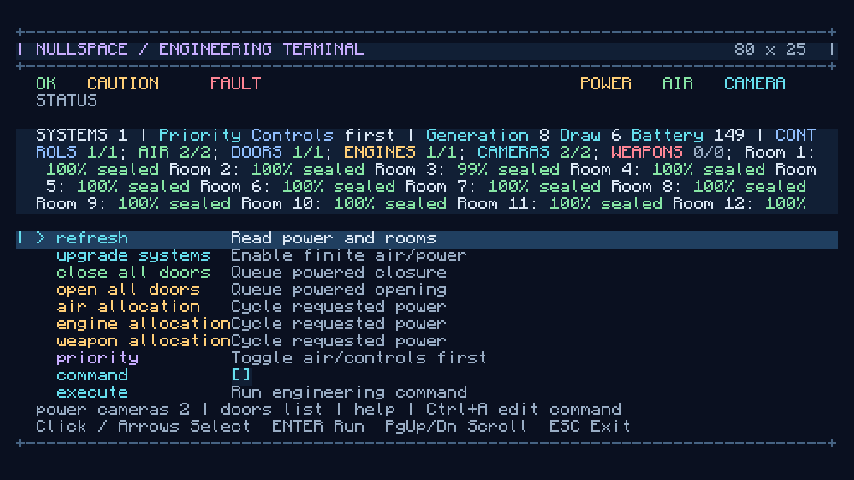

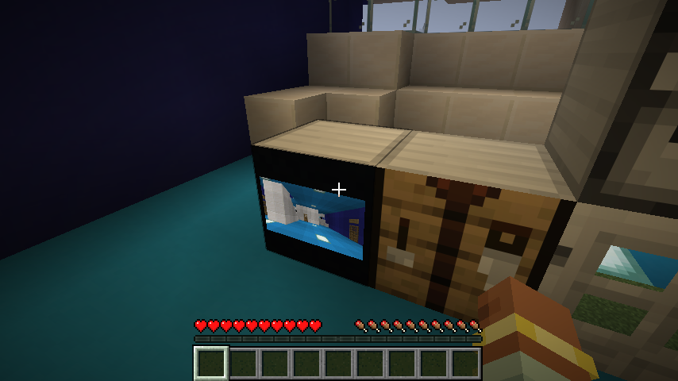

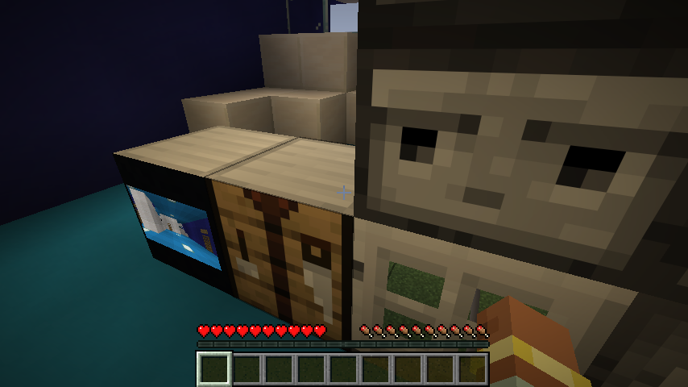

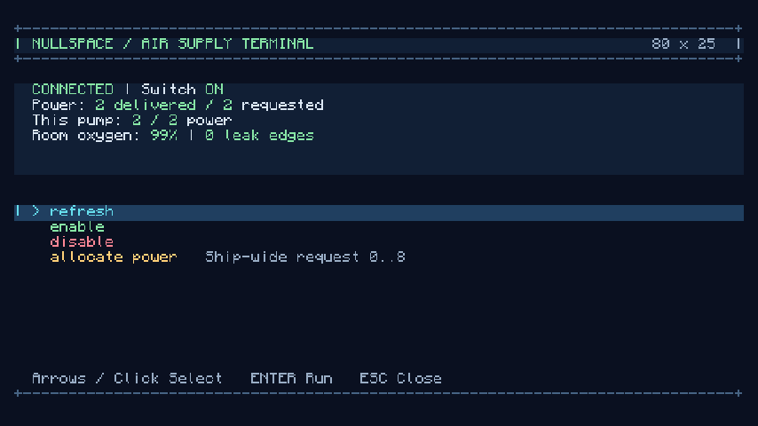

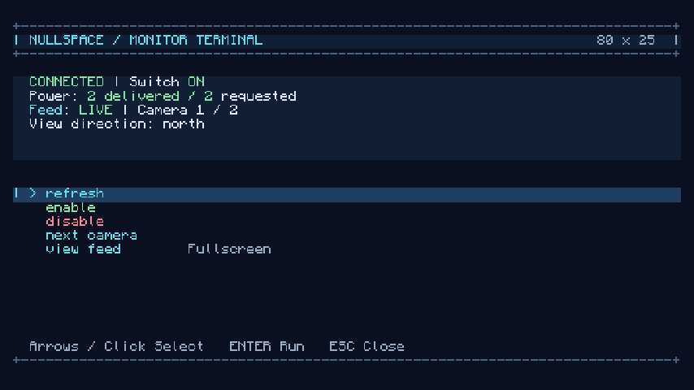

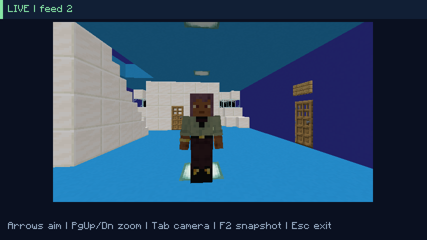

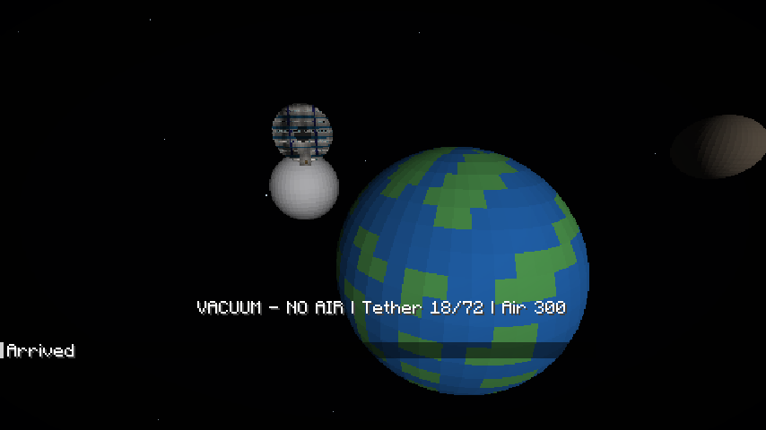

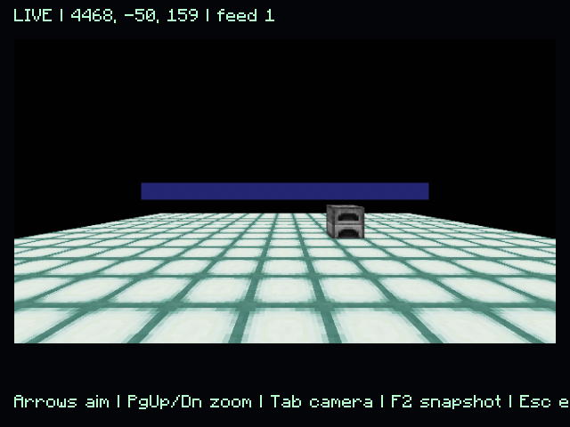

The implementation limits and remaining acceptance cases are listed in [the systems/viewport implementation record](ship-systems-and-viewports.md#implementation-record).

The expanded loopback scenario exposed a reconnect-registration bug: applying a cross-dimension arrival inside Fabric JOIN could precede native player registration in the captured login level. Arrival correction now runs at the end of the server tick. The test reconnects, moves to another chunk region, views a remote source, and disconnects cleanly; it also checks native player tracking while connected. The seven physical transfer-crash stages passed with systems state included on 2026-10-23. Combat damage receipts remain outside that crash guarantee.

Initial systems/scene verification passed 40 JUnit cases, 23 required server GameTests, four graphical scenarios, the two-client loopback scenario, and all seven process-halt/restart stages. The updated deferred-arrival assertion was additionally exercised for PREPARED and SOURCE_CLEARED rollback plus COMMITTED recovery after the journal safeguards. These are transfer/resource checks, not a crash guarantee for combat impacts. The two-client run also injects a late reading after switching away from engineering and verifies that it does not reopen the old terminal.

The equipment/monitor follow-up on 2026-10-23 passed **43 JUnit cases, all 24 required server GameTests, all four graphical scenarios, and both graphical clients in the loopback multiplayer scenario**. Evidence: `equipment-build.log`, `equipment-client.log`, and `build/local-multiplayer/20261023-205426-99403c/` (including its `passed` marker and clean client exits). The packaged artifact is `build/libs/nullspace-0.1.0.jar`. The seven process-halt stages above were not repeated for this UI/rendering follow-up.

The interface color pass passed all 43 existing JUnit cases and four graphical scenarios (`terminal-color-check.log`). The rendered pad, engineering, equipment, camera, and transit screens use the shared semantic palette documented in [terminal.md](terminal.md); updated screenshots above show the palette. Final legend/menu-label polish was followed by another successful JUnit/package run (`terminal-color-package.log`).

The compact-panel and vacuum-motion follow-up adds a server assertion that equipment readings omit repeated names, coordinates and UUIDs. Graphical coverage stands on a vacuum roof for 40 ticks with no flight/height oscillation, then jumps and verifies automatic flight. It verifies identical camera draws reuse their target, player animation is bounded to tick rate, and aiming invalidates the image. Player-camera coverage compares actual GPU pixels with the full-body player visible and hidden (at least 100 changed pixels), rather than checking a submit counter alone. `players-client.log` records all four graphical scenarios and 43 unit cases passing; `players-build.log` records all 24 server cases passing. The multiplayer source assertion uses internal source-position metadata instead of parsing coordinates from the visible status line.

Both independent graphical clients passed the revised loopback scenario, including source tracking, reconnect, shared-system revisions and non-ticking distant camera chunks. Evidence: `build/local-multiplayer/20261023-221440-5376a4/passed` and `players-multiplayer.log`. This verification establishes the removed repeated work and the movement/camera regressions; frame-time percentiles on arbitrary existing player worlds have not been measured.

Final verification and packaging passed again in `players-final.log`: 43 JUnit cases, four graphical scenarios, and assembly of `build/libs/nullspace-0.1.0.jar`. The current camera screenshot above shows the native full-body player and the compact feed-only header; equipment screenshots show the reduced readings without coordinates or repeated names.

The lab-login regression is covered by `LabArrivalClientGameTest`. It creates a disposable `NullSpace-Lab` inside the graphical harness, launches a gallery ship, saves the player in space, and removes only that test save's introduction marker. On reopening, it asserts that Fabric JOIN begins in space before the deferred lab introduction returns the player to the Overworld. It checks that exactly one native world owns the player, the distance manager contains the player, and the passenger scan finds them in their actual world. Inspecting and launching a second gallery ship then succeeds, followed by a clean disconnect. All five graphical scenarios passed in `lab-arrival-client-final.log`. The production fix queues lab setup by UUID until the end of the server tick, after native registration and travel-arrival correction. Existing fixture markers, ship data, and player builds are preserved. This covers the reported repeated passenger-list rejection and shutdown `DistanceManager.removePlayer` exception without weakening passenger validation.

The final build passed all 43 unit cases and all 24 required server GameTests, and packaged `build/libs/nullspace-0.1.0.jar` (`lab-arrival-build.log`). The loopback multiplayer and physical-crash suites were not repeated for this development-world login fix.

## Crafting and recipe chests

`RecipeGameTest` checks all nineteen loaded shaped recipes against their specified patterns, horizontal mirrors, mixed wood/rough-stone tags, exact outputs, required empty cells, wrong ingredients, native-recipe collisions, recipe-book unlock triggers, and equipment self-drops. Its finite-inventory helper crafts through real native crafting menus, consumes each input once, and checks the complete starter budget including vanilla subrecipes. The starter leaves one circuit board and two sticks; the suit uses that spare board. A computer base attached to an otherwise valid ship must not count as a second ship controller.

The gallery test checks all nineteen actual chest grids against the loaded recipes, including the four-board output, custom chest titles, openable lids, adjacent crafting tables, and preservation of removed samples and edited fixture blocks on a repeat visit.

`RecipeClientGameTest` opens a real chest screen in survival and checks the visible board pattern and output. It then fills an actual crafting screen using client inventory packets, takes the result, and verifies exactly four boards. It crafts the starter equipment and suit from the documented finite materials, installs the paid equipment into the reference hull, upgrades its systems, charges the initially empty battery, and launches and lands through the normal terminal packets. The hull, pad, door, and cargo are test fixtures; the equipment and suit are crafted from their full material budget. No creative inventory or give commands supply those crafted outputs.

The recipe pass passed 43 unit cases and all 26 required server GameTests (`recipes-server.log`), followed by all six graphical scenarios (`recipes-client.log`). The loopback multiplayer and physical-crash suites were not repeated for crafting/gallery work. Prepared player saves are not opened by these harnesses.

Final packaging passed again in `recipes-final.log`, including all 26 server cases and the preserved-edits check. `build/libs/nullspace-0.1.0.jar` contains all nineteen recipes and their unlocks; graphical/server test classes are excluded. The screenshot below is retained from the actual graphical test run.

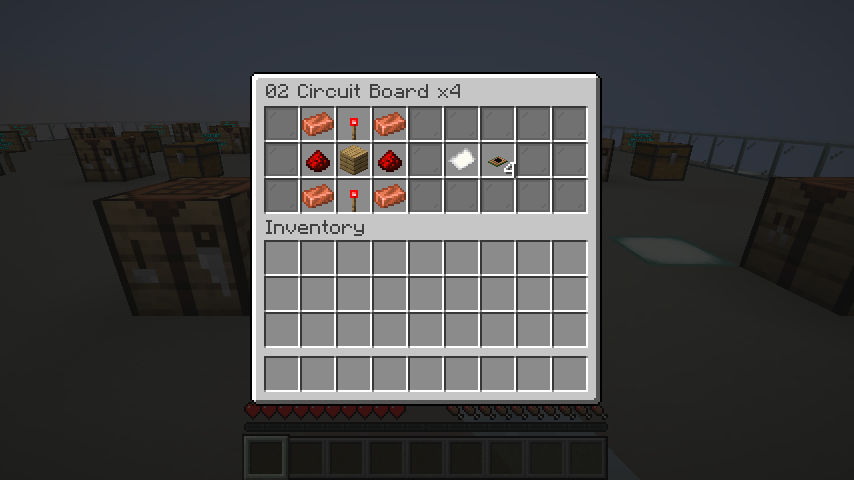

## Atmosphere, source-cache, and engineering improvement pass

The 2026-10-23/24 pass adds measured primitive atmosphere traversal, gas-displacement accounting, invalidation-driven source snapshots, compressed self-contained geometry, bounded client/server caches, indexed equipment lookups, immediate side-effect-free power previews, power presets, and independent live engineering pages. [The implementation record](improvement-pass-2026-10-23.md) contains the measurements, command reference, behavior changes, and remaining limits.

Final unit/server/graphical/package verification passed **69 unit cases, all 33 required server GameTests, and all six graphical scenarios** in `improvement-final.log`. New coverage includes randomized gas conservation, complete-volume removal, codec validation, external lighting propagation, cache lifetime, physical equipment grants, passive telemetry/durability, and concurrent viewers. The native graphical test retains a room page across automatic refreshes and checks real camera-channel cache reuse/bounds. It retains the existing actual GPU-pixel, monitor, player, crafting, travel, and vacuum-motion assertions. The built JAR excludes test classes.

The local `benchmarkSystems` task is opt-in and has no timing threshold. It reports median/p95 and current-thread allocation; it does not measure overall FPS. Raw before/after JSON is retained under `docs/performance/`. All verification worlds remain disposable and separate from prepared player saves.

The final two-client loopback run passed in `improvement-multiplayer.log`, with a success marker at `build/local-multiplayer/20261024-090039-d4300f/passed`. Both graphical clients exit zero with empty stderr logs. The added assertions retain a live room page for the pilot and a separate profile page for the crew through automatic updates. Shared power revisions, stale-write rejection, independent sessions, launch/offline return/reconnect tracking, distant actual GPU content, and non-ticking camera-only TNT/furnaces also pass. The physical seven-stage JVM-halt matrix was not repeated in this pass; the server suite's round-trip and interrupted-transfer recovery tests passed.

## Space compute renderer

The [renderer record](space-compute-renderer-plan.md) describes the OpenGL 4.3 startup hook, metadata protocol, compute passes, quality properties, GPU helper, and remaining native HDR limitations. `ComputeClientGameTest` and `ComputeSceneClientGameTest` are test-only entrypoints. The full graphical suite has eight scenarios; the existing six gameplay/UI scenarios remain enabled.

Reproduce the integration suite with:

```powershell
.\scripts\Invoke-Gradle.ps1 check runClientGameTest assemble --no-daemon --console=plain
.\multiplayer-test.ps1
```

The graphical process requires OpenGL 4.3 and creates disposable worlds. The NVIDIA preference helper changes only the current repo JDK's Windows per-user preferences and can restore the saved previous values. It does not launch or modify prepared player worlds.

Numerical GPU tests read back hit/optical images explicitly, with pixel-pack state isolated from Minecraft's screenshot buffers. Live frames use no synchronous texture readback. Shader failure tests intentionally log one compilation error and require the previous shader set to remain usable. Native glass coverage checks real use of the optical shader in both classic transparency and improved OIT, with no GL errors; screenshots are retained for appearance review.

Performance JSON records warm moving-camera samples for a sun, planet/atmosphere, moon, rough rock, nebula, two 32-cube four-deck hulls, and two independent monitor captures. Timings cover celestial tracing, surface reconstruction, and volume integration/reconstruction. They exclude native ship rasterization, final composition/copies, GUI, and full Minecraft frame time. The CPU field covers `SpaceComputeRenderer.surfaces` preparation/submission, not all viewport/world rendering. Reported bytes conservatively estimate owned targets/buffer capacity/staging, excluding driver caches. The original performance goals must be assessed against this scope rather than presented as overall FPS.

The pre-cleanup graphical/package run passed in `compute-final-graphics.log`: **88 JUnit cases and all eight graphical scenarios**. The server run in `compute-release-validation.log` passed **all 36 required GameTests**. That combined run initially failed its graphical gas-order fixture because compilation could advance its animation clock; the fixed-clock reference and separate moving-comet comparison passed in `compute-fixed-clock.log` and the final run. The final graphical test additionally resizes the actual native window twice, exercises both transparency modes, verifies both staggered monitor images advance with at most one steady capture per frame, opens a powered camera in space through the real protocol, and exports its compute view with F2.

The release JAR is `build/libs/nullspace-0.1.0.jar` (516,200 bytes). Archive inspection confirms compute assets, context/native-volume mixins, and renderer classes are included; GameTest/JUnit classes are excluded. Prepared saves remain untouched. The physical seven-stage JVM-halt matrix was not repeated: this pass adds/migrates celestial catalog metadata, without changing the transfer journal or persisted device layout; native round-trip/recovery tests did run.

On **NVIDIA GeForce RTX 3070 Laptop GPU / OpenGL 4.3.0 NVIDIA 610.62**, the final 50-sample moving-camera fixture uses 640 x 360 surfaces, 80 x 45 volumes, and two staggered 320 x 180 monitor targets. Timings vary with laptop load/clock state. [Final raw JSON](performance/space-compute-final.json) retains the complete fixture and measured scope. [The populated baseline before staggering](performance/space-compute-before-scheduling.json) measures both captures per frame; it is not an equal-refresh-rate comparison or a claim of a fixed hardware speedup.

| Measured work | Median ms | p95 ms |
| --- | ---: | ---: |
| Main solid tracing | 0.350 | 0.454 |
| Main surface reconstruction | 0.184 | 0.389 |
| Main volume integration | 2.139 | 2.394 |
| Main volume reconstruction | 0.101 | 0.130 |
| Main surface-preparation/submission CPU | 0.426 | 0.520 |
| Scheduled monitor capture stages, one of two per frame | 2.615 | 2.789 |

The sum of main GPU-stage medians is **2.776 ms**. This is not the median of the full frame or final composition. The conservative three-view resident estimate is **28,686,368 bytes (27.36 MiB)**. The main-stage and default-memory measurements fit their proposed budgets. The monitor capture exceeds the initial 2 ms target on this run; final color copies/composition and native full-frame timing still need separate profiling. There is no automatic quality controller hiding that result.

| Gate | Delivered evidence / qualification |
| --- | --- |
| G0: context and dispatch | Actual AMD/NVIDIA OpenGL 4.3 contexts, exact SSBO result, compute images consumed by raster draws, native rendering afterward. |
| G1: lifecycle | Odd target dimensions, full resource reload, rejected shader replacement retaining last-good programs, actual native window resizes, close/disconnect/shutdown, isolated GL bindings and diagnostic pack state. |
| G2: definitions and solids | Versioned/revisioned compact metadata, analytic hit, GPU BVH/reference agreement, nonzero body-index ABI, large relative origins, CPU shape references, real depth/shadow rendering. |
| G3: volumes and pass integration | Overlap-order optical comparison, sealed mask/breach checks, native glass in both transparency modes, remote glass path. Native composition remains RGBA8 with HDR compute intermediates, rather than the proposed full native HDR framebuffer. |
| G4: field/comet | Deterministic bounded cells, conservative edge/motion bounds, maximum traversal-stack test, matching moving/rotating comet GPU/CPU hit and generated tail. Finite fields use a hierarchy rather than infinite grid streaming. |
| G5: reconstruction | Depth-aware spatial reconstruction, per-view temporal reuse, camera/FOV/channel/time/reload rejection, velocity/spin reprojection. A perceptual error/ghosting study across drivers remains open. |
| G6: consumers / multiplayer | Main view, native hull/glass, two advancing installed displays, real space-camera lease, F2 image export, eight graphical scenarios. Loopback scene-consistency result is recorded below. |
| G7: activation / performance | Compute enabled deliberately after real dispatch proof and regression checks. Populated timings and memory are retained; monitor target and full native-frame profiling remain qualified above. |

The implementation differs from the original plan in four concrete ways: native composition keeps the existing LDR framebuffer; finite asteroid cells use one bounded generated hierarchy; driver-ordered buffer replacement/deletion replaces explicit upload/retirement fences; volume resolution defaults to one eighth per axis and monitor captures alternate frames after warmup. These are documented implementation choices, not evidence that every original quality/performance target has passed.

Actual GPU screenshots:

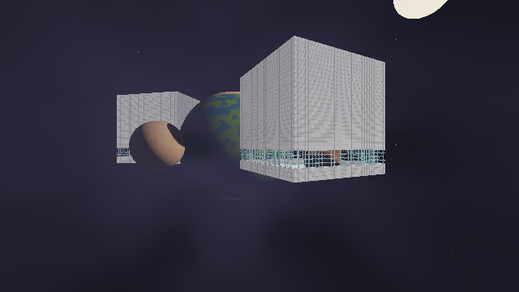

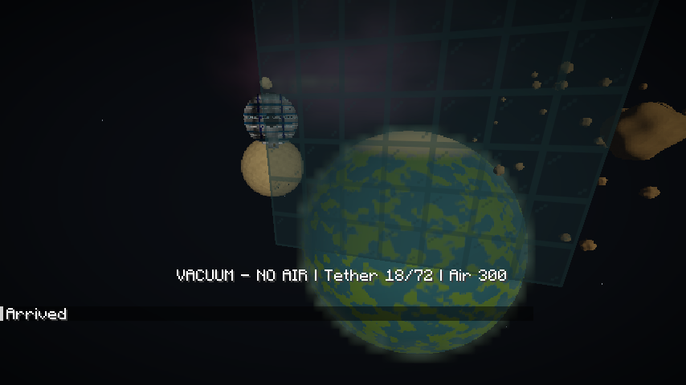

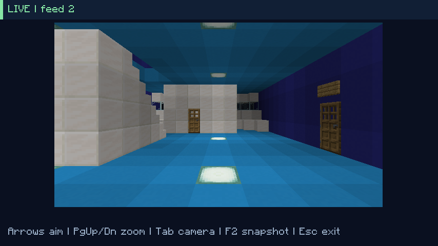


The expanded loopback scenario passed in `compute-multiplayer-cleanup.log`, with marker `build/local-multiplayer/20261024-113945-750b1f/passed`. Both clients exit zero. They render distinct observer poses, compare identical initial and edited definitions, propagate the same server scene revision, release GPU views and cached definitions on TCP disconnect, return while crew is offline, reconnect with tracking/inventory intact, retain independent engineering pages, reject stale writes, and render a distant source without advancing its TNT or furnace.

This test found a real cleanup bug. Fabric's disconnect callback can run on Netty before Minecraft's main disconnect clears queued tasks, so enqueueing cleanup with `client.execute` can lose it permanently. Cleanup now survives in an atomic connection token and runs on the render-thread client tick; new physical connections clear stale ownership and late old tokens are ignored. The initial immediate assertion and subsequent bounded wait both caught the leak; the production fix passed the complete loopback sequence. Seamless configuration transitions on the same physical connection retain their scene catalog.


Final verification completed successfully in `compute-complete-validation.log`: **88 unit cases, all 36 required server tests, all eight graphical scenarios, check, and assembly**. The final two-client rerun passed again in `compute-final-loopback.log`, with marker `build/local-multiplayer/20261024-114922-a1d438/passed` and empty stderr for both clients. This run includes connection-identity protection for seamless reconfiguration and late disconnects.

A final narrow geometry correction avoids Minecraft Vec3's small-vector normalization cutoff when rotating authoritative shapes. Small nonzero axes now retain the same direction as scaled equivalents, matching GLSL normalization. Its scale-invariance regression brings the unit total to **89**, with zero failures; unit tests and packaging passed in `compute-axis-package.log`. It does not change the default unit axes, scene schema, GPU kernels, or lifecycle paths exercised in the full integration runs.

## Ship navigation verification ? 2026-10-24

Passed **98 JUnit tests, 40 native server GameTests, nine graphical test classes, and the two-client loopback scenario**. The full run is recorded in `navigation-final-validation.log`; the subsequent loopback/package runs are `navigation-loopback.log` and `navigation-package.log`. The final package is `build/libs/nullspace-0.1.0.jar`. [The verification manifest](navigation-verification.json) records its hash and the loopback run directory.

New checks cover every horizontal ship controller orientation, ship-local steering, thrust/braking/power loss, finite and bounded controls, terminal navigation, stable region definitions, arrival clearance, stolen/replayed pilot input, release through recovered metadata, and blast isolation across regions. The graphical scenario uses typed ship controller actions, validates visible hull pixels, keeps physical crew stationary during simulated flight, visits Luna and Vega before returning to Terra, rejects landing at Terra pads from another region, and captures a 32-block sphere and orbit/zoom controls.

The two real clients exercise exclusive piloting, a simultaneous observer camera, clearing stale saved velocity when reacquiring control, and matching destination definitions after crew fast travel. Existing cargo, offline return, reconnect tracking, stale engineering writes, and distant camera checks also pass. The seven physical crash/restart scenarios were not rerun for this feature; the native journal recovery regressions are included in the 40 server tests. Prepared user saves remain untouched.


## Pad discovery, previews, hatches, and furnace cargo ? October 25, 2026

The [construction record](pad-previews-and-hatches.md) describes the implemented behavior and includes an actual rendered preview screenshot. World 5 was inspected read-only; its formerly unsupported machine is a furnace at 883, 66, -76. The save was never launched or modified during this work.

`pad-hatch-server-final.log` passed **check, 103 JUnit cases, all 46 required server GameTests, and assembly**. New coverage includes arbitrary controller facing, ring corners, exact-layer scanning, stacked pad ownership and height boundaries, invalid-machine previews, type-specific repair messages, trapdoor pressure and opening, ladder hatch exits, stable hatch group IDs, redstone override, and forged preview requests from a ship controller session. The existing four-stage interruption/round-trip test now verifies full inventory/fuel/cooking NBT for furnace, blast furnace, and smoker after repeated recovery, launch, and landing.

All **10 graphical entrypoints** completed successfully in `pad-hatch-release-validation.log`. That combined invocation failed only its server launcher configuration before server startup; the server task was corrected and passed separately in the final log above. The graphical scenario places a controller from outside the ring in Survival, uses real terminal/network actions, checks cyan highlight pixels, edits live connected hull geometry, checks that geometry refresh does not reset fading, verifies independent toggles and expiration, and performs a furnace round trip. A second embedded passenger deliberately withholds arrival readiness: all three running furnace types remain frozen for 25 ticks, retain exact NBT across transfer, then resume cooking after quarantine ends.

Server GameTests now use Minecraft's public `--universe` option to place each run's world under a fresh `build/run/gameTest-sessions/<UUID>/world`. The process working directory remains owned by Loom. This avoids repeatedly loading accumulated fixture chunks and completed transfer journals. Existing test directories and player saves are preserved. Test root creation happens at task execution and remains compatible with Gradle configuration caching.

The release JAR includes the preview renderer/protocol, hatch integration, diagnostics, and block-entity quarantine mixin. Archive inspection found no GameTest or JUnit classes. The seven real process-halt scenarios were not rerun; native journal rollback coverage and the held-arrival graphical scenario cover this change's transfer behavior.

The expanded two-client run passed in `pad-hatch-loopback.log`, with marker `build/local-multiplayer/20261025-114713-178a87/passed`. Both actual graphical clients exited zero. The pilot enabled both previews through typed requests; the crew saw neither highlight and retained its own terminal. Independent toggles, launch, local flight, region travel, offline return/reconnect, shared engineering revisions, and distant camera behavior all passed.


## Expanded ship block support ? October 25, 2026

The [support guide](ship-block-support.md), [full generated vanilla catalog](ship-block-catalog.md), and [verification manifest](ship-block-support-verification.json) record this change. The production policy and native registry test classify all **1,286 vanilla block IDs**: **674 supported**, **584 conditional**, **28 excluded** (including air variants). Eligibility remains subject to ship geometry, pressure, native placement requirements, pending-action checks, and the conditions documented for each block. It is not a claim of exhaustive testing of all block-state combinations.

`block-support-final-validation.log` passed **103 unit cases and all 52 required server GameTests**, including all **176 portable block-entity variants across 36 types**. The variant test checks full saved NBT with named components and inventory contents, valid written books, music discs and stored bees, then removal without dropped cargo. Separate cases verify loot seeds, quiet powered TNT/piston placement, malformed piston pairs, pending ticks/events, wet/dry states, falling-block support, soil preview membership, and hive flower-memory relocation. A workshop ship carries hopper, dispenser, dropper, brewer, crafter, lectern, decorated pot, chiseled bookshelf, jukebox, enchanting table and occupied hive through all four pre-commit interruption stages, repeated recovery, launch and landing.

These tests caught two transfer problems. Vanilla structure placement rerolls unopened container loot seeds; the mod now reloads the exact saved block-entity data. Emptying a jukebox during removal notifies neighbors and breaks a flower above it, leaving duplicated debris during rollback. Removal now suppresses side effects and detaches block entities without clearing their inventories; replacing a snapshot first clears the old block entities safely. The workshop's flower-on-jukebox fixture and subsequent landing checks pass with the correction.

The combined run's graphical task was interrupted by a Windows `AccessDeniedException` while atomically replacing a pad registry in a disposable gallery world. A standalone rerun in `block-support-graphics.log` passed **all 10 graphical entrypoints and assembly**, including actual world rendering, terminal actions, transfer and held furnace arrival. This was a test-file access failure, not an approval/sandbox rejection.

The expanded two-real-client loopback run passed in `block-support-multiplayer.log`; marker: `build/local-multiplayer/20261025-125034-4daab1/passed`. Both JVMs exited zero with empty stderr. A crew member opens a dropper menu before launch; travel closes the old source menu, and the dropper's five diamonds and brewing stand cargo survive launch, region flight/travel, offline return and reconnect. Existing private previews, shared systems revisions, independent terminal pages, tracking, scene convergence, and distant non-ticking cameras also passed.

The release archive contains the compatibility policy and queued-block-event accessor, and excludes test classes. Artifact: `build/libs/nullspace-0.1.0.jar`, **595073 bytes**, SHA-256 `1b867b083e7f6c6c0bad48980ad1cb2d102cfd7d5d95011e18fe5999a5b70ca4`. The physical seven-process-halt matrix was not rerun; the new workshop tests exercise actual journal snapshots and recovery at every pre-commit checkpoint. Player saves were not modified. Regenerate the catalog after a policy or Minecraft version change with `.\test.ps1`, then `.\scripts\Update-ShipBlockCatalog.ps1`.

## Space background camera stability - October 25, 2026

The user reported space tumbling around an otherwise stable launched ship. The native walking-bob transform contained a translation, but compute normalized a point on the 0.05-block near plane as a ray from the original eye. A regression fixture reproduces the resulting large angular error. `SceneCamera.compose` now extracts the effective eye offset and removes that translation from the camera-relative matrices; native depth, scene geometry and compute rays share the shifted origin. Native camera rotations, FOV, aspect, lens offsets and portal effects are preserved. See the [renderer plan](space-compute-renderer-plan.md#native-camera-alignment-correction).

`space-stability-validation.log` passed `check runClientGameTest assemble`: **106 unit tests, all 52 required server GameTests, and all 10 graphical entrypoints**. Three new unit cases check the original near-plane error, projection/ray agreement over 48 phases with both clip-depth conventions and a rotated ship, and immutable inputs/no movement at rest. The numerical GPU suite additionally checks actual planet hits against independently unprojected native-camera rays over twelve walking-bob phases. The graphical suite exercises travel, EVA, glass in both transparency modes, resizing, remote cameras and ship piloting. The updated release JAR is `build/libs/nullspace-0.1.0.jar`.

World 5 and its launch/landing journals were inspected read-only. No player save was opened or edited by the verification runs. The two-client and physical process-halt harnesses were not rerun for this client camera correction.


## Planet surfaces, NullOS, scanners, terrain cameras and spatial air - October 25, 2026

The [implementation guide](planet-computers-and-rendering.md), [NullOS manual](nullos.md), and [recipes](ship-recipes.md) describe the completed behavior and its limits. The custom Bash-style and Python-style interpreters share a bounded server scheduler and explicit Java ship APIs. Guest paths never become host filesystem paths. Detached programs compute using last-known power while chunks are unloaded; native world calls yield until equipment is loaded and valid. Disk contents, detached source, variables and instruction positions are saved with ship metadata and its transfer journal.

`expansion-final-validation.log` passed the combined `check runClientGameTest assemble` invocation: **131 unit tests, all 59 required native server tests, and all 11 graphical entrypoints**. A subsequent maximum-size disk/eight-job restoration regression and aggregate guest-memory limits are included in `expansion-package-verified.log`: **132 unit tests and assembly pass**. The final graphical capture against that package is recorded separately below. The native tests in `expansion-final-package.log` also passed all 59 cases; that invocation's unit fixture initially did not fill enough disk to reach its stated boundary, and its corrected fixture passes in the verified package run.

New unit coverage exercises language control flow, output, quoting, short-circuit native side effects, unavailable-device retries, infinite-loop yielding, scheduler fairness, output/input bounds, nested-value limits, path isolation, and saved detached programs. Gas tests check conservation, local filling, breach flow, impermeable cells and equilibrium. Celestial-frame tests check surface day/night alignment. Native cases use real registries, dimensions, blocks, scanner power grants, ownership-checked console sessions, removed hardware, expiring script flight and the longer scanner menu codec. Cold passive pad/flight fixtures explicitly request loading-only tickets before their asynchronous checks.

The graphical scenario types into the real 80-column terminal, writes and runs both languages, and checks their visible output. Its planetary camera captures a wall beyond the old 32-block ship cube, native fluid geometry, a chest and a sheep. It closes the feed until its subscription expires, changes the remote wall, then verifies the reopened feed receives the new state. This caught and fixed cache revisions restarting after eviction. Other regression work caught missing Bash stdout, unassigned IDs on detached native render entities, and the distant sensor mode exceeding the former packet string limit.

`expansion-multiplayer.log` passed **two real graphical clients connected to a loopback dedicated server**, with marker `build/local-multiplayer/20261025-222158-d9a6e0/passed`. A typed console command creates a guest file before launch. The file remains after local flight, Luna travel, home travel, offline crew return, reconnect and landing. Existing independent terminal pages, private previews, exclusive piloting, shared engineering revisions, scene convergence and distant camera tests also pass. The remote TNT fuse and furnace remain unticked during camera viewing; the camera does not populate the player's normal chunk cache.

Camera captures, packets, meshes, actors and tickets are bounded. The feed covers at most an 80 x 48 x 80 neighborhood; biome tint is sampled per section, generic entities use type/pose snapshots, and some block-entity neighbor dependencies or oversized visual tags are deliberately omitted. Planet terrains are native flat dimensions; breathable skies use an analytic blend. Spatial gas is conservative diffusion with exterior reservoirs, not momentum CFD or gas mixtures. Script languages are documented subsets. Known ship controller routes remain available without scanners. These are the current feature boundaries, not claims of full native rendering or language compatibility.

The physical seven-process-halt matrix was not rerun. Existing journal recovery and transfer regressions remain in the native/graphical suites. All verification worlds are disposable; no player survival save was launched or edited. Archive inspection confirms 22 shaped recipes, all four new planet dimensions, and no GameTest or JUnit classes in the production JAR.


The final client capture in `expansion-final-graphics.log` passed **all 11 graphical entrypoints and assembly**. Screenshots show the [Python-style console](images/computer-python.png), [Bash-style output](images/computer-bash.png), [planet terrain camera](images/planet-terrain-camera.png), [Luna sky](images/luna-surface-sky.png), and [graphics settings](images/space-graphics-settings.png). A final server availability correction follows this capture: computer equipment access and script flight now require every hull chunk to be loaded, using non-loading availability queries. `expansion-unloaded-hull-validation.log` passes **132 unit tests, all 60 server tests and assembly**; its cold partial-hull case checks that both paths defer access without loading the missing corner.

The preserved [performance JSON](planet-rendering-performance.json) records 50 warmed moving-camera samples on an NVIDIA RTX 3070 Laptop GPU, OpenGL 4.3 / driver 610.62. The fixture uses a 640 x 360 main surface, 320 x 180 volume, celestial bodies/nebula, two four-deck 32-cube hulls and two independent 320 x 180 monitor captures. Surface work is **0.577 ms median / 0.618 ms p95**, volume work **6.110 / 6.187 ms**, resolve **0.037 / 0.038 ms**, and CPU surface preparation/submission **0.418 / 0.597 ms**. Staggered monitor compute costs **2.386 / 2.434 ms** per scheduled frame. Owned image/buffer estimates are 51,314,016 bytes for the main view and 77,910,048 bytes across views. These measurements exclude native terrain/ship/entity rendering, final composition, GUI, driver caches and whole-game frame time; they are not an overall FPS claim or measurements of the higher-resolution Balanced preset.


The final availability guard also passes the full two-client scenario in `expansion-unloaded-hull-multiplayer.log`, marker `build/local-multiplayer/20261025-222948-e27edd/passed`. Both graphical client processes exit zero. The [verification manifest](planet-computers-verification.json) records the final artifact: `build/libs/nullspace-0.1.0.jar`, **734908 bytes**, SHA-256 `aca8a0cd294876f6c508973debd4834f90331957cfc176c6b8ed26421f077003`. Client rendering code was unchanged after the final graphical capture; the later server guard is covered by the native partial-hull test and this real multiplayer run.


## Moon scale, fullscreen piloting and air-flow shutdown - October 25, 2026

The [fix record](visual-polish-2026-10-25.md) explains the default Moon spacing/migration, fullscreen aspect-correct ship camera, H controls overlay, and stopping air effects in full rooms. [Encounter/docking](space-encounters-and-docking.md) and [rendering workshop](space-rendering-workshop.md) documents were written alongside this work; their features remain proposals for review.

`visual-polish-validation.log` passes **137 unit cases and all 11 graphical entrypoints**. Its server task failed an existing script-flight fixture that retained a metadata object across asynchronous updates. The fixture now obtains current ship metadata by stable ID; `visual-polish-server-validation.log` passes **check, all 62 required server tests and assembly**. New tests check angular size across surface viewpoints, repeatable layout, one-time migration, preserved custom positions, every region's companion spacing, maintenance refill without haze, quiet final refill, and real vacuum escape. The graphical suite checks air-flow packets, stop messages, expiry after updates cease, pilot target aspect and the H overlay. Captures: [fullscreen flight](images/ship-flight-fullscreen.png), [controls](images/ship-pilot-controls.png), [surface sky](images/luna-sky-scaled-companion.png).

A final pilot-target refinement bounds its aspect-correct dimensions by the selected quality dimensions. `visual-polish-package.log` passes assembly. `visual-polish-final-multiplayer.log` passes the complete **two-real-client loopback scenario**, marker `build/local-multiplayer/20261025-230426-e4fc80/passed`. Both 4:3 clients explicitly verify render-target aspect and quality bounds for the pilot and observer cameras; existing shared scene revisions, guest-file cargo, launch, piloting, jumps, offline return/reconnect, engineering and distant cameras pass. Both processes exit zero.

The [verification manifest](visual-polish-verification.json) records the final JAR: `build/libs/nullspace-0.1.0.jar`, **741343 bytes**, SHA-256 `39b163795c63c02317451369b4fb0f20a7ba19bba7a684a7d70e345f3cddb952`. No GameTest/JUnit classes are packaged. The physical process-halt matrix was not rerun. Tests used disposable worlds; player survival saves were not opened or edited. The one-time default-catalog migration occurs when the updated game is next played.


## In-game field guide - October 25, 2026

The [field guide](in-game-guide.md) is a native written book with **88 pages, 22 feature chapters and all 23 shaped recipes**, including its own book-over-copper recipe. `/nullspace guide` is available without operator permission and avoids adding another inventory copy. Lab visits/prepared development worlds supply a copy; new gallery supplies and the recipe annex include it. Existing saved galleries are preserved.

`field-guide-validation.log` passes **check, 137 unit tests, all 65 required server tests, all 12 graphical entrypoints and assembly**. New native cases verify that default recipe pages exactly match loaded recipes, every click is a valid page-change link, crafted books contain their written content, the item survives native inventory packets, obtaining two copies keeps one inventory book, and ordinary lectern placement consumes one book and preserves its contents. The expanded recipe regression includes the guide's shape, unlock, wrong-material rejection and lack of collision with vanilla recipes. Existing ship/cargo and journal cases also pass.

The graphical test uses a real inventory item and use packet to open Minecraft's book screen. It checks every page's height with the actual font and 114-pixel text width against the native 128-pixel height, then captures [cover](images/field-guide-cover.png), [contents](images/field-guide-contents.png) and [terminal recipe](images/field-guide-recipe.png). Contents and recipe pages were visually inspected. Links contain page changes only, without command or script actions. Book contents refresh from loaded shaped recipes when crafted/opened; a book on a lectern retains its snapshot until taken and opened again.

The [manifest](field-guide-verification.json) records `build/libs/nullspace-0.1.0.jar`, **763817 bytes**, SHA-256 `11b44a690c70d539b3baaacea22012dc430077195cdc74b38ff8fd35a0625d88`. The archive contains guide text and recipe data and excludes GameTest/JUnit classes. The two-client and process-halt harnesses were not rerun for this book. No player survival save was opened or edited.


## Graphical crafting and regression expansion - October 26, 2026

Recipe pages now draw Minecraft item icons in a 3 x 3 grid, an output icon and quantity. Hover names and cycling ingredient alternatives use the server's loaded recipes. Clicking a crafted part opens its recipe; native lecterns retain graphical recipe snapshots. The [terminal recipe](images/field-guide-recipe.png) and [lectern batch recipe](images/field-guide-lectern.png) were visually inspected.

`coverage-full-validation.log` passes **280 unit cases, all 72 then-current required server GameTests, all 12 graphical entrypoints and assembly**. This adds 143 deterministic unit scenarios across computers, terminal transport, spatial air/power, pad mutations, flight invariants and scene serialization. Native tests add full recipe-snapshot agreement, actual crafting, packet limits and action ordinals, and server session boundaries. The [coverage matrix](regression-coverage.md) lists behaviors and remaining limits.

The first physical process-crash run, `coverage-crash-matrix.log`, exposed real state loss: recovery replay cleared the physical source while treating those temporary removals as equipment destruction. Its recovered device list became empty despite the journal containing the original seven devices and battery energy. `ShipSystems.changed` now preserves authoritative device records during journal mutation. A new native replay regression checks exact systems state before and after rebuilding runtime caches, and verifies that ordinary destruction still removes the device record. `coverage-recovery-validation.log` passes **280 unit cases, all 73 required server GameTests and assembly** with this fix.

`coverage-crash-matrix-final.log` passes all **seven real JVM halt/restart stages**: PREPARED, DESTINATION_STAGED, SOURCE_CLEARED, PASSENGERS_MOVED, COMMITTED, TEMP_PREPARED and TEMP_SOURCE_CLEARED. Their markers are under `build/local-crash/20261026-000918-5973fa`. Each restart checks authoritative hull ownership, exact devices/power/finite air, entity UUIDs without duplicates, chest cargo, player inventory and arrival orientation.

Other regression fixes make computer restoration atomic and repeatable, preserve terminal RGB/inverted colors in snapshots, bound screen packets large enough for a fully styled 80 x 25 display, and reject non-finite ship controller yaw. The native RGB round-trip checks every cell. All tests use disposable worlds; no player survival save was launched or edited.

The final two-client run, `coverage-multiplayer-final.log`, passes against the corrected build, marker `build/local-multiplayer/20261026-001327-d82a5b/passed`; both client JVMs exit zero. Both players receive recipe snapshots from the dedicated server and navigate ingredient links, then retain exactly one guide through launch, jumps, offline return and reconnect. Existing independent engineering pages, stale edit rejection, power allocations, NullOS guest-file cargo and camera-only chunk behavior also pass.

The [verification manifest](regression-verification.json) records `build/libs/nullspace-0.1.0.jar`, **771793 bytes**, SHA-256 `0c87c689617198ebdd5d0aede8da4ee89bd59be6ff3cb2c35272943aafbbb649`. No GameTest/JUnit classes are packaged. Client rendering code is unchanged after its successful graphical run; the final server replay fix is covered by the full native suite, all seven physical crash/restart stages and the final two-client run.

## Test review follow-up - October 26, 2026

The final frozen-source run passed **303 unit scenarios, 93 mod GameTests plus Minecraft's optional smoke test, all 14 graphical entrypoints, two real local multiplayer clients, 14 physical launch/landing crash-restart cases and 15 verification-harness checks**. Minecraft labels its total count of 94 as required tests; the manifest distinguishes the 93 mod tests from the optional vanilla fixture. The ordinary crash entrypoint returns early; its full behavior is checked separately in the 14-case process matrix.

Evidence: [verification receipt](test-gap-verification.json), `build/verification/20261026-145734-01e044/manifest.json`, preserved logs/reports/screenshots and completion receipts. All selected suites pass against unchanged source/tooling fingerprint `9909f5c4da9e2582a5ccc0c89174bccee5c6b396b9a2aecee083e1b5bcf696f7`. The pinned formatter check passes.

The new checks cover actual Unicode storage, ordinary save retries and standalone guest-edit durability, corrupt computer preservation/migration, warm rollback, competing computers, unloaded hulls, real pad lifecycle changes, resource/datapack overrides and repeated world/GPU lifetimes. They exposed document/computer save-request gaps, malformed-owner data loss, synchronized device-budget starvation and cleanup failures after `Error`. [Detailed changes and limits](test-gap-review.md) also document the validation fixture corrections.

The release JAR is `build/libs/nullspace-0.1.0.jar`, **881,387 bytes**, SHA-256 `289bbee042449d7cb379dd0333c3f2241adf9321bcec4224bc8868c809a01755`. All 152 packaged JSON resources parse and no test/evidence classes are packaged. Player survival saves were not opened or edited; Git initialization, staging and commits were excluded.


## Atmosphere and replacement clouds - October 26, 2026

Frozen-source run `build/verification/20261026-220248-559f94` passed assembly, 316 unit cases, 96 mod GameTests plus one optional vanilla smoke test, all 15 graphical entrypoints, assets, the pinned formatter and the verification harness. Source fingerprint: `1aa325305d4a44e5a0532279c8682d94d290371341383f29ef54e5ff889c7b88`. Built JAR: 908,591 bytes, SHA-256 `8c5211bc463902154939256ea45f5bbff2873c97122f5d0e8f60f043cf8d6189`. Two-client multiplayer and the fresh-process crash matrix were not rerun for this renderer change.

[Implementation and limits](atmosphere-and-cloud-renderer.md), [machine-readable receipt](atmosphere-renderer-verification.json), [GPU reference sheet](images/atmosphere-cloud-reference.png), [native terrain/glass](images/atmosphere-native-terrain-glass.png), [native thunderstorm](images/atmosphere-native-thunderstorm.png).

New regressions cover profile serialization/backward compatibility, CPU/GPU transmission agreement, planet shadows, horizon reddening, optical scaling, camera/table cache behavior and eviction, invalid shader rollback, native opaque depth, avoidance of double sky scattering, weather, atmospheric/airless stars and finite rendering even at a planet center. The aerial-depth fixture caught and fixed premature optical-prefix termination when no nebula was present. Native captures caught the inappropriate use of an orange disk artwork color as a direct illuminant; the adapted light and a blue-daylight regression now cover it.

On the RTX 3070 Laptop GPU, transmission-table maximum absolute error was 0.000489. The native 960x540 scene's atmosphere/surface/volume p95 timings were 1.59/0.63/1.46 ms. Those separately measured passes exclude native terrain, GUI and final composition; cached atmosphere frames explain its 0.001 ms median. The distinct populated 640x360 space/nebula fixture still measured a 7.31 ms median volume pass, above the original main-view tuning target. Complete timings and scope are retained in the receipt and suite snapshot.


## Computer terminal exit shortcut - October 26, 2026

Replaced the Windows-reserved Ctrl+Escape close chord with Shift+Escape, using either Shift key. Plain Escape continues to reach guest programs; controller menus still close with Escape. Boot text, shell help, the in-game guide and terminal/design documentation now show the working chord.

Validation passed 316 unit tests, 96 mod GameTests plus one optional vanilla test, all 15 graphical entrypoints, assembly, content assets and the pinned formatter. The native keyboard callback checks both SDL Shift modifier bits, exactly one close callback, no stray guest bytes and stopped SDL text input. The actual computer scenario checks server-session removal after closing. Fabric 26.3's simulated held-key helper always sends zero event modifiers; the first regression run exposed that fixture limitation, and the final tests supply the same modifier bits as SDL through Minecraft's keyboard handler.

[Verification receipt](terminal-exit-verification.json). Retained logs, completion receipt and built JAR: `build/verification/terminal-exit-20261026`.

## World 5 sky and direct launch - October 26, 2026

`dev.ps1` now opens `run/saves/World 5` through Minecraft's quick-play argument, retaining Player451. The resolved task arguments and actual Loom game directory were checked without opening the survival save. Graphics checks used disposable worlds.

The daytime black sky at X=886, Z=-82 came from treating horizontal travel on flat terrain as altitude above a small spherical planet. Surface celestial position now uses native height; 512 Minecraft blocks span the atmospheric shell. Native aerial perspective uses the same distance conversion, while clouds follow the native ground axes. Rain and thunder force the cloud layer independently of the clear-weather preference. The native fixture now uses World 5's horizontal coordinates and time 9502 and captures a thunderstorm with optional clouds disabled.

Final retained run: `build/verification/world5-sky-20261026-232720`. Frozen source/tooling fingerprint: `45bde49874cba047825a141fbfc36cd284c2af191376f1b9e48fc51ac7748d4f`. **450 unit tests passed, 12 documented known-bug tests remained skipped, all 100 discovered server tests passed (99 mod and one optional vanilla), and all 15 graphical entrypoints passed.** Assets, packaging and the pinned formatter passed. This is recorded as `passed-with-known-skips`; it does not satisfy `verify.ps1`'s stricter no-skipped-tests gate. The named skips remain visible in the [receipt](world5-sky-verification.json) and [known-bug register](regression-coverage.md#known-bug-register). Two-client multiplayer and physical crash/restart matrices were not rerun.

JAR: 911,316 bytes, SHA-256 `46cb4f6df5b68166780061e46aca4b0b845c88a96eeb8281b4372b36d5fcd6b6`. On the RTX 3070 Laptop GPU, the native 960x540 scene's atmosphere/surface/volume p95 timings were 1.39/0.62/1.49 ms; these exclude native terrain, GUI and final composition. Updated [daytime](images/atmosphere-native-terrain-glass.png) and [storm](images/atmosphere-native-thunderstorm.png) captures are retained. Air balance remains as described in [its findings and test plan](air-balance-testing.md); this change does not tune it.

## Ship beacon and preset shipyard - October 27, 2026

Final run `build/verification/shipyard-20261027-003132` retained 454 passing unit tests, 12 previously documented skipped known-bug tests, all 109 discovered server tests (108 mod plus one optional vanilla), all 16 graphical entrypoints, assembly, assets and formatting. The frozen input fingerprint was `1224f65a5403b25f0fe21ba10f04bc8ce73c9a778ea020c8b080689f16ed9a3d`. The strict no-skipped-tests gate remains unsatisfied; the [receipt](shipyard-verification.json) names every skip. Two-client multiplayer and physical process-halt delivery recovery were not selected.

The tests exposed fixture coordinate collisions and checked engine/cabin/path behavior across all six hulls. Review caught a real exact-size-pad problem: hull-edge decorations could connect to ground controllers. Blueprint clearance and a regression with controllers on all four edges now prevent it. Entity data must be ready before delivery, including inactive loaded sections. Saved intents precede placement and support conflict-preserving resumption. Native checks read the saved intent, inject a placement interruption and resume without duplicate ships.

The actual client purchases through block use and typed terminal packets, refuses a second purchase, then launches and lands that ship. The showroom image waits for its own two rows of meshes, rather than treating received chunks as completed rendering or waiting for all distant background sections. Retained captures: [terminal](images/ship-beacon-catalog.png), [ship in space](images/purchased-ship-in-space.png), [six showroom ships](images/shipyard-showroom.png).

## Shipyard durability and multiplayer completion - October 27, 2026

Final evidence: `build/verification/shipyard-completion-20261027-005718`, with the two-client run retained at `build/local-multiplayer/20261027-005423-c5d6f8`. Both certify input fingerprint `35cdfa7fafbfcb7973cfe2ddbf563cf2abcc74cb0da8aea05a1950c49c7c0e66`.

- 454 unit tests passed; the same 12 previously documented known-bug tests remain skipped.
- All 112 discovered native server tests passed (111 mod plus one optional vanilla).
- All 16 graphical entrypoints passed, including beacon purchase, duplicate refusal, launch/landing and showroom visibility.
- All seven delivery crash/restart cases passed with actual halt exit 86 and verify exit 0. Startup completed pending orders without another player action. Saved cargo and committed ship/device identities survived.
- Two independent graphical clients passed the existing multiplayer sequence and then raced a purchase onto one shared pad. Pilot received delivery; crew received occupied-pad feedback. Exactly one ship remained, neither player lost currency items and no order remained pending.
- Assembly, generated assets, formatting and frozen-source checks passed.

The built JAR is 942966 bytes, SHA-256 `58ecb00f02a000cfc2d7e61e54bafa0f8ebcf91d466b571b6144b4ef0027b5f3`. [Machine-readable receipt](shipyard-verification.json). The separate fourteen-case travel crash matrix was not rerun. Status remains `passed-with-known-skips`; this does not satisfy the strict no-skipped-tests gate. All scenarios use disposable saves and leave World 5 untouched.

Final JAR: 941,659 bytes, SHA-256 `4da4efc3bc263b474f289ee65d46241f843f86178f2440d681b0c9ca2504e583`. All worlds were disposable; World 5 was not opened or edited during this feature's verification.
