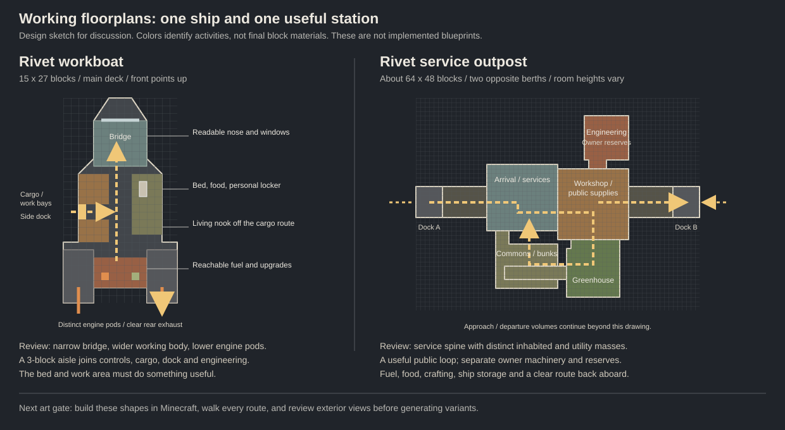
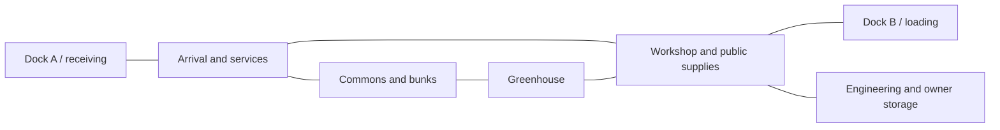

# Recovery, ships and stations: the next design pass

Working proposal, November 5. This describes changes to design together, not features already implemented. It takes priority over older proposals where they disagree. The existing playtest save stays intact.

**Navigation playtest correction:** the Scanner block owns the full destination browser and sets the destination directly. Remove the proposed Mark/Select handoff and the Scanner feed inside the controller. The controller displays the chosen destination and runs **Engage**, retaining basic local planet/pad navigation without a Scanner. This supersedes the earlier handoff mockups below; see [the current chunk walkthrough](playtest-chunks.md#chunk-1-navigation).

**Latest playtest decisions:** dropping out of FTL to investigate a vessel continues automatically into docking unless the player cancels; no second Engage click. Starting a station is an in-world action: in space, hold a Station Core and Shift-right-click empty space or a non-interactive block at the intended site. Remove the Controller's station-build button. Current location, Fly manually, View ship, Loose blocks and Locate problem are approved Controller labels; keep Destination, Trip, Engage, Disengage and Check ship.

After docking at an investigated encounter, the ship Controller presents the saved journey destination again. Engage handles undocking and resuming that paid trip together. Do not require separate manual Undock and Resume actions, and do not replace a different destination explicitly selected by the player.

The player should always have a way forward, understand what their controls will do, and have a reason to care about a ship or station beyond getting its machinery to pass validation.

## Decisions so far

| Decision | Status |
| --- | --- |
| Emergency rescue keeps the player's carried inventory. Their ship and its cargo remain behind. | Agreed |
| Ship/station appearance, interiors and useful activities need equal attention. | Agreed |
| Use focused checks during development, with an integration sweep at the end of an agreed batch. | Agreed; recorded in [AGENTS.md](../AGENTS.md) |
| Choose a place and press **Engage**. Launch, departure, jump, approach, docking and landing are phases of that trip rather than separate primary buttons. | Agreed; supersedes the previous five-button direction |
| The **Scanner block** browses and directly sets destinations; the **Ship Controller** displays the course and operates the ship with Engage. | Agreed after playtesting; no marking step or controller Scanner feed |
| Built-in navigation works within the current star system. A powered stock Scanner enables interstellar travel; upgrades improve detection/range. | Agreed |
| A physical **Ship Title** represents the ship and can be handed to another player. | Agreed; replaces the proposal for an item that is only a bookmark |
| The server holds the vessel data; the physical title authorizes it. There is one current authorization and one actual vessel. | Recommended implementation of the physical title |
| Provide a guaranteed public recovery destination on breathable Terra. An orbital station can offer services without being the final respawn fallback. | Recommended |
| Make one authored starter ship and one useful service station excellent before expanding the generator or rebuilding the whole catalog. | Recommended |

## What is wrong with the current experience

- Recall requires a registered, clear, empty pad. A docked ship or offline crew can block it. That is useful transport with restrictions, but it cannot be the only recovery mechanism.
- Space beds currently do not establish a spawn point. Existing ordinary bed bindings are not retargeted when their blocks travel. A bedroom therefore does not yet provide the security a player expects.
- Starting a station produces an exposed platform, then asks the player to choose room tiles, kits and build-area expansion. They have to understand the construction system before getting a useful first room.
- The controller presents many mechanisms together without a clear distinction between flying, managing a vessel, building a place and asking for help.
- The reference station is largely a repeated square perimeter. The ship interiors and station rooms often read as similarly sized boxes with equipment inserted afterward. Manufacturer names, room labels and extra variants have not solved that.
- Public stations protect their storage and machinery, so their appearance does not reliably tell a visitor what they may actually use or obtain.

## Recovery must not depend on the thing that failed

There are three different actions. Give them different names and explain their consequences before committing.

| Action | Moves | Leaves in place | Needs |
| --- | --- | --- | --- |
| **Call rescue** | The living player and carried inventory to a safe arrival point | Their ship, its cargo and other players | No ship power, fuel, working controller, landing pad, scanner or money |
| **Recover ship** | The same owned ship into storage, represented by its physical title | Other players and unrelated builds | Valid ownership/title recovery and a safe transfer; no working engines, fuel or empty destination pad |
| **Deploy ship** | The ship represented by a valid title onto a clear compatible pad or berth | Other stored ships | Its title and a reserved destination that fits; no repair or refuelling is implied |

Call rescue belongs in the Minecraft pause menu as **Rescue**, with a backup command for diagnostics. It must be reachable after the controller is destroyed, the player falls outside the hull, or every destination is unavailable. Discovery and navigation upgrades must not hide this action.

The confirmation says: **“Rescue takes you to Terra Harbor. You keep what you are carrying. Your ship and its cargo stay here.”** Use a short visible countdown and Cancel. Damage and a lost connection during that handoff must resolve to one safe player arrival, without duplicating inventory. Rescue does not move companions without their consent.

Arrival needs a clear floor, breathable surroundings and brief protection against an immediate fall/suffocation loop. It does not restore items lost in an earlier death or grant ship fuel, charge or upgrades. The ship remains listed in My ships with its last known location and a recovery action.

Terra Harbor is a small protected arrival and service area with access to ordinary surface resources, renewable food and a ship-service console. A player can recover from an empty fuel inventory by playing Minecraft there. An empty service locker must not make rescue itself unavailable. Keep a validated alternate arrival position if the first one is occupied.

An emergency button is the fallback. The ordinary route should also explain how to get unstuck: a planet destination shows available landing sites, an unavailable pad offers another site or storage, and an empty generator points to fuel rather than an unrelated navigation screen.

## Death and a bed aboard a moving ship

Right-clicking a usable ship bed should establish **Respawn aboard this ship**. Space does not need to skip the night for the bed to serve as a home.

Bind that spawn to the vessel's stable ID and the bed's local position/placement identity. Do not save only an absolute position in the hidden space allocation. When a surface ship launches with the player's current bed aboard, convert that binding as part of the same transfer.

At respawn, resolve the binding against the current vessel and actual blocks:

| Situation | Result |
| --- | --- |
| Ship moved or changed dimension; same bed still exists and a safe position is usable | Respawn at that bed aboard the same ship |
| Ship is in transit | Finish or resolve its transfer before choosing a safe arrival; never spawn into the staging area |
| Ship is stored | Respawn at the safe harbor; My ships still contains it |
| Bed was broken, left on a detached fragment, replaced, or its doorway/floor is unsafe | Explain the missing/unsafe bed and use the fallback |
| Ship is missing, destroyed, inaccessible, or cannot provide a safe breathable/suit-appropriate arrival | Use a valid personal surface spawn or the safe harbor |
| Player has not entered the space game and has no vessel binding | Preserve ordinary vanilla respawn behavior |

Death uses the server's normal inventory/drop rules. Rescue preserving carried inventory is a separate living-player action. Death must not issue another starter ship, restore old cargo or erase the right to recover an existing ship. Reusing a physical storage slot for another ship must never redirect someone's respawn to it.

## Physical ship titles, My ships and freeing a pad

The physical item is **Ship Title — Courier**, styled as a signed/stamped ownership paper with the ship's name, manufacturer/type and registration number. It is a normal non-stackable Minecraft item: carry it, put it in a chest or hand it to someone. It represents the existing vessel, including cargo, upgrades, fuel and damage.

The title exists while the ship is deployed as well as while it is stored. Deploying does not create another ship or leave a reusable copy in storage. The item's details show the live state: Deployed, Stored, Recovering or Unavailable.

Use **My ships** at the Pad Computer, ship-service console and station desk to find owned ships and use titles. The list is also useful after losing a title; it does not silently replace the physical transfer mechanic. Ship controllers can show vessel status, while deployment still uses an appropriate service location.

```text
MY SHIPS
Courier       On this pad       Fuel empty      [Store as title]
Workboat      Stored            Title present   [Deploy here]
Scout         Stranded at Luna                  [Recover]

Selected: Courier
Cargo and upgrades stay in the ship. Storage does not repair it.
[Show ship]                                  [Back]
```

For an occupied pad, offer **Store Courier and clear this pad** directly. The player retains/receives its valid physical title and the pad becomes empty. An empty generator, missing engine or damaged helm must not prevent storing a wreck. Preview/highlight the exact blocks to be captured; do not assume every block above a pad belongs to its ship.

The ship's identity, actual hull, container contents, machine state, remaining fuel, upgrades and damage survive storage. Storage itself preserves ownership/crew access and does not tick farms or generators. A deliberate title transfer changes ownership without moving or restoring the ship.

### Handing a title to another player

Recommended first interaction: the recipient right-clicks the valid title to **Take ownership**, with the ship name and included cargo clearly shown. That commits the transfer; the former owner cannot recover the ship or reissue that title afterward. Trading a deployed vessel transfers that vessel, not a fresh blueprint. A later buying/selling interface must perform payment and this same ownership transfer together.

Owner permissions transfer, while occupants retain a safe way to leave. The new owner manages future crew permissions. Do not teleport passengers, discard offline player anchors or strand people because a paper changed hands. Their bed/respawn permissions are revalidated normally.

The server stores the full vessel snapshot. The item carries its registration and current authorization rather than a huge portable inventory payload. Renaming or crafting a paper cannot create ownership. Successful title actions advance that authorization; a copied/old paper cannot create a second ship or retain authority after transfer. Failed deployment leaves the ship stored and the title usable.

### Lost, destroyed and replaced titles

The item must be valuable without making its destruction another permanent soft lock. Recommend **Replace missing title** at the recovery desk for the current registered owner. It invalidates the older authorization and issues a replacement; the former owner cannot use this to undo a completed transfer. A stored ship is not deleted when paper burns, despawns or is lost on death.

Whether finding a dropped title should let another player claim the ship is an ownership/gameplay decision still to settle. The physical transfer is agreed; replacement rules and the exact transfer confirmation remain proposals.

Online passengers must leave before storing their ship; a transfer or occupied docking tunnel must finish safely. Offline crew should not make storage impossible forever: retain their association, and reconnect them at the harbor when their ship is stored, with a clear message. Do not delete their inventory or silently move online companions.

An owner can store or recover their own ship. A pad owner can clear an abandoned, unoccupied visitor into protected storage for its original owner, without acquiring it. Active arrivals, departures and boarding have priority over clearing. Another player's vessel cannot be scrapped just because it occupies a pad.

Make **Store** the normal reversible action. **Scrap ship permanently** is a separate owner-only action with a named confirmation explaining what will be destroyed. Do not label it Sell or promise a payout before buying/selling exists. A station owner's loss, server restart or full surface pad must not erase stored ships.

Internally, storage needs a durable transaction: reserve the same vessel ID, save its complete snapshot, remove the physical copy, then publish Stored and the valid title state. Deployment reverses that process into a reserved destination. Ownership transfer validates the current title and commits one new owner/authorization. Interruption must leave exactly one authoritative vessel and inventory, with a usable title or a recoverable pending issue. Reuse the existing transfer guarantees.

## Controls organized around player intentions

Keep ordinary actions visible and use the same names everywhere. A disabled action gives its current reason and a useful fix on that screen. Routine use should not require Advanced, commands, tile coordinates, or a written procedure beside the game.

### Scanner: see and understand destinations

The Scanner is the full map/catalog. It lists destinations using navigable geography, not a flat list of every region, pad, vessel and port.

```text
SCANNER                         Stars > Sol > Terra
[Back to Sol]                   [Search destinations]

Terra orbit
  Rivet Depot            Station   Fuel / workshop   2 berths
  Waypoint               Station   Public supplies
  Alex's Courier         Ship      Alex             Moving

Terra surface
  Terra Harbor           Landing site / recovery services
  Home                   My landing pad

Selected: Rivet Depot, in orbit around Terra
[Set destination]  [Save place]  [Show on map]
```

At system scale, show planets/moons and the station/ship counts around each. Selecting Terra zooms to its orbital stations and surface places. **Stars** zooms out to star systems; selecting another system shows its planets and known places. The current system/body and the player's own ship stay clearly marked. Clickable breadcrumbs and Back follow the map scale rather than opening unrelated menus.

One station is one entry, with berth capacity/status. One moving player ship is one stable contact, not another entry for every port or region change. Assign a compatible free berth during final approach. Individual berth choice is an optional station detail, not the normal way to find the station.

The full catalog includes known/charted and currently detected destinations that the player may see. Preserve public/private visibility; “all destinations” does not reveal other players' private storage or every undiscovered encounter. Scanner information identifies where a station is, what it offers, whether it is operational/claimable and how to get there. An unidentified signal remains honest about what is unknown.

The Scanner sets the ship's destination directly, without starting travel. It refuses to change an engaged course until the player disengages. The controller immediately shows the same saved destination; there is no separate mark or confirmation handoff.

The full browser belongs to the physical Scanner block. The controller does not contain a second Scanner view. The Scanner's Settings / upgrades action opens its real equipment inventory.

### Ship Controller: select a course and Engage

```text
COURIER                           Docked at Waypoint / Terra

Destination set at Scanner: Rivet Depot, Terra orbit
  Basic local travel: planets and landing pads    [Choose]

Course: Rivet Depot / Sol / Terra orbit
Trip: Undock -> local travel -> dock at an available berth
Fuel needed: ...    Available: ...    Estimated time: ...
[Engage]                   [Disengage]

Fuel: Loaded
Power: Ready     Air here: Safe

[Pilot]  [Look outside]  [Close exterior doors]
[My ships]  [Start station]  [Help / Rescue]
                                    [Details] [Advanced]
```

**Engage** carries out one server-owned course to the selected place. Launch, undock, local travel, interstellar jump, approach, dock and land remain real phases with different requirements, but the player does not have to assemble them by pressing five separate buttons. Preview the actual sequence and final state before departure. A station trip ends docked; a landing-site trip ends landed; selecting a planet's **Orbit** explicitly ends in orbit.

The controller shows the destination already set by the Scanner and operates the trip. It retains basic local planet/pad choices to support travel without a Scanner. Full station/ship discovery and interstellar destination browsing stay at the Scanner block. The player does not copy or confirm a marked candidate between screens.

| Example | What Engage does |
| --- | --- |
| On a pad, choose a station in this system | Validate the full course, launch, travel locally and dock |
| Docked at a station, choose Home on a surface | Close/separate safely, travel to that planet, approach and land |
| Choose a station in another star system | Leave the current place, make the scanner-enabled interstellar jump, travel within the destination system and dock |
| Choose only a star system | Arrive at a clearly named safe system-entry location; do not imply a particular planet or station |
| Choose a nearby player's ship | Request access/consent as needed, approach and dock to that vessel |
| Just leave a pad or berth | Select **Open space nearby**, Engage, then stop safely clear of the departure path; Pilot is available there |

Within a system, built-in navigation supplies its planets/moons, personal home/saved places and immediate local contacts without a Scanner. A powered stock Scanner supplies the full destination catalog and enables interstellar courses. Upgrades improve detection/range; they do not gate ordinary local travel. Missing or unpowered hardware gives a direct explanation on Engage. A scanner failure during an already committed jump must not abandon the ship in an invalid transit location.

Previously charted places can remain visible when the Scanner is offline, clearly marked as cached information. New detection/live updates and interstellar departure need the working Scanner. Knowing a place and having the equipment/fuel to reach it are different states, and the screen should explain both.

While engaged, show the current phase, final destination and remaining trip. **Disengage / Stop** is the ordinary interruption action; it cancels safely or finishes the current indivisible transfer before stopping. Do not strand passengers between frames or charge a paid leg twice when resuming. Manual piloting remains available as a separate way to fly.

A moving player ship is a live target, but its movement cannot silently start extra interstellar trips. If it changes system, disappears or loses permission, stop at a safe point and offer the updated course. If a station fills while the player is travelling, hold safely and explain the berth status; do not choose another destination or burn propulsion fuel indefinitely while waiting.

Fuel/power/air faults remain visible after clicking another control. Show the first action needed to proceed, while Details can expose the rest. Ship management does not belong mixed into the travel destination list.

### Station Core: understand and extend this place

```text
RIVET DEPOT                                  Visitors allowed
Power: Ready     Air: Safe     Berths: 1 of 2 available

[Station map]    [Build]    [Ships and berths]
[Services]       [People and access]

Dock 1: Courier        Dock 2: Available
                                     [Details] [Advanced]
```

The map is the station's actual rooms and connections, with names, berth locations, hazards and available expansion doors. Build opens that same map in placement mode. Visitors get a simple station/service map; construction and permission controls belong to builders. A Station Core should not look like a ship helm with broken engines.

Repairing machinery still happens at the real block. Useful physical signs and routes should let a visitor reach a workshop, fuel locker, greenhouse or their ship without browsing the core's diagnostic graph.

## Building a station should produce a useful first place

1. Carry a Station Core and the materials for one **Starter dock**. Open **Start station** at the ship controller.
2. See a ghost of the complete first section outside the ship, including the ship's docking position and departure space. The screen shows what it contains and the exact materials still needed. Choose Place here or Cancel.
3. Commit the reserved build. Construction progresses visibly; resources are held safely and a failed build does not eat them or leave duplicate structures.
4. The ship automatically docks after the finished section passes its checks. The player opens the normal door and walks into a sealed, lit room containing the core and accessible utilities.
5. At an expansion doorway, or on the core map, choose a room, preview it against that doorway, review materials and place it. Compatible connections and their orientation are handled by the builder.

The first section contains a dock, walking room, core, basic engineering/air provision and a small useful work/storage area. It is not an exposed platform followed by a second unexplained construction step. Fuel and initial air must be explicitly accounted for in its material/commissioning cost; placement cannot secretly create endless supplies.

Grid coordinates and 32-block rendering sections are implementation details. Use the real footprint, door graph and reserved approach volumes to judge placement. The player sees the room and what it connects to. A platform may exist internally while construction is incomplete, but it is not presented as a finished station or a safe place to disembark.

Hand building remains supported. Place a core and construct with ordinary blocks; the same map should identify real rooms, framed doors and docks. Kits are a convenient construction method, not the only way to make a valid room. Planned diagrams must not override a wall someone actually removed.

## Build quality: author examples before expanding generation

The current screenshots show the problem: [fleet](images/shipyard-manufacturer-fleet.png), [station ring](images/full-station-ring.png), [ship corridor](images/ship-rooms-upper-corridor.png). We need better proportions and useful routes as well as better contents. More colors, room names and random seeds will not establish that.



Keep the Rivet, Halcyon and Bastion personas, ordinary Minecraft materials and consistent 16-pixel block textures. Design each vessel's main masses and deck plan together. Furnish a room around an activity, then make its entrance, storage, lighting and window placement support that activity.

### First ship: a small Rivet workboat

Proposed envelope: about **25–27 long, 13–15 wide and 9–10 high**, inside the 32-block ship allocation. One usable main deck; no mandatory second floor just to make it seem larger.

| Part | Form | What the player does there |
| --- | --- | --- |
| Forward bridge | Narrow raised nose with grouped forward windows | Sees the direction of travel and operates the controller |
| Main cabin | Wider body with a clear cargo/work route | Stores finds, crafts repairs and reaches the dock without crossing the pilot's position |
| Living nook | A warm, compact space off that route | Uses a working bed and finds food; not a separate empty bedroom box |
| Aft machinery | Distinct engine pods and a connected service spine | Finds and loads the generator, accesses upgrades and understands the exhaust direction |
| Side dock | A visible entrance beside cargo | Boards with a clear route into the cabin and no machinery in the doorway |

```text
                    FRONT
               /  bridge  \
          +----+----------+----+
 side dock| cargo / work aisle | living nook
          +-----engineering---+
             engine    engine
                    REAR
```

Use iron/stone/copper, restrained wood and warm lighting. Let the nose, cargo body and engines have different widths/heights. A block count, decorative trim or a “manufacturer” label cannot substitute for a readable outline. The exact design needs exterior and interior review in Minecraft before it becomes the new starter.

### First station: a Rivet service outpost

Start with **two genuinely usable opposite berths**, then expand the design to four/eight once its circulation and services work. The current 128-block area is available; there is no requirement to fill it with a square ring of identical rooms.

Give it a freight/service spine, an offset inhabited section, a smaller greenhouse and a visibly separate engineering mass. A short circulation loop connects the public rooms. Keep the ship approach/departure volumes reserved before placing those masses.



| Place | Reason to enter | Permission / supply rule |
| --- | --- | --- |
| Arrival/services | Orient yourself, access My ships and find the return dock | Visitor-readable; owner controls are separate |
| Public supplies | Obtain available food/fuel or leave supplies | Clearly labeled finite stock; no refill on revisit; destination advertises when stock is empty |
| Workshop | Craft parts and prepare ordinary hull/equipment repairs | Real Minecraft workstations and player materials; no free automatic hull restoration |
| Greenhouse | Harvest and replant food | Real crops, water, lighting and station conditions |
| Commons/bunks | Set an allowed station spawn and meet another player | Spawn access is explicit, with the same safe fallback |
| Engineering/storage | Maintain the actual power, air and station reserves | Builder/owner access; not disguised as public loot |

For now, a supply locker is not a trading system. The future shop can replace or supplement it when buying and selling exist. Ship services store, recover and deploy the vessel represented by its physical title; buying/selling later exchanges that same title/ownership rather than generating a replacement ship.

## Encounter controllers and taking over derelicts

Damage and ownership are separate states. A working console on an unclaimed encounter should have a useful action; a damaged console should clearly look and behave as damaged. Avoid decorative controllers that resemble usable equipment but only produce unexplained refusals.

| Encounter state | Controller behavior | Can the player take it over? |
| --- | --- | --- |
| Unclaimed derelict, working controller/core | Shows its condition and **Claim ship / Claim station** | Yes; claim the existing structure and issue its physical title |
| Unclaimed derelict, damaged controller/core | Shows **Damaged**, what must be repaired/replaced, and the vessel's claim status | Yes; ownership can be recorded separately from making it flightworthy/operational |
| Operational public service station | Shows visitor services, map and its actual operator | Not through ordinary claim; being public does not make it abandoned |
| Player-owned ship/station, even with a broken or missing controller | Retains its owner and recovery rights | No claim-by-demolition; transfer its valid title or use an explicit future abandonment rule |

Recommend a damaged state/appearance of the existing controller block rather than another family of required machine blocks. Repair uses real materials or a replacement controller. Claiming does not refill fuel, restore hull, restock cargo or clear faults. For a station, use a **Station Title** variant of the ownership paper; transferring it changes the station owner without implying that a full station can be packed/deployed like a small ship.

Claim requires physical presence and an explicitly claimable, unowned vessel record. The first committed claimant wins; map selection is not remote ownership. Replacing a controller preserves vessel identity and never resets someone else's ownership. A destroyed claim terminal needs an in-world replacement/registration route, not a permanently unclaimable wreck. Existing public-service stations must not become claimable just because an older save has an empty owner field.

Use **Claim and take command** for an intact derelict ship and **Claim wreck** for a damaged one. Repairing/replacing the controller does not itself claim the vessel, and breaking a damaged controller must not yield a free fully repaired controller.

A claimed encounter keeps its original ID, blocks and depleted supplies. Its generation record must remember that it was claimed/moved/stored, so revisiting the old site cannot create a fresh copy. My ships and the issued title should make the new ownership visible immediately.

The player may claim a derelict while their original ship is still docked to it. Let them recover/store one and depart in the other without losing either vessel. Engage must be able to separate the ship the player is actually commanding; internal visiting/target docking roles are not a reason to hold the new owner hostage. Existing passengers retain safe exit/reconnect paths throughout the claim.

Halcyon should later earn its survey/observation destinations through a different outline and activity layout; Bastion through protected berths, equipment and compartment routes. Do not implement all three by reskinning this first outpost.

## Player walkthroughs that define success

| Starting problem | Actions a player should be able to take | End state |
| --- | --- | --- |
| No fuel and no reachable landing site | Pause → Rescue → arrive at harbor → My ships → Recover → gather fuel → Deploy | Same ship/cargo, a safe player, and a playable route onward |
| Dead; bed moved with the ship | Respawn | Correct current bed or a safe named fallback; never the old physical allocation |
| Dead; ship and bed are stored/missing | Respawn → My ships | Harbor arrival with a truthful ship status; no replacement starter duplication |
| My pad has my dead/empty ship on it | Pad Computer → My ships → Store this ship | Empty pad; original ship safely stored |
| A visitor has abandoned a ship on my pad | Clear pad → review ownership-preserving storage | Usable pad; visitor retains access to their vessel |
| I hand a stored/deployed ship to a friend | Hand over its title → recipient accepts ownership → deploy or take command | The same vessel and cargo; previous owner cannot reclaim it with an old copy |
| I lose my title after a death | Respawn → recovery desk → replace missing title | Recoverable ship; old authorization invalidated without cloning cargo |
| I find an abandoned encounter | Inspect controller/core → claim → repair or recover | One owned derelict and its title; the encounter never respawns a duplicate |
| I need to find a station | Scanner → system → planet → station → Set destination → controller Engage | Understandable location and one planned trip, not pages of ports |
| I want my first station | Start station → preview Starter dock → Place → automatic dock → walk inside | A useful first room with an obvious next expansion |
| I want another room | Choose an expansion door → choose room → preview → Place | Understandable cost and connection; docked ships can still depart |
| I visit a service station | Follow receiving signs → use an advertised service → return to my dock | A concrete gain or task completed, without reading engineering screens |

## Implementation and verification order

### UI refinement from the interactive audit

The [interactive UI audit](ui-audit-notes.md) is now a requirement for this work, not a separate future polish list. The player assigned all remaining screens to the standard review rather than continuing the individual critique session. "Fine" means barely good enough and does not indicate satisfaction or design approval.

Establish a consistent design language, using the Ship Delivery Beacon as the strongest positive reference. Improve information hierarchy, categories, grouping, sizing and placement across screens. Separate current location from destination, remove duplicate navigation text, keep Trip and Manual steps, clarify secondary actions and reserve space for messages so Close cannot overlap them.

Favor useful graphical UI elements and the inventory-style equipment screens. Remove Advanced equipment UIs while retaining necessary ordinary controls. Make generation and consumption clear; refine air meters, visualization and leak feedback as actual player feedback systems, not only new labels.

Center camera video, put Previous/Next below its left/right sides, make fullscreen fill the display, add camera resolution to Space Settings and improve overlays. Remove large movement buttons or use compact directional controls. Flight button placement and scale also need work.

Keep the Station Controller's underlying system but completely revamp its UI, with better construction previews and a whole-station preview. Preserve the Delivery Beacon's positive direction while improving preview centering; real screenshots or an in-space render are alternatives still to choose between. The programmable OS stays lowest priority.

**Wording approval:** when implementing a chunk, propose concrete replacement labels and ask the player to approve them before applying them. Do not choose new wording unilaterally or request approval during this planning handoff.

Deliver this in the small UI groups added to [the current chunk plan](playtest-chunks.md#ui-refinement-added-after-the-navigation-playtest). Keep rescue, respawn, titles, claiming and authored builds in scope. Use focused checks per chunk and one final integration sweep for the agreed batch.

The smaller playable delivery order and current navigation walkthrough are in [Playtestable changes](playtest-chunks.md).

Implement in small slices, keeping the same end-to-end walkthrough in view:

| Slice | Concrete result | Focused evidence during development |
| --- | --- | --- |
| 1. Navigation/controller prototype | Scanner catalog/map and controller course selection + Engage, first with one pad-to-station round trip | Focused local/interstellar courses, one entry per vessel/station, scanner loss, moving target and only the changed screens |
| 1a–1c. Audit-driven UI refinement | Shared design language, navigation/equipment clarity, camera and flight presentation | Review actual screenshots and changed interactions in small playtestable groups; obtain wording approval when implementing |
| 2. Rescue and safe respawn | Accessible rescue, safe harbor arrival, vessel-relative beds and reliable fallback | Targeted rescue/death cases, moved/missing/stored bed, one actual menu/respawn walkthrough |
| 3. Ship lifecycle, titles and claimable encounters | Physical titles, transfer/replacement, Store/Recover/Deploy, claim and damaged-controller handling | Storage/title interruption, copied-paper rejection, item conservation, offline reconnect, two-player handover/pad clearing, competing claims and no encounter regeneration |
| 4. Authored builds and station construction | The workboat/outpost, useful services, doorway placement and complete Starter dock | Review exterior/interior builds and paths; focused service permissions and a real first-room expansion |
| 5. Final integration | Rescue → recover → deploy → refuel → travel → dock → use station → build → store → die/respawn | One agreed unit/native/UI/two-player sweep; storage recovery boundaries get physical interruption checks |

No full sweep after every slice. If the final sweep finds a failure, return to its focused reproduction and repeat the checks it actually invalidated. Art/layout approval happens by reviewing the builds, not by adding assertions that repeat the blueprint.

## Decisions to review before coding

- Should a dropped/stolen title be claimable by its finder, and is replacement by the current registered owner the right lost-item recovery rule?
- Review direct Set destination at the physical Scanner, then Engage at the controller; no marking step or duplicate Scanner view.
- Review claimable derelicts versus protected public service stations, and how a damaged controller is repaired.
- Are free rescue/recovery services with a visible delay acceptable for the first playable version, leaving money and towing fees for the economy pass?
- Does the workboat plus two-berth service outpost make the right first design pair, before revising the rest of the fleet?
- Review the controller mockups and first-room flow here before extending the existing menus again.

**Your notes:**
