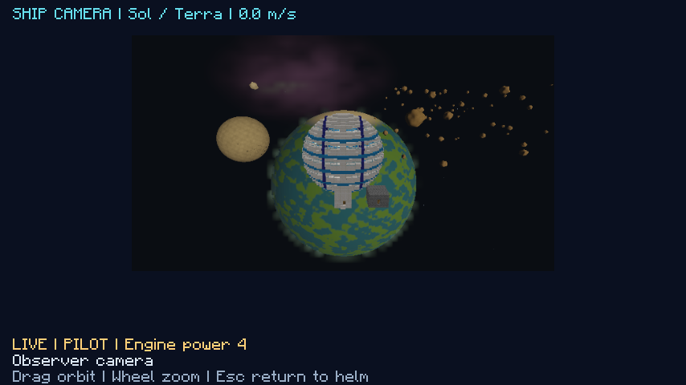

# Ship cameras, local flight, and helm navigation

Ships have a simulated pose and velocity inside a named local space. Their hull blocks, rooms, cargo, and crew stay in their existing axis-aligned storage slot in the shared `nullspace:space` dimension. Moving or rotating the simulated ship changes its observer-relative surroundings, third-person image, and combat coordinates.

## Using the helm

Launch normally, then right-click the helm or legacy ship computer. The existing inspection, launch, landing-pad, engineering, and weapon actions remain available. The bottom three actions are:

- **Pilot ship** opens the external ship camera and acquires exclusive flight control.
- **Ship camera** opens an independent observer camera without acquiring control. Another crew member can use it while the pilot flies.
- **Navigation** opens an 80-column destination menu. Select a planet with arrows and Enter to begin fast travel. Escape returns to the cabin.

| Input | Action |
| --- | --- |
| W / S | Forward / reverse thrust toward the bridge's forward direction (opposite the panel face) |
| A / D | Yaw left / right |
| Up / Down | Pitch nose up / down |
| Q / E | Roll left / right |
| Space / Ctrl | Ship-relative vertical thrust |
| R | Brake |
| F | Fire the mounted weapon using its existing power and cooldown rules |
| Mouse drag | Orbit the third-person camera independently of steering |
| Mouse wheel | Zoom |
| H | Toggle the controls overlay |
| Escape | Release controls and return to the cabin |

The chase camera starts behind the bridge's forward direction, aims at the connected hull's bounds, and chooses its distance from the hull size. It supplies a modest camera fill light so an unlit hull remains readable; this changes camera presentation only, without changing world light or equipment power. It renders ordinary textured ship blocks and crew through the existing independent scene renderer, with the same compute-rendered celestial surfaces and gas as cockpit and monitor views.

Pilot and observer cameras fill the screen with aspect-correct targets and compact status overlays. Press **H** for controls. See the [visual-fix record](visual-polish-2026-10-25.md) for the fullscreen capture.

## Local flight

The server integrates flight at 20 Hz. Inputs are bounded button masks tied to the owning player, helm, ship, and random session token. Sequence numbers reject replays. Only one pilot can control a ship; observer views have no thrust authority. Leaving helm range, changing dimension, losing the helm, dying, disconnecting, missing heartbeats, or closing the screen releases control and stops the ship. Window focus loss clears held controls.

Translation uses normalized combined thrust, damping, a brake, and a power-dependent speed cap. Steering operates in ship-local axes, including a helm mounted facing any horizontal direction. Rotation preserves the storage cube's simulated center. Powered ships require delivered control and engine power and enabled engines with clear exhaust. Legacy ships retain their compatibility engine output. Power loss stops movement; the camera remains available and shows the reason. Flight stops while online crew are outside breathable cabins, including after a breach.

Local movement stays within an 8,192-block radius. Swept conservative bounds stop translation into explicit celestial bodies or another ship in the same local space. This is collision avoidance; generated asteroid-field instances are currently visual obstacles, and contact does not apply impact damage or rigid-body response. Weapon fire still traces actual hull geometry and explicit celestial shapes. Gravity, orbit integration, docking, and free EVA between ship frames remain separate work.

Authoritative scene snapshots advance at 10 Hz during piloting. All client views share bounded position/quaternion interpolation. Geometry arrays remain shared; pose changes do not rebake hull models. The motion cache is limited to 64 ship/region entries and clears on disconnect. Poses save periodically while piloting and when controls are released; a process crash may lose the latest unsaved flight movement. Opening controls or an observer camera without an active pilot clears stale saved velocity.

## Planets and systems

| System | Local spaces |
| --- | --- |
| Sol | Terra, Luna, Ares |
| Vega | Pelagos, Cinder |

Each destination has a stable server address and a persisted celestial definition with its own ID, seed, bodies, gas, asteroid field, and epoch. Existing saves without an address default to Sol / Terra. Local thrust never changes this address, even if the ship reaches the edge of the encounter space. Planet-to-planet and system-to-system changes require Navigation at the helm.

Ships in different regions can occupy identical simulated coordinates. Their storage slots remain distinct. Backgrounds, monitors, ship cameras, weapon targets, and native TNT blast fan-out filter by region. A bounded arrival search leaves clearance around ships and explicit bodies before choosing the new pose.

Fast travel validates the issued route, ship/cargo preflight, a sealed occupied cabin, powered propulsion, and recalled EVA crew. It rejects the current destination and unresolved queued combat impacts. It closes pilot leases, locks the hull and crew through the existing transit protections, and shows the loading screen to all online occupants.

After preparation acknowledgments, the server rechecks the ship and atomically saves its new region and arrival pose. It transfers no blocks or entities. A save failure restores the old metadata. The loading screen waits for the new definition and a prepared scene on each client before acknowledging arrival. Wrong-token and premature arrival acknowledgments cannot release the crew. Preparation timeout or pilot disconnect cancels before commit; a client that fails destination synchronization after commit must reconnect. Region jumps and physical launch/landing transactions serialize to keep whole-store recovery snapshots consistent.

The initial navigation feature used Terra landing pads only. [Planet surfaces](planet-computers-and-rendering.md#planet-surfaces-and-travel) now add four native flat terrain dimensions and starter landing sites. Jump to a pad's planet before landing there; existing overworld pads belong to **Sol / Terra**. Fuel costs, unlocks and route progression remain separate work. Jump arrival resets simulated orientation and velocity; player facing, block facing, and physical crew positions stay intact.

## Verification

`FlightDynamicsTest` covers every helm facing, steering direction, diagonal thrust, speed bounds, opposing inputs, braking, power loss, invalid inputs, and repeated rotations. Terminal tests cover the flight actions and stable route selection. Native navigation tests cover persisted region definitions, session catalog validation, arrival placement, exclusive ownership, stolen/replayed input, and stopping on release.

`NavigationClientGameTest` drives the real typed terminal and input packets, checks simulated movement with stationary physical crew, opens the observer camera, and performs Terra ? Luna ? Vega/Pelagos ? Terra with destination-scene readiness. The local two-client harness adds exclusive piloting, a simultaneous crew camera, stale-velocity recovery, and shared-region round trips before its existing offline landing and engineering scenarios.

Verified: 98 unit tests, 40 server tests, nine graphical test classes, and the two-client loopback scenario passed. See [local verification](local-verification.md) and the [verification manifest](navigation-verification.json).

The [flight view](images/ship-flight.png), [orbit view](images/ship-camera-orbit.png), and [helm navigation menu](images/helm-navigation.png) are captures from the graphical regression.

## Proposed encounters and docking

The [encounters and docking proposal](space-encounters-and-docking.md) adds persistent sensor contacts, generated stations/ships/wrecks, assisted port capture and real boarding. Accepted initial behavior uses short airlock transfers and exploration encounters. These features are not implemented yet. The proposal keeps local approach, region jumps and physical hull storage as separate operations, and specifies docking collision, pressure, multiplayer and recovery checks.
