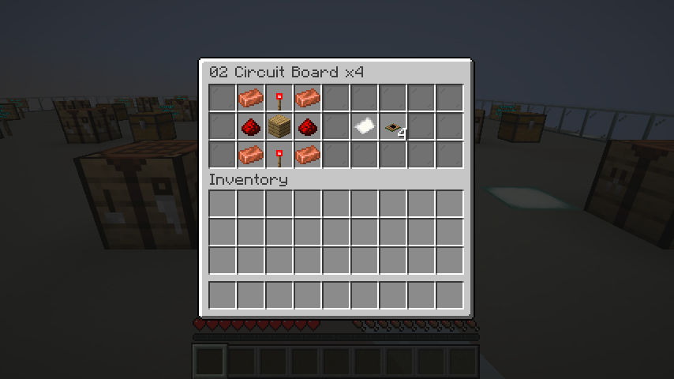

# Ship recipes

**Implemented. All twenty-four recipes use native shaped crafting and recipe-book unlocks.**

The [in-game field guide](in-game-guide.md) contains these patterns and feature instructions. Obtain it with `/nullspace guide`, or craft a normal book above a copper ingot in a vertical two-slot pattern.

Use shaped recipes and a small set of shared components. Building a computer should involve electronics, a housing, and then the controls for its job. Keep the ingredients obtainable through ordinary mining and wood gathering: iron, copper, redstone, glass, cobble, and planks.

## Crafting rules

- All recipes below are shaped crafting-table recipes. Each pattern is shown from top to bottom. A slash separates rows; a dot is an empty slot.
- Use normal horizontal recipe mirroring. Rotating a pattern is not another valid arrangement.
- Every recipe makes one item unless an output count is shown.
- Iron and copper mean ingots. Glass means ordinary full glass blocks.
- `W` accepts any vanilla planks, including mixed wood types in one recipe.
- `S` accepts cobblestone or cobbled deepslate, including mixtures. This applies to our recipes; native piston and lever recipes still require actual cobblestone.
- Use the existing vanilla recipes for redstone torches, pistons, furnaces, levers, and dispensers. Crafting these parts is part of the cost.
- Unlock raw-material recipes when the player gets their main material, and component-based recipes when they obtain the relevant component. Use the recipe book to show the patterns.
- No custom ores, new workstations, or rare Nether/End materials are required for this first set.

| Symbol | Ingredient | Symbol | Ingredient |
| --- | --- | --- | --- |
| `I` | Iron ingot | `C` | Copper ingot |
| `G` | Glass block | `W` | Planks |
| `S` | Cobble / cobbled deepslate | `R` | Redstone dust |
| `T` | Redstone torch | `B` | Circuit board |
| `H` | Machine casing | `K` | Computer base block |
| `P` | Ordinary piston | `F` | Furnace |
| `L` | Lever | `D` | Dispenser |

## Shared components

### Machine casing — one casing

```text
I C I
C . C
I C I
```

Four iron and four copper form the housing. This is a crafting item used by computers and machines. It is not a required hull material or an installed power-bus block.

### Circuit board — four boards

```text
C T C
R W R
C T C
```

Four copper, two redstone torches, two redstone dust, and one plank make four boards. The batch output keeps outfitting several rooms reasonable. Use real redstone torches as ingredients; they are consumed during crafting.

### Computer base — one block

```text
G G G
B H B
C T C
```

Three glass, two boards, one casing, two copper, and one redstone torch make the shared computer base block (`nullspace:computer_base`). This is the starting point for Pad Computers and Ship Controllers.

The base is a placeable, unconfigured computer chassis. Its tooltip and right-click message explain that it must be crafted into a controller. It does not count as an active ship controller, register a pad, supply power, or run an operating system. Crafting a specialized controller gives it its current role. This block is distinct from the existing ship computer, so existing ships retain their working controller.

The other new crafting items are `nullspace:machine_casing` and `nullspace:circuit_board`. These three shared components are enough for this pass; individual resistors, wire items, and processors are not required.

## Computers and displays

Each table pattern is the same 3 x 3 grid shown above, written as three rows separated by slashes.

| Part | Pattern | Construction and use |
| --- | --- | --- |
| Pad computer | `WWW / CKC / STS` | Wood desk, computer base, copper connections, stone feet, and a redstone torch. Register and name the pad. |
| Ship computer | `WGW / CKC / WTW` | Wood console around the same computer base. Unified Ship Controller for flight, travel, docking and engineering. |
| Ship beacon | `GTG / CKC / SHS` | Ground controller that calls a free preset ship onto a registered, empty pad. Keep its pad computer too. See [ship beacons and the shipyard](shipyard.md). |
| Camera | `IGI / CBC / .H.` | Glass lens, circuit board, copper connections, and a casing. |
| Monitor | `GGG / GBG / CHC` | Five glass blocks around a display board, mounted on a casing with copper connections. |

Install exactly one Ship Controller for travel. The pad computer stays on the ground. Cameras and monitors have their own boards and casings; they do not each need a complete computer base.

## Machinery

| Part | Pattern | Construction and use |
| --- | --- | --- |
| Engine | `IPI / CHC / SFS` | Piston drive and furnace exhaust built into a casing. |
| Generator | `ITI / CFC / SHS` | Furnace core, redstone ignition, copper connections, and casing. |
| Battery | `CRC / CHC / IRI` | Copper cells and redstone around the casing. Starts empty. |
| Air supply | `IGI / CPC / BHB` | Piston pump, glass gauge, and two control boards. |
| Ship cannon | `III / PHP / CDC` | Iron barrel, two pistons, and a dispenser in a casing. |

Engine and generator share furnace fuel stored inside connected generators. The dispenser in the cannon recipe does not add an ammunition inventory.

## Stations and docking

These three recipes add directly to the same crafting chain. See [stations and automatic docking](stations.md) for construction and airlock placement.

| Part | Pattern | Construction and use |
| --- | --- | --- |
| Station Core | `XXX / BKB / XXX` | `X` means iron block. Deploys the construction platform directly in space. |
| Station Module Kit | `IGI / BHB / IGI` | Builds one room; assembling a generated section uses four kits. |
| Docking Base | `III / CDC / III` | Here `C` means circuit board and `D` means any wooden door. Install in the floor directly below the dock door. |

## Space suit

Use shaped armor-like patterns with copper fittings, a glass visor, and a control board in the chestplate. Craft the pieces directly; an existing armor set is not an ingredient.

| Piece | Pattern | Ingredients |
| --- | --- | --- |
| Space helmet | `III / IGI / .C.` | 5 iron + 1 glass + 1 copper |
| Space suit chestplate | `I.I / ICI / IBI` | 6 iron + 1 copper + 1 board |
| Space leggings | `ICI / I.I / I.I` | 6 iron + 1 copper |
| Space boots | `I.I / C.C / ...` | 2 iron + 2 copper |
| **Full set** | | **19 iron + 5 copper + 1 glass + 1 board** |

All four pieces are still required for suit protection. The chestplate electronics do not add portable oxygen storage: current EVA still depends on the ship's working air source and tether rules.

## Building materials

Use ordinary Minecraft blocks and their existing recipes for the ship itself:

| Build | Materials |
| --- | --- |
| Cheap hull and floors | Full cobble, stone, or wood plank blocks. |
| Metal hull | Full iron or copper blocks when the player wants to spend more. Metal hulls are optional. |
| Windows | Full glass blocks. |
| Doors and airlocks | Ordinary wooden or iron doors in complete, sealed frames. |
| Stairs and fittings | Vanilla stairs, slabs, buttons, levers, signs, chests, and barrels. |
| Landing pad | Keep the existing pad layout and supported floor rules, including grass turning into dirt. |

No special hull block is required. Material choice keeps its ordinary block properties and explosion resistance. Stairs, slabs, panes, and fences remain fittings rather than pressure seals. Existing ship validation, build bounds, and transfer restrictions still apply.

## First powered ship

Craft one Pad Computer, one Ship Controller, one engine, one generator, an optional battery and one Air Supply. Use one Scanner with upgrade items for distant destinations.

| Raw ingredient | Starter including battery | Starter plus full suit |
| --- | ---: | ---: |
| Iron ingots | 34 | 53 |
| Copper ingots | 50 | 55 |
| Redstone dust | 17 | 17 |
| Glass blocks | 8 | 9 |
| Cobblestone | 30 | 30 |
| Planks | 21 | 21 |

These totals include native subrecipes and batch rounding. The starter leaves two circuit boards and three sticks; adding the suit uses one spare board. Add hull materials, a door, crafting table and generator fuel separately. A newly crafted battery and generator are empty. Load any furnace fuel by hand or hopper before flight. The ready controller initializes ship systems automatically.

### Universal System Upgrade

`ICI / CRC / ICI`: I = iron ingot, C = circuit board, R = redstone. One recipe makes one upgrade item. Engine, Generator, Battery and Scanner accept up to three of this same item in actual slots.

### Compact Docking Base

`III / CDC / III`: I = iron ingot, C = circuit board, D = any wooden door, including bamboo, crimson and warped. Place any standard door above the base, in a full frame. The installed door can be wooden or iron; no button, second door or connector is needed.

## Recipe chest gallery

Use **`/nullspace lab recipes`** in a development run to visit twenty-four labeled recipe chests. The annex is also added automatically when preparing `NullSpace-Dev` or `NullSpace-Lab`, including existing saves.

Each single chest shows the ingredient pattern in a 3 x 3 square on the left (columns 2-4), a paper arrow in the middle, and the actual output on the right. Empty pattern cells stay empty. Gray panes frame the grid; the chest title names the output and quantity. The circuit board chest shows four boards as its result. A crafting table stands beside each chest.



The displays read the server's loaded shaped recipes when first built; they do not maintain separate ingredient definitions. Example tag ingredients use oak planks and cobblestone. Samples are ordinary removable items. Revisiting does not refill chests, recreate removed blocks, or overwrite player edits. The gallery has its own saved marker and chooses a new clear site above terrain, outside registered pads. New galleries contain all twenty-four recipes; previously saved nineteen-, twenty-two-, or twenty-three-chest galleries retain their layout and edits. An interrupted build is reported and preserved rather than regenerated.

## Implementation and checks

The computer base block/item, machine casing item, and circuit board item are registered with distinct models and names. There are twenty-four native shaped recipes: three shared components, fourteen active equipment blocks, the upgrade item, station module kit, four suit pieces and field guide. Only the board recipe has a batch output. Ingredients use the vanilla planks item tag and a mod tag containing cobblestone and cobbled deepslate. Equipment and the computer base have self-drop loot tables and the pickaxe mining tag, so crafted machines can be recovered when mined. Battery charge is not created by crafting or replacing a block.

Recipe-book unlocks follow the crafting chain. Casings unlock on iron, boards on redstone, the computer base on boards, controller recipes on the computer base, machinery/display recipes on casings, and suit recipes on iron. These unlocks reveal recipes without adding mandatory progression flags.

Verify exact ingredient counts, outputs, mirrored patterns, required empty slots, and rejection of incorrect arrangements. Compare normalized and mirrored patterns against each other and native recipes. Check mixed plank/cobble inputs, the new base's exclusion from active-ship controller counts, and the shopping-list totals against actual recipe data. In a disposable survival world, craft the starter kit and suit, build and register a small ship, upgrade systems, charge the battery, then launch and land through the normal terminals without commands or creative inventory.

Fuel, real inventories, hopper automation and System Upgrades are implemented. See [fuel and power](ship-systems-redesign.md#fuel) for operation. Cannon ammunition, solar panels and fuel residues remain separate future decisions.


## Computers and scanners

These additions use the same shaped crafting and component progression.

| Part | Pattern | Additional symbol |
| --- | --- | --- |
| Computer Terminal | `GGG/BKB/CTC` | Existing symbols above |
| Local Scanner | `IGI/RKR/CTC` | Existing symbols above |
| System Upgrade | `ICI/CRC/ICI` | Three identical items reach Tier III |

The computer runs the [NullOS shell and scripts](nullos.md). Scanners use the cameras/sensors bus: installed enabled cameras occupy its first power slots, followed by enabled scanners sorted by position. Allocate another unit for each scanner you want online. The Scanner reports local contacts; installing its first System Upgrade enables distant destinations.
