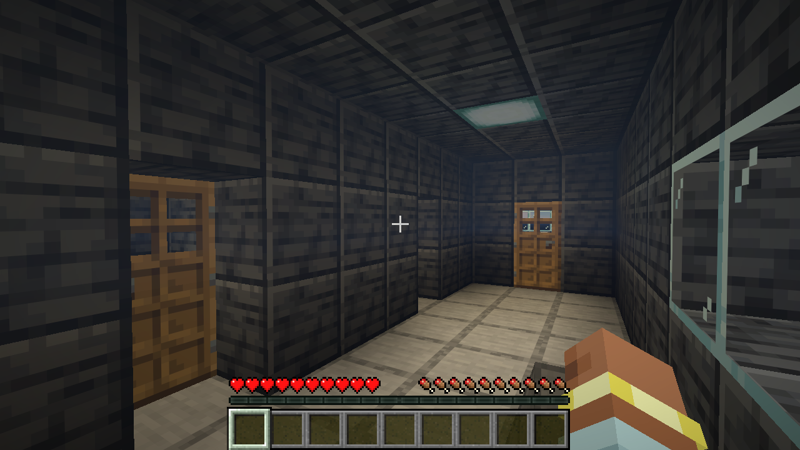

# Ship rooms and resources

Rooms should help the player decide where to go and what to look for. A ship needs recognizable places to live and work, with different sizes, furniture and walking routes. Finding a useful room should help with the next expedition.

## Implemented manufacturer interiors

This pass updates the nine manufacturer ships. The six original starter designs retain their existing layouts.

| Ship type | Interior |
| --- | --- |
| Rivet Ranger | Bridge, workshop, engineering, crew berth, galley and a reclamation bay with a smithing table and blast furnace. |
| Halcyon Horizon | Observation bridge, workshop, engineering, private crew cabin, galley and a survey lab with cartography table, books and lectern. |
| Bastion Pioneer | Command, workshop, engineering, crew quarters, galley and a sickbay with a bed and wash basin. |
| Rivet Hauler | Bridge, cargo hold, engineering, crew mess and a repair shop. |
| Halcyon Courier | Bridge, cargo hold, engineering, galley and a courier cabin. |
| Bastion Tender | Bridge, cargo hold, engineering, provisions room and a maintenance bay. |
| Bolt, Swift and Ward scouts | Retain their small bridge and shared rear compartment. Add recognizable work, food, fuel and sleeping nooks rather than squeezing in extra corridors. |

Explorer living rooms open onto a side aisle beside the stairwell. Their bridge entrance joins that aisle. Freighter side rooms flank a three-block cargo route; twenty cargo barrels remain accessible. Working doors, floor support, hull connections, air supplies and the existing stairway are part of the layout checks.

Beds, workstations and furniture are ordinary Minecraft blocks. The specialty rooms do not add passive research, healing or other new ship bonuses. Beds in the space dimension do not set spawn or sleep; they remain recognizable bunks and recoverable furniture.

## Search by room

Encounter supplies now use explicit room containers, replacing the old first-container reward pile. Their inventory titles identify the supplies.

| Place to search | Freighter encounter | Scout salvage encounter |
| --- | --- | --- |
| Engineering | 32 coal in a fuel locker. | 8 coal in a fuel locker. |
| Galley or provisions | 6 bread and 2–5 carrots. | 3 bread and 2–5 carrots. |
| Workshop or survey bench | 12 iron and an iron pickaxe. | 2 System Upgrades, 16 iron and 12 redstone. |
| Cargo | 8–16 copper and 4–8 glass. On the Courier, cargo also carries the repair supplies because it has a crew cabin in place of a workshop. | Equipment and hull blocks can still be salvaged. |
| Courier cabin | 3 white wool and 4–8 paper. | — |

Amounts within a range come from the saved encounter seed. Returning to the same site does not reroll or restock anything. Supplies are actual items: carry them home, feed coal into the generator, plant the carrots, or use the components to improve the ship. Normal delivered ships receive their normal starting provisions rather than encounter reward inventories.

An older site saved during construction retains its saved hull plan. If it lacks the new room lockers, its original reward goes into an existing container once. It is not rebuilt into the new layout.

The growing station retains its real wheat farm and gardening supplies. Encounter roles and route identities remain stable; this pass makes the existing ships more useful to explore.

## Player story to test

1. I notice that my generator is running low.
2. I investigate a freighter signal, dock and enter through the normal door.
3. I use my pickaxe to clear the blocked cargo entrance.
4. I find fuel beside the generators, then check the galley and workroom for food and parts.
5. I carry my finds home, load the coal and store the other supplies in the appropriate places.
6. I return later and find the same ship with my changes and empty lockers still present.

The guide's **Already on a ship** chapter teaches the room-search rule. Ship selection descriptions now name the interiors rather than only describing the exterior hull.

## Existing worlds

Restart `dev.ps1`, or update the server and clients. Newly delivered ships and newly constructed encounter sites use these interiors. Existing ships and visited sites keep their builds, inventories and player edits. Use a fresh delivery or an unvisited route to review the new layouts; a world reset is unnecessary.

## Verification

The [verification receipt](ship-rooms-verification.json) records a passing full suite of 526 unit tests, 177 mod server tests plus one native smoke test, and 24 graphical entrypoints. Follow-up checks cover the final older-plan supply fallback and corridor lighting, including another actual stair ascent/descent. The final source fingerprint matched the focused graphical run. Disposable test worlds were removed.

