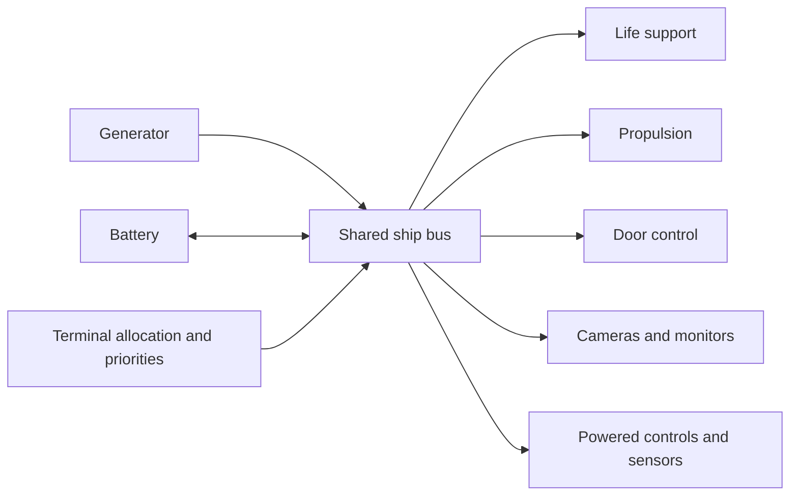
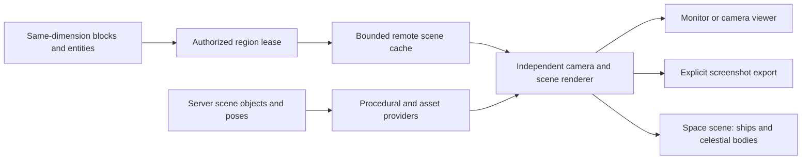

# Ship systems, power, and remote viewports

**Status: core systems and scene implementation is available. Shared power, finite atmosphere, the consolidated controller, real furnace fuel, upgrade inventories, compact docking, door commands, GPU cameras/monitors, celestial rendering, and mapped hull damage are implemented. The [current equipment reference](ship-block-ui-design.md) and [fuel rules](ship-systems-redesign.md) supersede older hardware proposals below.**

[Stations and automatic docking](stations.md) now implement the first station/boarding loop. The broader [encounter design](space-encounters-and-docking.md) and [rendering workshop](space-rendering-workshop.md) retain future work: random encounters, larger stations and the rendering edit loop.

The user selected a shared ship power bus with FTL-style allocation. The viewport system must support live camera monitors, other ships at simulated positions, and the space scene itself: stars, planets, moons, and other space objects. These share a scene/viewport service with different source providers. They have separate acceptance gates; none replaces the others.

This extends [the ship and space plan](ship-and-space-plan.md). It defines the system boundaries for finite oxygen, powered equipment, and simulated ship surroundings. Numerical capacities and update limits below are starting proposals for playtesting.

The [space compute renderer implementation](space-compute-renderer-plan.md) now supplies the default OpenGL 4.3 path: client-generated celestial surfaces, deterministic fields, atmospheres, nebulae, comet tails, per-view acceleration/reconstruction, and native depth/transparency integration. Versioned definitions travel separately from ship geometry and pose/time updates. Physical hulls and players remain rasterized. The implementation record documents the legacy switch, GPU preference helper, verification, and native HDR/quality limits.

The [ship recipes](ship-recipes.md) implement shaped crafting using common materials, redstone torches, and native mechanical parts. Machine casings and circuit boards feed into a craftable computer base block, which is then crafted into a specialized controller. The unconfigured base does not count as an active ship controller. Hulls and fittings use ordinary vanilla materials. `/nullspace lab recipes` visits nineteen labeled chests showing the loaded ingredient patterns and outputs. Construction recipes are implemented; shared furnace fuel and upgrade inventories are implemented.

## Implementation record

The next resource-system proposal is [ship fuel, engines, generation, and batteries](ship-fuel-and-power-design.md). It separates combustible propulsion from electrical allocation, proposes clean/dirty fuel and reusable combustion products, and ends with decisions for critique. It is a design draft; generators now consume real furnace fuel for electrical work.

The [extended improvement record](improvement-pass-2026-10-23.md) documents the atmosphere benchmark, compressed/cached camera sources, regression tests, and engineering additions. Engineering now supports `rooms <page>`, `room here`, `air audit`, and `profile cruise|combat|emergency`. Readings remain available during a blackout and each player retains an independent live page. Presets respect physical hardware and device switches; power previews refresh immediately without spending battery energy. Construction displaces gas through newly filled volumes; filling an entire compartment with no surviving recipient removes its gas and records the loss, and reopening does not refill it.

The current equipment roles are:

| Block | Role |
| --- | --- |
| `nullspace:ship_computer` | Ship Controller: flight, destinations, launch, land, docking, weapons and Advanced engineering. Install exactly one. |
| `nullspace:camera` / `nullspace:monitor` | Camera source and video display. The display surface is separate from the 80 x 25 text terminal. |

Machines store real fuel and upgrades in block inventories. Stable device IDs, machine contents and ship resources travel through the durable transfer journal.

Right-click machinery for its native controls and inventory slots. Advanced opens an **80 x 25 diagnostic terminal**. Use arrows and Enter, or click an action. Inspection does not change equipment state. Readings update once per second, including during a control-power blackout; local enable/disable switches remain available. Unregistered and disconnected equipment explain the setup or connection required instead of silently ignoring clicks.

Interfaces share a navy background, colored role headers, highlighted selection/input fields, and semantic status colors: green for healthy, amber for caution/partial power, red for faults/leaks, gold for power controls, and cyan for navigation/cameras. Oxygen percentages, battery charge, and power delivery carry individual colors for quick scanning. Text labels accompany each state. Camera and transit screens use the same palette; [terminal.md](terminal.md) records the display thresholds.

| Equipment | Readings and actions |
| --- | --- |
| Generator | Fuel slots, return slot, output, supply switch, upgrade slots and Advanced diagnostics. Generation consumes furnace fuel from its hopper-accessible inventory. |
| Battery | This battery's stored energy/capacity and charge/discharge limit, enable/disable, and **Manual restart**. A restart creates no energy. |
| Air supply | Pump power, room oxygen and leaks, outlet warnings, enable/disable, and air allocation. |
| Engine | Exhaust direction, fuel and power readiness, enable/disable, upgrade slots and Advanced diagnostics. |
| Ship Controller: doors | Door count, open count, queue progress/results, door allocation, **Close all doors**, and **Open all doors**. |
| Camera | Source direction, feed/power status, enable/disable, camera allocation, and **View feed** for this camera. |
| Monitor | Selected source and feed/power status, enable/disable, **Next camera** to change its placed display, and **View feed** for fullscreen video. |
| Cannon | Muzzle clearance, recharge, delivered/requested power, enable/disable, and weapon allocation. Fire remains a ship controller action. |

Allocation changes require powered controls and cycle the subsystem's ship-wide request through 0-8. Local switches affect only the selected device. Equipment menus cannot issue ship controller or general engineering commands. Sessions bind actions to the player, block type, dimension, range, and current configuration revision. Door batches retain the existing cancellation rules when their terminal closes.

Local panels show the block name once in the header and a short set of operational readings. Coordinates, device/ship UUIDs, repeated names, the color legend, repeated action descriptions, and tutorial paragraphs are omitted. Full equipment IDs/positions remain available through engineering diagnostics when needed.

Vacuum flight allows stable walking after landing on solid ground. Suit/creative flight permission remains available outside a cabin, and becoming airborne automatically activates flight; returning to a breathable cabin restores ordinary gravity. This respects Minecraft's client landing behavior instead of repeatedly forcing flight back on while grounded.

Powered survival reads the cached finite-air state directly, and power/air accounting visits the cached equipment list. Camera membership reuses the same invalidated topology cache. Metadata has one periodic save rather than duplicate gzip/fsync work on the same tick. Scene views share immutable packet arrays, cache stars/body meshes, reuse unchanged GPU images, and cache terminal output until its contents/input change. Background projection includes native view bobbing/hurt effects. These remove identified repeated work; they are not a measured frame-time guarantee for every world.

Placed monitor faces use Minecraft's actual world projection, including view bobbing, hurt tilt, and portal effects, with a small physical separation from the block face. Normal depth testing still lets hull blocks occlude the image.

The engineering application has live power/room readings, arrow-key actions, and an editable command field. Reading updates use a separate session-bound packet that cannot reopen a closed terminal. Static diagnostic pages and typed commands are preserved. Typing focuses the command; Enter selects Execute and Enter runs it. `help` lists the commands. Requested power is 0-8; actual delivery is capped by hardware and supply.

```text
power controls 1
power air 2
power doors 1
power engines 3
power cameras 2
power weapons 2
order 0 1 2 3 4 5
supply off
devices
device <8-character-id> off
doors list
group lock add <door-id>
doors lock close
doors <door-id> open
doors all close
```

Priority numbers are controls 0, air 1, doors 2, engines 3, cameras 4, weapons 5. Use each once. `devices 1` reads the next page of device identities, conditions, and stored energy; `groups` lists groups and `group lock delete` removes one. Groups contain stable door IDs; replacing a door does not transfer its group membership. Closing a terminal cancels its unfinished door work. After a blackout, right-click an installed generator or charged battery and select **Manual restart** to re-enable supply and restore a control-power reservation. Reading local diagnostics remains possible without control power.

New development fixtures are **plots 23 and 24**, two powered Meridian spheres. Use `/nullspace lab systems` or `/nullspace lab plot 24`. The ship controller and a systems terminal are on deck 3; supply, air, door hardware, another systems terminal, and monitors are on deck 1. Their fixed simulated positions are 180 blocks apart and their cannons face one another. Launch both real ships to see both in space. Operators can set their current ship's simulated pose with `/nullspace scene pose <x> <y> <z> <yaw> <pitch> <roll>`; this changes the rendered/combat frame and preserves real blocks and crew coordinates. Camera orientation is its lens face; right-click a monitor and select **View feed** for fullscreen viewing. Tab selects a camera, arrow keys aim, PgUp/PgDn change field of view, and F2 exports a PNG. **Next camera** in the monitor terminal cycles its placed display. A camera's own View feed stays pinned to that camera. Original plots and existing builds are not retrofitted.

Implemented rules and starting limits:

- Systems enforcement is opt-in through **Upgrade systems**, requiring a connected generator and air supply. Identity and diagnostics work before strict travel validation. A ship whose systems are not set up has no air: crew need suits until a generator and an Air Supply are connected and set up.
- Each development generator supplies 8 power units/tick. Batteries store 1,200 energy with charge/discharge limits of 4 per tick; new batteries start empty. Fuel recipes remain separate balance work. Disabled/destroyed/detached devices cannot supply power. Replacing a destroyed battery does not restore its charge.
- Atmosphere uses conserved per-cell quantities, bounded connected rooms, a 25% breathability threshold, powered pumps, occupant consumption, gradual vacuum leakage, and consumption from tether oxygen sources. Open planetary rooms refill from ambient air. Unattended ships pause; observing them through a camera does not run their machinery.
- Installed framed doors are queued one per tick under the delivered door budget. Individual, group, open-all, and close-all operations read back the real result, respect redstone override, and cancel on power/controller/session loss or transfer.
- Server snapshots contain block states and light values, without inventories. Each delivered camera unit services one enabled physical camera in a stable position order; unfunded channels report no power. Monitors share the funded feed without additional per-viewer energy charges. Bounded source snapshots persist across capture intervals until actual block/light/readiness changes invalidate them. Palette/nibble encoding reduces wire volume; frames remain self-contained. Server source caches and shared client decoded-volume caches have 64-entry limits. Clients cache native static block meshes and render independent GPU color/depth targets. Fullscreen feeds are 640 x 360; up to two nearby placed monitors use 320 x 180 targets. No live CPU image readback is used. Monitors inside a captured scene remain ordinary block surfaces, preventing recursive video.
- Camera feeds also render players, including the viewer's full body in first person, using an independent native player-render submission and reverse-depth target. Native skins, clothing, armor and held items are available for players already tracked by the client. Sources include bounded player poses and worn item types for players outside normal entity tracking; those use player-list skins and basic worn gear, with pose updates at source snapshot rate. Each source and render submission is capped at 32 players. Invisible players and spectators are excluded. No fake entities are created, no remote gameplay ticking is requested, and the main camera/entity list stays unchanged. Fixed-camera player animation is capped at client tick rate; aiming or observer movement still invalidates the view immediately.
- Feeds refresh at 20 server ticks, contain at most four subjects, use expiring non-ticking FULL tickets for bounded source chunks, and never change the player's chunk center. Lost-power/loading/stale states clear the fullscreen image; unavailable installed displays go dark. The operator-only `/nullspace viewport <x> <y> <z>` opens a bounded arbitrary same-dimension source using the player's look direction.
- The shared space scene composes actual distant ship geometry at independent double-precision positions/quaternion orientations, seeded stars, finite sun/planet/moon/asteroid meshes, and catalog-based sun lighting. The local hull uses native rendering; remote geometry is composed with converted depth. EVA retains the owning ship's observer frame. New physical slots are 4,096 blocks apart with bounded reservations; occupied legacy slots stay put. Unrelated physical sections/entities are filtered out of the main view.
- The first cannon is a powered, server-resolved ray with a 40-tick cooldown. Rays test actual hull collision shapes in each ship's local frame; finite celestial spheres occlude shots. Mapped explosions mutate real target blocks and restrict their block damage to that ship's bounds. Ordinary space TNT/creeper blasts fan out to simulated-nearby ships without recursive forwarding. Quarantined targets retain pending impacts against stable ship IDs. The prototype limits each shot to 128 geometry queries after ray/body culling and its arrival queue to 128 impacts. Distant unrelated ships do not exhaust the shot budget, and hulls behind the first hit are not queried. A full queue rejects cannon fire before firing; excessive native blast forwarding reports rejection rather than crashing the server. Burst-overload behavior still needs dedicated acceptance coverage.

Remaining acceptance work is explicit:

- **V1/V2:** non-player animated entities and special block-entity visuals (including sign text and chest models) are not yet captured. Players are rendered; untracked-player equipment currently retains item types rather than all custom item components, and its pose updates at snapshot rate. Static block materials and glass render; full native lighting, source deltas, adaptive refresh, permission leases for crew-operated remote cameras on *another* ship, and cache/LOD scheduling still need work. A gameplay camera currently belongs to its connected ship; arbitrary sources are operator-only.
- **V3/V4:** native transparency interleaving through several remote/local glass layers, two-observer visual assertions, body-size/occlusion regression fixtures, adaptive detail, and resource-reload stress still need acceptance coverage. Bodies currently have fixed poses and procedural materials; orbital movement, clouds, rings, and terrain mapping are not implemented.
- **S1/S4:** ambiguous wreck splits/merges need an explicit repair/claim workflow. A surviving ship controller anchors its connected bus. With no ship controller, the largest component containing supply/control hardware is serviced; equal-size ambiguous components remain offline. Oxygen consumption currently counts players, not every breathing mob. Gas displaced by construction remains conserved, including through thick new bulkheads and above nominal pressure. Full compartment removal explicitly records gas loss; reopening starts empty. Boundary, compartment-removal and seeded randomized remapping tests cover that rule in the [improvement record](improvement-pass-2026-10-23.md).
- **C1:** normal runtime transfer quarantine queues impacts, but combat damage and its receipts do not yet have a separate crash-atomic world/drop journal. Do not claim that accepted impacts are exactly once across a process halt. Two-client damage presentation, blast-during-arrival cases, and dedicated explosion crash injection remain acceptance work. Native bows/projectiles are not cross-frame weapons.
- **S5:** travel has powered readiness checks, but there is no continuous thrust, steering, or engine vector integration. Per-engine on/off is available through device control; throttle and flight dynamics remain separate work.

See [local verification](local-verification.md) for checks and [the gallery guide](test-gallery.md) for fixtures. The sections below preserve the intended behavior and gates rather than redefining missing acceptance cases as completed.

## 1. Ship identity and device membership

A ship has one stable ID, a bounded physical build, equipment, rooms, and its own simulation state. The computer is an interface to those systems. Destroying or depowering a controller must not erase stored energy, reset cabin air, or stop otherwise working life support.

Equipment joins the shared bus through membership in the connected ship structure. No power cables, voltage tiers, or conductive hull materials are required in the first version. A disconnected device loses ship-bus service. Its stored energy or fuel is retained according to that device's normal block/item rules; detaching and replacing it must not produce resources.

Separate bounded topology discovery from travel validation. A ship with an open door, damaged cabin, or missing engine still needs working controls and equipment diagnostics. The current `ShipScan.inspect` rejects those conditions, so it cannot be the only entry point for discovering systems.

Establish identity before first launch, while a controller recognizes a build on a registered pad. Reuse that ID through launch, landing, controller replacement, and recovery. A pad ID is a destination identity, not a ship identity. Replacing the controller inside the same recognized build must not create a fresh battery or fresh atmosphere. Ambiguous splits, merges, or competing controllers require an explicit repair/claim result; never silently merge ship inventories or energy.

Each real device has a stable device ID, type, ship-local position, enabled state, and current condition. Copies placed as new blocks receive new IDs. Device identities are reconciled against real blocks after edits and loads. Cached membership is not permission to power a missing or detached block.

Damage can leave the controller missing while the saved build still exists. Continue servicing validated surviving equipment inside that ship's bounded area. Keep detached equipment offline until membership is resolved; do not follow hull connections out into another ship or surrounding terrain.

## 2. Power model

The first bus has generation, battery storage, subsystem allocations, and device loads. The server owns all four.



| Term | Meaning |
| --- | --- |
| Generation | Available sustained output from enabled working generators. |
| Battery | Stored energy, with explicit capacity and charge/discharge limits. |
| Requested allocation | The maximum power the player assigns to a subsystem. |
| Delivered allocation | The amount actually available after supply, damage, and higher-priority allocations. |
| Actual draw | Energy consumed by the enabled work performed this tick. It cannot exceed the delivered allocation. |
| Hardware capacity | The upper allocation limit supported by installed working equipment. |

Use integer energy units and power units. One power unit supplies one energy unit per server tick; at normal tick speed this is 20 energy units per second. Display allocation as bars and battery charge as a percentage, with numerical details available in the terminal. Avoid calling these watts until the game has a reason for physical electrical units.

Players allocate to named subsystems through the terminal. Allocation reserves a share of the available output; it does not manufacture energy. Idle equipment may draw less than its reservation. Unused output can charge batteries, but is not silently assigned to a subsystem the player left unpowered.

### Allocation and energy accounting

1. Reconcile changed membership and device conditions. Disabled, missing, detached, or damaged equipment cannot contribute output.
2. Determine generation and usable battery discharge for this tick. Battery output is limited by both stored energy and its discharge rate.
3. Fund requested allocations in the saved priority order, capped by installed hardware. Use stable subsystem/device IDs to resolve ties.
4. Tick consumers against their delivered budgets. A subsystem reports its actual draw and output. Do not let a later consumer take energy already spent by another consumer.
5. Discharge storage only for actual demand beyond generation. Charge from the remaining generation, respecting capacity and charge-rate limits; curtail any remainder.
6. Publish one state revision containing generation, requests, delivery, actual draw, storage, and reasons for unavailable service.

The energy balance is `generated + discharged = consumed + charged + curtailed`. Charging and discharging the shared battery bank must not happen simultaneously in the same tick. Save fractional work progress explicitly where a device needs it; do not round an incomplete operation into free output.

On a brownout, shed lower-priority allocation deterministically. Preserve the player's requested settings so the terminal can show `REQUESTED 3 / DELIVERED 1`. Restore delivery as supply recovers. Do not erase priorities or require the crew to rebuild the configuration after every interruption.

Starting priorities are controls, life support, doors, propulsion, then cameras/sensors. Players can reorder them. The controls' physical display has a passive local diagnostic mode during a blackout; powered remote commands still require power. This lets players understand and repair a blackout without inventing an unlimited emergency generator.

Provide local manual supply controls on generator/battery hardware, including a way to restore a control-power reservation. Restarting a fueled generator or enabling a charged battery must not itself require the already-powered ship computer. An unpowered computer's diagnostic display does not execute arbitrary commands. Test recovery from a player deliberately allocating controls to zero as well as from an empty battery.

An illustrative test setup is an 8-unit generator, a battery with a 4-unit discharge limit, and requests of controls 1, life support 2, doors 1, propulsion 3, and cameras 1. Final capacities, fuel costs, and oxygen rates are balance work. A development supply can provide bounded test power without claiming to be the survival reactor/fuel design.

## 3. Systems and equipment

| Subsystem | Physical equipment | Powered behavior | Loss of power |
| --- | --- | --- | --- |
| Supply | Generator and battery blocks | Produce, charge, and discharge under the shared accounting rules. | Generation stops; storage retains its remaining energy. |
| Controls | Ship computer/control block | Accept authenticated system commands and expose live readings. | Local passive diagnostics remain readable; commands requiring service report no power. Other equipment continues independently. |
| Life support | Air-supply block | Add a bounded amount of breathable air to its connected room. | Replenishment stops. Existing room air remains and is consumed or lost normally. |
| Propulsion | Existing engine blocks | Supply enabled engine output within the granted budget. | Thrust/launch service stops. No stored allocation or stale command produces output. |
| Doors | Ship Controller plus recognized framed doors | Execute individual, group, open-all, and close-all commands. | Remote movement stops; doors retain their real state and local vanilla operation. |
| Cameras | Camera blocks and monitor hardware | Enable named feeds and monitor presentation. | Show no-power/stale status; never present the last image as a live feed. |
| Sensors | Ship sensor equipment | Supply contact identity and permitted diagnostics. | Enhanced contact data stops. A physically visible hull does not disappear merely because sensors lose power. |

Implement small handlers for these actual devices, rather than a general plugin or automation framework. Each reports identity, condition, supported commands, power request, actual draw, and output. The future computer can call the same command boundary without bypassing its validation; choosing a CPU, OS, or scripting language remains separate work.

Camera/monitor energy use follows enabled hardware and server simulation ticks. It is independent of client frame rate, screenshot resolution, or the number of viewers. Sharing a feed does not duplicate a physical camera's draw, and disconnecting every viewer does not secretly refund an enabled camera's operating cost. An explicit standby/disable state can reduce consumption.

### Engines

Track power and enabled/throttle state per engine, within the propulsion allocation. Its local thrust direction is opposite its exhaust. Later movement combines enabled engine outputs in the ship's simulated frame; Minecraft blocks remain stationary.

The current launch/landing effect is a discrete transfer. Give it an explicit powered readiness requirement when systems enforcement is enabled. Do not pretend that engine count already implements a thrust or orbital simulation. Meridian's opposed engines are useful for directional tests; firing opposed engines must not create fictitious net acceleration.

### Air

Rooms hold air quantity and volume. Life-support output is a consumer of delivered power, not an unconditional property of the computer. Air consumption, leaks, and door exchange are independent of power allocation; a blackout stops replenishment rather than instantly deleting a room's air.

Splitting or merging rooms conserves their existing air. Opening a door exchanges air; a breach drains it over time. A repaired seal stops loss and does not refill the room. Pumps replenish at their rated output. The terminal reports room level, source condition, and exposure.

Tether oxygen must draw from an actual supplied room/reserve under the same accounting rules. Keeping the current unlimited tether source would bypass finite life support. Define its consumption and source selection with the atmosphere implementation. Portable suit tanks are still a separate feature.

Keep the accepted movement policy explicit: the current prototype enables suit flight outside breathable cabins. Finite air introduces a breathability threshold; do not quietly add a powered gravity generator or a new gravity model while implementing power.

## 4. Door control and FTL-style commands

The powered Ship Controller manages the ship's recognized framed doors through the shared bus. Existing oak and iron doors remain usable. A door is one device identified by its lower half; both halves, frame, and current state are validated before an operation. An open but otherwise valid door remains discoverable as a controllable door.

The terminal supports a door list, individual commands, named groups, **Close all doors**, and **Open all doors**. Include the airlock and interior room doors. Group membership belongs to stable door IDs, so a moved or replaced door is not silently treated as its predecessor.

These are server commands with a result per door. They are not a client loop over arbitrary coordinates. Use bounded queued work when the delivered budget cannot move every door at once. Opening or closing one complete door has a defined energy/work cost. A command completes only after the actual world state has been read back.

Report `CLOSED`, `ALREADY CLOSED`, `NO POWER`, `REDSTONE OVERRIDE`, `MISSING/INVALID`, or `CANCELLED` as applicable. For a batch, show counts and failed door locations. Never report the whole ship sealed just because commands were sent.

Preserve local vanilla/redstone behavior. In particular, a door held open by a redstone signal reports an override to a close command. Do not continuously fight that signal or change its `POWERED` state to fabricate success. Manual operation after a close-all command is still possible. A persistent lockdown/override policy would be a separate command and decision.

Close-all is a one-shot operation, not an automatic safety interlock. It may close doors around crew using normal door behavior. Open-all can expose occupied rooms. No suit check prevents the player from making that choice. Power loss, transfer, controller/session loss, or target removal cancels unfinished commands visibly; they must not unexpectedly resume after power returns or the ship lands.

Recompute compartment connectivity after actual door-state changes, including manual and redstone changes. Closing all doors may restore seals; finite atmosphere still needs time to recover.

## 5. Controls, persistence, and multiplayer

Keep the 80 x 25 terminal as the interface. Add system summary, allocation/priority controls, door groups, camera selection, and room readings as terminal applications/pages. A graphical viewport is a separate display surface alongside the text terminal, not pixels squeezed into its character buffer. A monitor can show video while its configuration is controlled through the terminal.

Every command includes a current session/revision and a typed action. Validate the player or authorized onboard machine, ship membership, real device, dimension, access, transfer state, and power. Reject stale configuration edits explicitly. The bounded destination catalog retains the home pad first, then the most recently registered destinations; catalogs hold at most 128 entries and require reopening to refresh. Full paging remains future UI work. Two crew members receive the same authoritative result; packet ordering must not double-spend energy or execute a door command twice.

Persist ship ID, device IDs, allocations, priorities, enabled states, stored energy/fuel, atmosphere, and simulated pose. Keep block-local resources in their owned state and ship-wide state in ship metadata without duplicating either. Add explicit transfer support for the new block entities: the current allowlist only permits containers and signs. A system's state and resources must have exactly one authoritative copy through journal recovery.

Pause systems with the existing travel lock and snapshot their state consistently. A committed boarding/travel operation assigns a passenger to one ship and removes stale crew entries in other ships in the same journaled metadata update. Transfer/recovery cannot generate power, refill air, replay a command, or move resources between duplicate copies. Invalidate camera leases and queued commands when a source changes location; rebind stable identities only after commit.

The current game pauses unattended ship areas. Preserve that policy for this milestone; no offline air/fuel depletion or generation. Loading chunks for a camera does not, by itself, turn on unattended simulation. Changing this rule later requires an explicit offline-simulation design.

Version the save migration. Existing builds and gallery edits must survive. Systems enforcement remains disabled for an existing legacy ship until it is explicitly upgraded or a tested migration supplies its complete initial state. Do not silently insert equipment, fabricate repeated refills, or strand a legacy crew behind a newly imposed powered-landing requirement. New systems test fixtures use the new rules explicitly, with physical supply and consumer blocks. Retain the old fixtures as compatibility cases.

## 6. One shared dimension, two coordinate spaces

Use one `nullspace:space` dimension for all ships. This is already the current implementation. Each ship occupies a reserved physical region with ordinary axis-aligned blocks; it also has a separate simulated position, orientation, and later velocity.

| Space | What it controls |
| --- | --- |
| Storage coordinates | Actual blocks, local collision, entities, chunks, saves, and transfer destinations. |
| Ship-local coordinates | Equipment, rooms, crew offsets, and stable references that survive transfer. |
| Simulated coordinates | Where ships appear relative to one another and later how they move. |
| Camera coordinates | A particular observer's position, orientation, projection, and output image. |

Never move or rotate ship chunks to make the ship appear to turn. Render its surroundings from the observer ship's simulated frame. Crew on different ships can see different relative arrangements while sharing the same physical dimension.

The allocator now uses `slot * 4096` at Y=96, checks bounded reservations against occupied ships including legacy slots, and filters unrelated physical sections/entities out of the main view. Legacy `slot * 256` ships stay in place. Ordinary native subscriptions are still distance-based; explicit subscription filtering remains a hardening task for extreme server distances. A larger spacing alone is insufficient. Any future relocation must use the transfer journal rather than direct block rewriting.

The reserved region must include the build and the permitted EVA envelope. Tether checks, building limits, and transaction bounds remain based on physical ownership. Rendering a ship nearby does not make its actual blocks nearby.

Space objects share simulated coordinates with ships. A planet, moon, or star can have a simulated pose and visible extent without occupying a giant region of Minecraft blocks. A planet's optional link to a landing world/pads is separate from its space representation. Its appearance must not require loading planetary terrain just to look through a window.

## 7. Reusable remote viewport contract

A viewport renders a bounded scene from an independently specified camera pose. Source providers are a Minecraft region in the player's current dimension, an isolated ship, a procedural/asset space object, or a composed universe scene. Minecraft-region cameras remain same-dimension; rendering a planet model with a link to another world is not a cross-dimension terrain feed. Server policy determines which regions and scene objects a gameplay caller may observe.

```text
ViewportRequest
  source: world region, isolated subject, space object, or composed scene
  source identity: source ID, content revision; dimension/storage origin when applicable
  source bounds/mask or object extent: what this render is allowed to contain
  scene context: simulated reference frame, server time, permitted contributors
  camera: position + orientation, independent of the player entity
  projection: perspective or orthographic, FOV/extent, aspect, near/far
  output: width/height, world view or isolated transparent subject
  scheduling: requested refresh, priority, maximum acceptable frame age

ViewportFrame
  GPU color texture + coverage/alpha
  GPU depth texture + exact view/projection/depth convention
  source identity/revision + capture pose + capture time
  state: ready, loading, stale, unavailable, denied, or no power
```

Both camera pose and source extent are explicit. An external observer's camera may be far outside the target ship's hull; loading a region around that camera instead of around the subject would produce empty space. A celestial model has a known extent and representation, but does not need a Minecraft chunk subscription.

The output is a reusable render texture. A screenshot/export is an optional asynchronous readback of that texture. Do not encode PNGs, read pixels back to the CPU, write files, or upload them again on every live frame. A screenshot button may save an image deliberately; normal feeds and ship presentation stay on the GPU.

Consumers are in-world monitor surfaces, a full-screen camera viewer, explicit screenshot capture, and the observer's surrounding space scene. They share source providers and rendering. Windows/EVA, monitors, and screenshots must show the same celestial bodies and permitted ships from their respective camera poses. Power belongs to gameplay devices such as cameras and monitors; the rendering API itself does not invent a ship power requirement for seeing a planet or star.



## 8. Distant source acquisition

Being in the same dimension does not give a client every ship's chunks. The local 26.3 `ClientChunkCache` retains a player-centered region and rejects chunks outside its range. Do not recenter it for a remote feed or send distant chunks into it and assume they will remain available.

Add a bounded remote-scene cache keyed by source identity and section coordinates, separate from the player's normal chunk cache. A viewport acquires a server-authorized observation lease; multiple consumers can share one source subscription when their authorization and content requirements match.

World-region sources use that chunk/visual-data path. Space-object sources use a bounded scene catalog containing stable IDs, representation/asset references or seeds, poses, extents, and revisions. A composed scene combines both. Do not create dummy chunks or a fake planet dimension to make a procedural sphere fit the region-source interface.

For physical camera feeds, validate the real camera block, its ship/power state, and the viewer's control session. For visible ships, the server supplies allowed contacts using simulated positions and visibility policy. A developer viewport tool may select arbitrary same-dimension locations through operator-only validation. A client-supplied coordinate is never sufficient authorization for unrestricted world streaming.

The protocol supplies a bounded baseline and versioned block, light, visual block-entity, and entity updates. Send data needed for rendering, not inventories or arbitrary saved entity/block-entity payloads. Preserve visual entity identity and interpolate poses without spawning duplicate gameplay entities. Include signs, doors, containers' visible states, and player/mob presentation in the rendering acceptance tests.

A late packet from an old source revision, lease, transfer, or world cannot update a new viewport that reused its slot. Missing sections show a loading/unavailable result; they must not masquerade as a valid empty scene. Initial snapshots and deltas need a consistent revision barrier so an edit cannot be lost between them.

An active authorized lease may request a bounded region beyond normal player distance. Use expiring region loading with explicit ownership and cleanup. Establish which chunks can be loaded without independently requesting gameplay/entity ticking; verify this against 26.3 rather than relying on a generic force-load call. Cameras do not create fake players, move real players, duplicate entities, or silently turn paused machinery back on.

Release leases, source data, and GPU resources after closure, loss of access/power, dimension changes, disconnect, resource reload, or source removal/transfer. Apply per-player and server limits to regions, sections, entities, bandwidth, subscription rate, and lease lifetime. Renew only subscriptions that are still authorized and useful.

## 9. Rendering monitors, ships, and space objects

### Live camera/monitor

Place a camera, name it through controls, and select its feed on a monitor. Its position is ship-local; editing orientation/FOV changes the viewport rather than teleporting a player or requiring a dummy camera entity. A world-view feed renders the permitted environment with normal opaque background. A screenshot saves what that viewport captured, with a timestamp and source identity.

The local player camera, mouse targeting, movement, audio listener, HUD, and network chunk center stay unchanged. Render monitors during secondary captures using their previous completed frame or a placeholder, so two cameras looking at each other's monitors cannot recursively render forever. Never sample a texture while that same texture is being written.

### Other ships in space

A color screenshot on a flat quad is useful as a distant approximation. It does not by itself supply correct near-view perspective, occlusion, depth, or newly revealed surfaces when the observer moves. The shared service supports isolated subject capture with transparent background, matching view/projection, and depth-aware composition. Reuse source geometry while rendering from the current observer-relative camera.

Let storage origin be `O`, simulated ship position be `P`, and simulated orientation be quaternion `Q`. For the observer camera at storage position `C_A` aboard ship A, with local camera orientation `R_A`:

```text
virtual camera position     V = P_A + Q_A * (C_A - O_A)
virtual camera orientation  R = Q_A * R_A

camera for target ship B     C_B = O_B + inverse(Q_B) * (V - P_B)
camera orientation in B     R_B = inverse(Q_B) * R
```

Render B's actual subject region from `C_B, R_B`. That region's blocks remain axis aligned in storage. The simulated orientations determine their apparent rotation. Use the same simulated scale and a known projection, and composite the result into A's view.

Depth must be reconstructed using the capture's actual projection and converted into the observer's depth convention before testing against local geometry. Do not blindly compare depth textures from different near/far planes or assume a conventional OpenGL depth range. Preserve the native renderer's depth convention, transparency, and color-space handling. Transparent glass must not become an opaque rectangle around the captured ship.

A single resolved color/depth pair still cannot represent every transparent layer or correctly interleave multiple ships and local geometry through glass. Prove a shared opaque/depth pass followed by compatible transparent contributions, or render the cached subject geometry directly into the observer's scene for the near view. This is a rendering backend choice; the source cache, pose transforms, camera API, and axis-aligned physical ship do not change. Keep screenshot-based distant approximations labeled as such instead of claiming that one image is a complete 3D replacement.

Use camera-relative calculations and cull in simulated space before converting large position differences to GPU floats. Refresh when the source or relative view changes. A stale image is not a newly correct view after rotation; the scheduler must request a new capture or clearly degrade to a distant approximation. Moving observers must reveal the correct surfaces.

Only the selected subject, its permitted visible entities, and intended local effects enter an isolated capture. Do not capture a storage neighbor, the subject's storage sky/background, or another ship's already-composited surroundings. Composite simulated contacts once in the observer scene to avoid duplicate ships and recursive worlds.

Start with two actual ships whose simulated poses can be positioned and rotated through development controls. This proves the required rendering without waiting for engines, navigation, planets, or orbit integration. Different observers calculate their own view; do not share one global background offset or one angle-independent screenshot.

### Stars, planets, moons, and other space objects

The surrounding space scene is another required consumer of the viewport system. Give each relevant space object a stable scene ID, type, simulated position/orientation, extent or radius, visual representation, and revision. Optional fields include a parent body, spin/pose epoch, light emission, and a landing-world association. The server owns identities, poses, seeds, and time; clients derive the view and level of detail from that common state.

| Source | Space representation | Physical Minecraft source |
| --- | --- | --- |
| Ship or block-built station | Live cached blocks/entities, or a derived distant capture. | Its reserved same-dimension storage region. |
| Planet or moon | Mesh/procedural surface with material, optional clouds/atmosphere/rings, and a finite simulated radius. | None required for the space view; optional landing-world link. |
| Local sun/star | Finite emissive body/light source at a simulated position. | None required. |
| Distant stars | Seeded catalog rendered as a batched point field or cached environment representation at the appropriate distance tier. | None required. |
| Asteroid, debris, or other object | Mesh/asset/procedural source, or a block-region source when actual editable blocks are needed. | Chosen per object; not assumed for every object. |

All providers use the same observer pose and simulated scene. A procedural moon and a block-built station must agree on which side of a planet they occupy. A physical camera mounted on ship B renders the surroundings from B's simulated pose, even when its monitor is viewed aboard A. An isolated ship capture excludes that background; the final observer scene composes celestial objects and other ships once.

Preserve finite-body perspective, angular size, translation/parallax, and rotation. Planets and moons must get larger as the observer approaches and can occlude stars, ships, and one another. Only sufficiently distant stars may use a direction-based background approximation. Do not flatten all space objects into one decorative sky image attached to the storage coordinates.

Large distances need a scene-scale/depth strategy in addition to the camera-relative transforms. Retain simulation positions at sufficient precision, subtract the observer before GPU conversion, and use distance tiers or separate render passes where appropriate. Keep a coherent visibility/depth order across those tiers: a moon in front of a planet remains in front, a ship behind the planet stays hidden, and the player's own hull occludes the outside scene. Do not stretch the normal Minecraft near/far range until nearby cockpit geometry loses depth precision.

Use screen coverage to select mesh/texture detail, distant captures, and star batches. The shared viewport API does not imply one expensive offscreen world render per star or body. Compose/batch contributors into a scene pass where possible, reuse immutable geometry/materials, and invalidate cached captures when pose, lighting, appearance, or view changes. Transitions must preserve silhouette, apparent size, and scene identity.

Celestial surfaces use a consistent light direction and scene time so day/night appearance and visible phase agree between observers and monitors. Emissive stars, atmospheric/glass transparency, and rings need explicit composition rules; no opaque rectangular capture backgrounds. Directional lighting/shadows on ordinary ship blocks, solar-panel power, and environmental radiation/heat are separate gameplay/rendering extensions, not implied implementations of this first body renderer.

Start with server-authored fixed body poses and a deterministic distant-star seed. Spin or explicitly prescribed paths can use a shared server epoch. This does not require N-body gravity, orbit integration, complete solar-system generation, or continuous surface descent. A landing association identifies a body/world/pad relationship; matching a generated terrain surface to a particular orbit-view pixel and seamless approach/landing need a later mapping design.

Rendering a body does not create native block collision. Finite solid bodies need explicit server collision/occlusion proxies when C1 weapon queries include them, so a weapon cannot shoot through a visually blocking planet. Surface impacts and damage to a planet's landing terrain are not automatically provided by that proxy. Boarding, landing, and entering an asteroid's editable block region likewise need their explicit gameplay transitions.

### Interaction boundary

A rendered ship has no local Minecraft collision or hit targets at its apparent location. Showing it nearby does not permit vanilla block interaction or walking across a gap. Automatic docking and checked airlock transfers provide boarding through the [station service](stations.md). Camera viewing and screenshots do not transfer ownership or authorize remote block edits. Ship-to-ship weapon hits require the server-owned mapping below; an ordinary vanilla projectile in the observer's storage region cannot automatically strike the rendered target.

### Combat, explosions, and physical hull damage

Ship damage and explosive ship-to-ship combat are required extensions of this design. Actual blocks remain the damage model: an impact destroys or damages real hull/equipment, and the resulting geometry drives atmosphere and system membership. A single abstract ship-health bar must not replace breaches, damaged doors, destroyed machines, and isolated rooms.

Today, ordinary local TNT explosions can destroy blocks and damage entities beside a ship, subject to the native explosion rules and block resistance. Outside transfer quarantine, there is no blanket explosion protection on a ship. If a blast makes a continuous opening to vacuum, current binary pressure exposes that connected compartment immediately; a closed room stays sealed only if its hull, door, and complete door frame survive. A thick or resistant hull may absorb a blast without an air leak. Current transfer inspection rejects both TNT blocks and unsupported primed explosives, so this is not permission to launch with live TNT aboard. TNT placed after arrival is still constrained by the existing build bounds.

In the implemented finite-air model, the same breach drains the affected room over time. Destroying generators, batteries, engines, cameras, or door hardware removes their actual output/service. Reconcile equipment and compartment geometry after the explosion's block mutations, not just after player edits. Surviving bulkheads remain useful. A damaged ship can exist as a persistent wreck even when it no longer passes travel inspection or has lost its computer. Repair/diagnostics must remain possible. Disconnected fragments do not acquire drifting rigid-body physics automatically; their ownership, power loss, visibility, and later salvage/cleanup need explicit handling.

For a ship-to-ship weapon, resolve the projectile/ray and hit on the server in simulated coordinates. Use a bounded broad phase over ship poses, then transform the candidate ray into each target's local coordinates and test actual authoritative geometry. Do not use a flat rendered image or client-reported screen pixel as the authoritative collision shape. First version support can use rays and server-simulated projectiles; integrating ordinary bows/arrows into that mechanism is a separate adapter.

For target B, a simulated hit at `H` maps to physical storage position `O_B + inverse(Q_B) * (H - P_B)`. Apply the resulting local damage/explosion through the server's block/entity damage path, with weapon/attacker attribution. Broadcast the resulting real block, equipment, atmosphere, and visual updates. All observers then see the same damaged ship through their viewport caches.

An area explosion can affect several simulated-nearby ships even though their storage regions are far apart. Resolve affected ships in simulated space and apply bounded local effects once per affected ship/entity. Never let a local storage-region blast accidentally damage an unrelated storage neighbor, and never recursively forward the same explosion between frames. Give each damage event an identity and retain attribution/deduplication across its local applications. Local TNT and creeper explosions need the same frame-aware fan-out when cross-ship blast effects are enabled.

Order combat impacts with transfer commits. An accepted impact cannot silently disappear because transfer quarantine temporarily rejected block mutation. Validate it before snapshotting or retain it against stable ship identity for ordered resolution; a stale event cannot damage whichever ship later occupies a reused storage slot. Define and test the combat/escape rule before enabling inter-ship weapons.

Add acceptance cases for real TNT detonating against a hull, a nonpenetrating blast, one vented room with an adjacent intact room, damaged door frames, destroyed power/control equipment, and surviving wrecks. Cross-frame tests need two ships far apart in storage but close in simulation: hits must damage the intended real blocks once, update both viewers, respect hull occlusion, and leave a physically nearby but simulated-distant storage neighbor untouched. Include a blast during travel preparation and recovery without duplicated damage, resources, or drops.

## 10. Rendering implementation constraints

Use the game's Blaze3D render targets and 26.3 RenderPearl pipeline/buffer APIs, and respect extraction versus drawing. Fabric's [rendering concepts](https://docs.fabricmc.net/develop/rendering/basic-concepts) and [world rendering guide](https://docs.fabricmc.net/develop/rendering/world) describe that separation and the backend abstraction. Their current examples target 26.2; the [26.3 porting notes](https://fabricmc.net/2026/09/15/263.html) and pinned local sources determine exact integration points.

Local source review shows that 26.3 `GameRenderer` owns the main target/camera/state and `LevelRenderer` maintains view-area, occlusion, sorting, and frame resources. Calling the main render method again with a changed position is not an isolated secondary renderer. The technical spike must establish a separate extraction state, culling/section visibility, render target, projection, and resource lifetime for each active secondary view. Share only resources whose lifecycle permits it.

Use a scoped secondary scene renderer over source providers. The block-region provider reads the remote cache; celestial providers supply geometry/materials and scene metadata. Reuse vanilla/Fabric models and rendering facilities where compatible; verify support for entities and visual block entities rather than promising that every renderer works with a new world cache unchanged. Read gameplay data during extraction and render the resulting state. Main-world mutation during drawing is forbidden.

Begin with bounded source regions and resolution/refresh caps, then measure. Candidate initial limits are two live monitor feeds at 320 x 180 and up to four visible ship subjects with distance-based resolution. Set a GPU-time/memory budget and schedule work within it. Refresh only visible/actively requested consumers; allow explicit low-refresh monitoring. Geometry/content caches and per-observer view captures have different invalidation rules.

Measure the cost of two populated Meridian-size ships, transparent windows, moving entities, and multiple observers. A reusable viewport service is required; rendering the whole dimension once per monitor is not an acceptable scaling strategy. Distant lower-detail captures can be added after the correct near-view path works.

Include a planet/moon pair, a local sun, and a populated distant-star field in performance checks. Budgets apply to the complete scene, not just to each ship feed in isolation. Celestial viewing must not force-load planetary terrain or allocate a chunk region per star.

## 11. Implementation sequence and gates

These are completion gates. The implementation record above distinguishes implemented behavior from outstanding acceptance work.

| Step | Deliverable | Required gate |
| --- | --- | --- |
| S1 | Stable prelaunch ship/device identity and discovery independent of travel validation. | Open doors, missing engines, damaged rooms, and a replaced controller remain diagnosable without resetting state; detached devices lose membership. |
| S2 | Generator, battery, shared allocation, passive diagnostics, and terminal system page. | Energy conservation, deterministic brownouts, allocation changes from two clients, save/load, and no resource duplication through detach or transfer. |
| S3 | Controller door functions and individual/group/all commands. | Close Meridian's ten room doors and both airlock doors; handle power loss, partial budget, redstone override, removal, stale requests, transfer cancellation, and real pressure updates. |
| V1 | Independent bounded same-dimension viewport into a GPU texture, with screenshot export. | Secondary rendering leaves the main view/input/audio unchanged; opaque blocks, glass, lights, signs, and moving entities render; multiple views and recursive monitor views remain bounded. |
| V2 | Authorized distant-source subscription/cache and placed cameras/monitors using S2 power. | Feed works beyond both normal player chunk ranges on a dedicated server; live edits appear, stale packets are rejected, power/access loss is visible, and leases/resources clean up. |
| V3 | Two real ships in shared space, independent simulated poses, and depth-aware subject composition. | Ships appear at chosen virtual positions/orientations while storage blocks/chunk axes stay unchanged; correct perspective and occlusion from two different observers, no storage-neighbor leaks or recursive scenery. |
| V4 | Shared space scene with a star field, finite sun, planet, moon, and another representative object. | Bodies appear consistently through windows/EVA, monitors, and screenshots; correct relative pose, angular size, parallax, occlusion, lighting phase, and detail transitions from two observers, independent of storage slot. No planetary chunk loads or per-star world renders. |
| C1 | Server-owned cross-frame weapon hits and explosions using physical hull damage. | Real local TNT damage, compartment isolation and equipment loss; simulated hits map to the correct storage blocks, finite solid bodies block weapon queries, blast fan-out is bounded/deduplicated, visual updates agree for two clients, and transfer ordering cannot erase or duplicate an accepted impact. |
| S4 | Finite atmosphere, powered air supply, and tether consumption. | Room merge/split conserves air, door exchange and leaks drain it, blackout stops refill only, and saves/travel/recovery preserve quantities. |
| S5 | Powered propulsion readiness and system-enforced launch/landing; explicit upgrade path. | No unpowered launch or stale output in upgraded ships; compatibility fixtures and existing user builds remain recoverable. Local piloting, third-person ship cameras, and ship controller-only region jumps are implemented in [ship navigation](ship-navigation.md). |

S1-S3 define the gameplay backbone before finite oxygen. V1 is an early rendering risk check and can be developed independently of oxygen. V2-V4 are all required consumers of that service: monitors, ships, and celestial surroundings. V3 and V4 consume server-authoritative piloted ship poses and planet/system region definitions; operator pose commands remain available for fixtures. Future inventory-bearing camera/monitor block entities must pass the travel/recovery support gate before boarding. Current cameras and monitors are ordinary blocks whose persistent configuration belongs to ship metadata.

Use JUnit for energy balances, priority allocation, room quantity transitions, frame transforms, projection/depth math, revision handling, and protocol bounds. Use server GameTests for real devices, door operations, membership, leases, and transfer persistence. Use graphical tests for offscreen content, monitor recursion, player-camera preservation, alpha/depth composition, and image export. Extend the existing local two-client dedicated-server harness for remote sources outside both players' normal ranges and two distinct observer frames. Keep it loopback-only.

Celestial tests must include the same simulated pose in different storage slots yielding the same scene, two separated observers yielding the expected different apparent body sizes/positions, a moon crossing a planet, a ship passing behind a body, and a monitor agreeing with its source camera rather than the viewer's sky. Save/reload preserves object IDs, seeds, time/pose state, and landing associations. Include large-distance precision and cleanup of body assets/captures after world changes.

Re-run the physical crash/restart matrix when introducing persisted system/device state into transfers. Test energy, atmosphere, device IDs, queued-command cancellation, and camera rebind alongside the existing cargo/player checks. Screenshots demonstrate appearance; assertions and multiplayer tests establish source correctness, cleanup, and authority.

## 12. Deliberately separate follow-up work

Physical wiring, circuit breakers, heat, reactor fuel recipes, powered gravity, portable oxygen tanks, autonomous computers/OSs, gravitational/orbital dynamics, generated solar-system progression, continuous planetary descent/terrain mapping, hull-to-hull collision dynamics, stations spanning several simulation sections, and cross-dimension terrain cameras remain separate designs. The first automatic docking and airlock boarding loop is implemented. Celestial presentation is included through V4; weapon hits/explosions are included through C1. Neither supplies full orbital, surface, or ship rigid-body simulation. The bus, typed command boundary, persistent identities, source providers, remote scene cache, and per-observer viewport transforms must support those extensions without claiming they already exist.


## Hatch integration ? October 25, 2026

Framed floor/ceiling trapdoors now join normal doors in live pressure checks, stable device discovery, named groups, and individual/open-all/close-all operations. Native redstone overrides remote closing. Ladder routes to high hatch exits are validated. See [pad previews and hatches](pad-previews-and-hatches.md) for construction rules, furnace transport, and the associated regression coverage.
