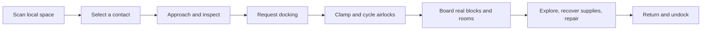

# Space encounters, stations and docking

Status: proposal for review. The encounter and docking features described here are not implemented yet.

Accepted decisions: boarding initially uses a short transfer between airlocks. The first encounters emphasize exploration: stations, neutral ships and derelicts. Active hostile ships and combat AI come later. Rendering iteration is covered in the companion [rendering workshop proposal](space-rendering-workshop.md).

## The play loop

Sensors should give us somewhere interesting to go, rather than merely printing a list. A local contact can be a station, survey vessel, cargo ship, wreck or signal source. Selecting it exposes range, identification confidence, last reading and available actions. A station or ship has a real editable interior, inventories, atmosphere and damaged machinery. Visiting the same object returns to the same state.

Proposed first examples:

| Encounter | What the player finds | Reason to board |
| --- | --- | --- |
| Waystation | Lit arrival room, functioning air supply, observation deck | A safe destination and introduction to docking |
| Survey vessel | Parked neutral ship with instruments and a ship log | Learn about another contact or nearby region |
| Damaged freighter | Some pressurized rooms, failed equipment, ordinary cargo | Repair doors/power and recover supplies |
| Derelict | Breached hull, dark rooms, emergency entrance | Suit-and-oxygen exploration and salvage |
| Distress beacon | Unidentified signal that resolves into a vessel on approach | A small authored problem using existing ship systems |

These are encounter templates, not a promise of NPC dialogue, trading or autonomous traffic in the first implementation. Neutral vessels can be parked and uncrewed. Hull damage and vacuum already provide hazards without combat AI. Initial supplies use existing materials and items.

Existing player weapons, TNT and hull damage retain their rules. The first encounter generator simply does not introduce actively hostile AI.

## What exists and what must change

Ships already have stable IDs, separate physical storage slots and simulated poses within a local region. Sensors currently enumerate registered ships and five planet addresses; they do not generate encounters or track discoveries. Scene views show up to four ship subjects. Flight currently stops translation using conservative ship bounds, which would also prevent close docking.

An apparent neighboring hull is a remote rendering, with no native collision or interaction at that apparent location. Boarding must move the player to the target's actual storage region. Our chosen first version makes that transition explicit at an airlock; hull blocks remain in their original regions.

## Persistent space objects

Introduce a common object record with `id`, `kind`, `region`, simulated pose, lifecycle, template version and physical module references. Kinds distinguish player ships, generated ships, stations and wrecks. Keep existing ship IDs and records through an additive migration.

Stations use the existing rooms, damage, power, computers and camera paths. A station is anchored and does not require engines, a planetary pad or successful launch inspection to exist. A wreck remains discoverable after losing its helm or pressure seal. Ship launch/landing menus must reject stationary objects explicitly rather than treating every record as a flyable ship.

Start with 32 x 32 x 32 prefab modules, matching the current scanner, atmosphere and snapshot bounds. The first station fits one module. Give station identity and module identity separate fields so larger stations can later combine modules without increasing every ship grid or pretending several modules share one native room. Large stations and their inter-module travel remain a later extension.

Generate real hulls only when a contact needs its interior or detailed nearby view. Reserve physical slots through one shared allocator used by launch and encounter generation. Persist the reservation and placement intent before writing blocks; generation has an idempotent recovery record and readiness checks. Scanning a signal must not allocate a whole dimension or synchronously build every encounter.

## Randomness, discovery and persistence

Use two sources of encounters:

- Seeded regional sites: stable stations and wreck locations derived from world seed, region ID, generation version and site index.
- Occasional signals: a server-owned persisted regional event sequence and eligible-play cooldown. Events draw from weighted templates and reserve a clear simulated location.

Repeated scanning reveals the same existing signals. Closing a screen, reconnecting or jumping away and back does not reroll loot or create another freighter. Once generated, blocks and inventories are authoritative; updating a template never repairs or refills an existing encounter. Different players discover the same regional objects, rather than overlapping private copies.

Proposed initial tuning, exposed in server configuration rather than hard-coded into UI:

| Control | Starting proposal |
| --- | --- |
| Seeded sites | One station and two exploration contacts per region |
| Occasional signal cooldown | 8–15 eligible minutes, persisted and shared per region |
| Active generated signals | At most four per region |
| Saved generated modules | At most 64 across the server initially; defer new hull generation at capacity |
| First exploration contact | Place an introductory contact within local scan range of an arrival area |
| Search work | At most sixteen placement candidates per scheduling attempt; defer if obstructed |
| Hull generation | One bounded placement job at a time, with measured work per tick |

Only regions with participating players advance the occasional-event clock. Menus, scans and computer polls do not advance it. Ordinary scanning does not force-load undiscovered hulls. Nearby previews use bounded loading-only sources; actual players aboard provide normal simulation. A contact must not claim its oxygen, furnaces or NPCs have simulated while its physical world was dormant.

Do not automatically delete a visited or edited hull. Occupants, offline return anchors, docking reservations, cargo, player edits and pending damage all prevent retirement. Completed signal records can be compacted while retaining IDs, claimed rewards and generation history. At the generated-module cap, postpone creation and explain the limit to operators; preserve existing encounters. Persistent discovered sites need an explicit retention policy, not an infinite sequence of disposable loot ships.

## Sensors and routes

Keep the two sensor roles:

| Scanner | New information and actions |
| --- | --- |
| Local | Contacts in this encounter region; identify, track, inspect signal, select as docking target |
| Long-range | Planet routes and selected broadcast sites/signals associated with other regions |

Discovery belongs to the ship's shared crew record. Contact packets expose authorized public metadata, not full interiors or all regional encounter records. Loss of scanner power leaves labeled, timestamped last-known information; it cannot keep updating live contacts. Sort by range with stable IDs and retain a selected target when paginating the bounded list.

Keep planet address and encounter identity separate. A route to a distant station is `(regionId, contactId)`, not a new planet address. Inter-region travel still uses the helm's loading-screen jump. It arrives at a checked stand-off point near the contact, not inside its docking port. Local approach uses normal piloting. Selecting a sensor contact never teleports the ship or grants boarding access.

For the initial UI, the scanner shows contacts and the helm owns approach/docking actions. Docking Port blocks report their own status when clicked. Proposed script APIs are `ship.contacts()`, `ship.target(id)`, `ship.dock(portId)` and `ship.undock()` through the existing validated native dispatcher. These additions must extend structured contact data without breaking existing scripts.

## Ports and docking

Add a craftable Docking Port block using the existing casing, circuit board, iron, copper and redstone progression. Final recipe and quantities belong in the recipe review. A port identifies its vessel/module, local attachment pose, associated airlock chamber and safe arrival/return anchors. Initial ship ports attach to a framed horizontal airlock; existing doors/trapdoors inside the ship retain their existing pressure behavior. Floor/ceiling docking ports can follow with explicit arrival rules.

Validation reports specific repairs: no enclosed chamber, obstructed entrance, missing seal, missing controls power or occupied berth. A powered port can request and cycle docking; the mechanical clamp remains latched through a blackout. An emergency release closes surviving local hatches and checks occupants before separating. Wrecks may offer a marked EVA entrance if their docking hardware cannot operate.

Proposed state machine:

`AVAILABLE -> RESERVED -> APPROACHING -> CLAMPED -> CYCLING -> BOARDABLE`

`BOARDABLE -> SEALING -> UNDOCKING -> AVAILABLE`

Power loss, damage and stale requests produce explicit blocked/fault states. Reservations expire before clamping; a clamped connection persists across saves. Each connection names both object IDs and both port IDs. A server reservation prevents two ships claiming the same berth.

The player requests docking from the helm after selecting a discovered nearby port. The server checks region, consent, range, speed, alignment, equipment, travel state and a clear approach. NPC stations can accept by policy; another player's vessel must explicitly accept a request. Mechanical capture locks the relative simulated pose. The first version treats the connected pair as stationary: neither ship can thrust, jump or land until undocked. A station can have several independent ports; a mobile ship has one active connection, avoiding moving assembly graphs in this version.

Use a short assisted final approach after validation, rather than asking the player to hit a pixel-perfect port. Proposed capture gates are port separation within 12 simulated blocks, relative speed below 1 block/second and forward/up alignment within 10 degrees. These are tuning values, not implemented constants. Compute mating transforms from port poses, not ship centers; support differently placed ports and arbitrary simulated ship orientation.

The existing conservative collision rule needs a docking-specific path. Keep normal collision avoidance until a valid port reserves a corridor. During final approach, check actual nearby hull occupancy and the connector clearance; exempt only the intended mating faces. Do not disable target collision for an entire approach or allow an assisted path through a wing. Pin the dock target and partner in scene selection so the four-subject limit cannot hide them.

## Airlocks and boarding

Mechanical docking does not merge the two atmosphere grids, power buses, inventories or redstone networks. Each airlock cycles using its real local gas supply and doors. There is no free refill when connecting ships. Cross-ship utility sharing and conservative gas transfer across linked grids are later mechanics.

To board, enter the source chamber and choose **Board** on its port. Isolate the chamber, verify the destination arrival space and wait for its chamber to become safe. An unsafe destination requires an equipped suit with usable oxygen and an explicit vacuum warning. Damaged or unpowered machinery cannot silently declare an airlock pressurized. Redstone-opened hatches and breaches invalidate readiness; normal atmosphere rules continue to apply.

The transfer moves the player and their carried inventory through Minecraft's normal entity path. It does not copy inventory, rebuild the hull or instantiate a temporary clone of the target. A short transition hides the storage-coordinate jump while destination chunks and the scene become ready. Transform the local entrance offset and look direction into the destination frame; clear accidental inherited motion and place the player at a checked safe anchor. Native players have yaw/pitch but no body-roll field, so preserve the transformed look direction, not an unsupported full three-axis head attitude.

Persist a small boarding intent keyed by player UUID and transfer ID. Validate before commit and again immediately before movement. Reuse the established readiness-token and reconnect concepts; do not reuse the whole-hull snapshot operation for a passenger-only move. Coordinate commits with launch, landing and region jumps so recovery of an older whole-store snapshot cannot erase newer docking/encounter state. Repeated acknowledgments cannot move a passenger twice. After commit, a disconnect resumes at the destination; it must not duplicate cargo or return a second copy to the source.

A player can explore while their own ship remains docked. Ordinary undocking rejects pending boarders or crew still on the other vessel. An explicit leave-crew-behind action is a separate future decision. Offline crew retain stable return anchors; destroying a port must not strand a login at an invalid block. Losing a connector requests closure of surviving hatches and clears the docking relationship, while preserving both hulls and ordinary damage/oxygen consequences. Redstone overrides or damaged hatches remain real failures; emergency closure cannot claim a seal it did not achieve.

## Acceptance checks

| Area | Required evidence |
| --- | --- |
| Generation | Same seed/version yields the same sites; restart/scan/revisit never duplicate hulls or loot; interrupted placement resumes safely |
| Discovery | Two clients share object identity but see only authorized discoveries; stale/unpowered sensor readings stay labeled |
| Placement | No hull/body overlap; bounded search defers cleanly; storage reservations cannot collide with launch slots |
| Docking | Port transforms and approach clearance, different helm facings, reservation races, replayed packets, blackout, damage and reconnect |
| Airlocks | Real pressure/supply, blocked anchors, redstone override, breached chambers, suited vacuum arrival and power loss during cycling |
| Boarding | Two real clients on different hulls, inventory retained exactly once, orientation, disconnect at each stage, crash/recovery around commit |
| Departure | Launch/jump/thrust blocked while clamped; no accidental crew abandonment; destroyed ports preserve usable return behavior |
| Rendering | Dock target/partner retained in bounded views; station and ship poses agree from both interiors and external cameras |

Build the smallest complete loop first: one deterministic waystation and one damaged vessel, discovery through sensors, assisted capture, real airlock boarding, exploration, return and undocking. Then expand encounter templates and the persisted random scheduler. The [rendering workshop](space-rendering-workshop.md) should provide fixed docking/encounter shots alongside its celestial scenes.
