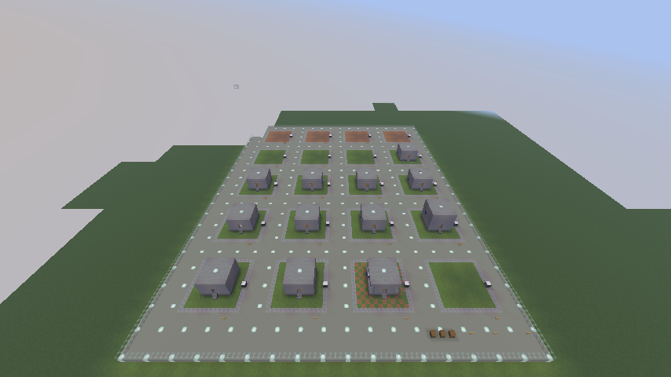
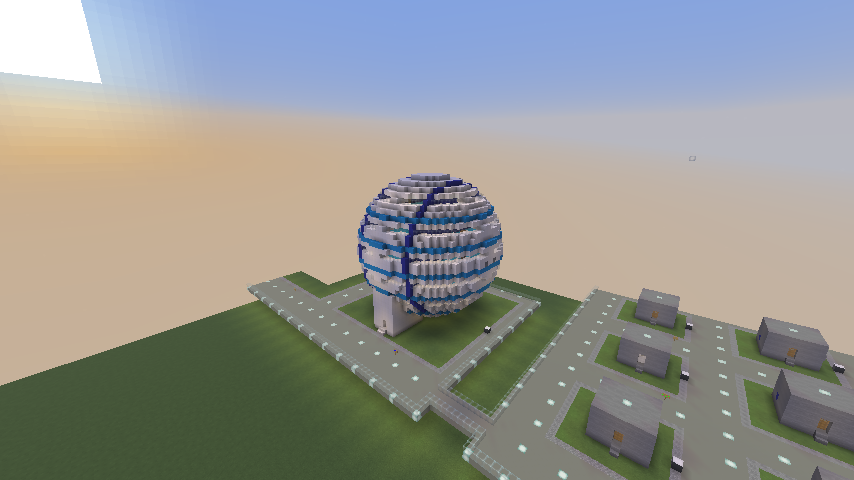
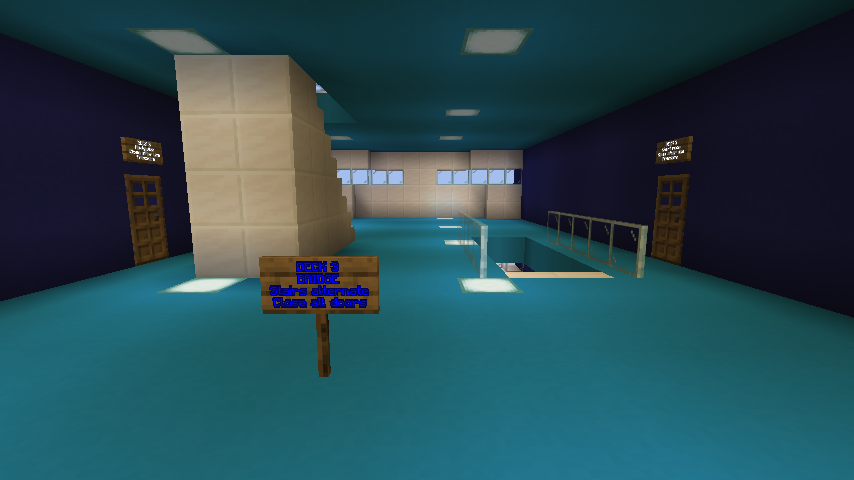

# Walking ship test gallery

Run `.\lab.ps1`, then use `/nullspace lab` to visit the entrance. A fresh `NullSpace-Lab` save starts there automatically. Existing saves gain the gallery on their next launch, preserve your position, and show its coordinates in chat. `.\playtest.ps1` also adds the gallery beside the existing development area without rebuilding the original plots.

There are 20 numbered, labeled plots on one level, joined by lit walkways, plus a large-ship annex with plots 21 and 22. Every pad is registered. Walk into a ready ship, close its doors, right-click its ship computer, Inspect, then Launch. No setup command or pad registration is needed. The landing destination defaults to that ship's own pad; choose another empty pad to try cross-pad landing.



Captured after the scout landed on blank pad 13: its original pad 01 is empty, and the ship now occupies a user pad.

## Layout

Read left to right, starting with the row nearest the entrance:

| West | | | East |
| --- | --- | --- | --- |
| 01 Scout | 02 Glass cabin | 03 Cargo | 04 Airlock |
| 05 Upper deck | 06 Half steps | 07 Twin engines | 08 Iron door |
| 09 Roof leak | 10 No engine | 11 Blocked engine | 12 Sky obstruction |
| 13 Blank 01 | 14 Blank 02 | 15 Blank 03 | 16 Blank 04 |
| 17 Blank 05 | 18 Blank 06 | 19 Blank 07 | 20 Blank 08 |

Green signs mark ready ships, orange signs mark repair examples, and blue signs mark blank pads. Each sign explains the plot. Pad names follow `Lab 01 Scout`, `Lab 13 Blank 01`, etc.; the prefix receives a numeric suffix if these names already exist in the save.

## Ready ships: 01-08

| Plot | Try this |
| --- | --- |
| 01 Scout | Basic sealed cabin, one engine, entry stairs, and seven diamonds in a chest. Launch and return. |
| 02 Glass cabin | Full-glass walls that seal correctly, over a mixed grass/dirt pad. Watch the cabin and exterior while testing pressure. |
| 03 Cargo | Chest with seven diamonds, barrel with 16 iron ingots, blue shulker box with 32 redstone, and an onboard sign. Edit cargo, travel, and check it afterward. |
| 04 Airlock | Two framed doors and a separate chamber. Close both before travel. In space, close the inner door before opening the outer; opening both exposes the main cabin. |
| 05 Upper deck | Walk up two internal stairs to the controller on the upper deck. The usable route changes elevation while the whole cabin remains sealed. |
| 06 Half steps | A strip of bottom slabs inside the cabin. Walk over it and inspect; slabs are traversable fittings, not pressure seals. |
| 07 Twin engines | Two separately exposed exhausts. Inspection should report two engines. |
| 08 Iron door | Buttons on both sides of the iron entry. Press to enter and let the door close before Inspect/Launch. |

Every ship has its own floor, lighting, a working controller, and entry stairs inside its pad. The stairs travel with the ship. Pad computers, signs outside the pad, plaza supplies, and walkways stay on the planet.

## Repair examples: 09-12

These deliberately fail Inspect until repaired:

| Plot | Expected issue | Repair |
| --- | --- | --- |
| 09 Roof leak | Controller cabin is not sealed; leak highlight leads through the missing roof block. | Patch the roof with a full sealing block. |
| 10 No engine | Missing engine. | Replace a side-wall stone with an engine exhausting outward. |
| 11 Blocked engine | Engine exhaust blocked. | Remove the stone immediately outside the engine. |
| 12 Sky obstruction | Disconnected glass above the ship's height limit. | Remove the floating high glass block; clear sky is required above the full pad. |

After repair, these are ordinary launchable ships. Repairs persist.

## Blank pads: 13-20

Each blank has a **12 x 12 interior and 32-block build height**, a complete cobblestone border, its own pad computer, and an existing destination registration. Pads 17-20 start entirely dirt; other blanks start grass. Grass becoming dirt is allowed.

Use them as landing destinations, or build your own ship and test cases. Keep all blocks within the interior, give the ship its own floor, and keep exterior access stairs inside the footprint so they can be captured safely. Equipment and building materials are in the entrance barrels. Rename a blank through its pad computer if useful; renaming preserves its destination ID. Blank-pad signs are also editable so you can label your own cases.

The gallery is generated once. Reopening the world or visiting again preserves custom builds, renamed pads, container edits, repairs, and ships that have departed. It does not refill emptied supply barrels or respawn the example ships.

## Full-size sphere: 21 Meridian

Use `/nullspace lab sphere` or `/nullspace lab plot 21`. Meridian occupies the full **32 x 32 x 32** capture envelope above its pad. Its quartz hull has window bands, five lit decks, ten side rooms with framed pressure doors, and four outward-facing engines. An enclosed stair airlock connects the ground-level entrance to the first deck; alternating two-block-wide stair flights connect the other decks. Flight is not required to reach the bridge or any room.



| Deck | Floor above pad | West room | East room |
| --- | --- | --- | --- |
| 1 | 5 blocks | Cargo hold | Workshop |
| 2 | 10 blocks | Crew quarters | Medical bay |
| 3 | 15 blocks | Navigation | Chart room |
| 4 | 20 blocks | Laboratory | Life support bay |
| 5 | 25 blocks | Observation | Reserve stores |

These room names label test spaces; machinery, medical systems, and finite oxygen production are not implemented. Each room has a cargo barrel with a different count of iron ingots or diamonds for checking transfers. The bridge computer is in the central hall on deck 3, facing the stairs. Follow the deck signs and close both airlock doors and all room doors before Inspect/Launch.



The open stair hall shares air between all decks. Breaching that hall vents the bridge, while the ten closed side rooms stay sealed. Opening a room door to the breached hall vents that room too. Use a full suit for space tests; repairing a breach currently restores binary cabin air immediately. The hull is two blocks thick radially, so a breach must pass through every hull layer.

Plot **22 XL Blank** is a registered **32 x 32** landing pad beside Meridian. The original 12 x 12 blanks cannot accept this ship. Select the exact plot-22 name in the ship terminal's Destination field, then Land. The two large pads also support custom builds up to 32 blocks tall.

The annex is generated separately and once, including in existing lab saves. It selects an unused site above the highest surface and preserves the original plots. A walkway connects it to the east side of the gallery when their heights match and the exit is clear; the visit commands always work. Its marker is `nullspace-sphere-lab-v1.nbt`. Subsequent visits preserve edits, emptied cargo, renamed pads, and ships that have left.

## Getting around and supplies

```mcfunction
/nullspace lab                 # Gallery entrance
/nullspace lab gallery         # Same entrance
/nullspace lab plot 5          # Outside plot 05; numbers 1-22
/nullspace lab sphere          # Outside Meridian; same as plot 21
/nullspace lab plot 22         # Empty full-size landing pad
/nullspace lab reference       # Original standalone reference ship
/gamemode survival            # Enable real suit/oxygen hazards
/gamemode creative            # Build and inspect safely
```

The three entrance barrels hold suit/food, computers/engines/doors/buttons, and building blocks/containers. Visiting through the command also supplies missing suit pieces and food in your inventory. Creative is immune to exposure; switch to survival when testing hazards. Current air is binary; finite oxygen levels remain future work.

The original reference ship and the player's existing plots remain separate. The gallery chooses an unused bounded footprint above the highest terrain/build in that footprint. Its marker is `nullspace-ship-gallery-v1.nbt` in the save; the original reference marker is retained independently.

## Verification

The gallery server test checks all eight ready ships through the real inspector, all four expected failures, eight clear blank pads, entry geometry, working iron-door buttons, airlock isolation, and preservation of edits/departed controllers/emptied supplies. A graphical test walks from outside the scout onto its floor, operates the real controller, launches, lands on a blank pad, verifies the source does not regenerate, and captures an overview.

The sphere server test checks its exact 32-cube bounds, four engines, walking routes to all five decks and ten rooms, airlock isolation, closed-room pressure during a hall breach, and opening a room into vacuum. It launches the full-size ship and returns it to an equally large empty pad, checking all ten cargo barrels and player inventory. The sphere graphical test walks through the entrance airlock and two stair flights to the bridge using ordinary movement, runs the real terminal inspection, checks repeat-visit preservation, and captures the exterior and stair hall.


## Powered systems annex: plots 23 and 24

Use `/nullspace lab systems` for plot 23 and `/nullspace lab plot 24` for the target ship. These are additional 32 x 32 x 32 Meridian spheres, generated separately from the existing sphere and blank pad. Earlier builds and edits are preserved. Each has a ship controller on deck 3, engineering access on decks 1 and 3, two development generators, a battery, powered air supply, controller door functions, internal/external cameras, video monitors, and an outward-facing cannon.

Walk into the airlock and close it. At engineering, use Close all doors to close the twelve real doors; inspect room/power readings. At the ship controller, Inspect and Launch. `power weapons 2` in engineering enables the mounted cannon; these two ships have opposing cannons and fixed simulated positions 180 blocks apart. Both must be launched to test ship-to-ship rendering or combat. Operators can then use `/nullspace scene pose <x> <y> <z> <yaw> <pitch> <roll>` to position/rotate their current ship in simulated space. Physical blocks stay axis-aligned. Block damage is real, so use these disposable fixtures for explosions. Generation does not repair or respawn damaged ships.

Right-click any equipment for its 80-column diagnostic terminal and local switches. Pumps show outlet-room oxygen/leaks; batteries show charge; controller door commands show open counts and offer Close/Open all. At a monitor, choose **View feed** for fullscreen video or **Next camera** to change its in-world feed. In fullscreen video, Tab changes source; arrows aim, PgUp/PgDn zoom, F2 exports a viewport PNG, and Escape returns to the ship. A generator/battery's **Manual restart** restores the control-power reservation after a blackout. Engineering command examples and implementation limits are recorded in [ship systems and viewports](ship-systems-and-viewports.md#implementation-record).
