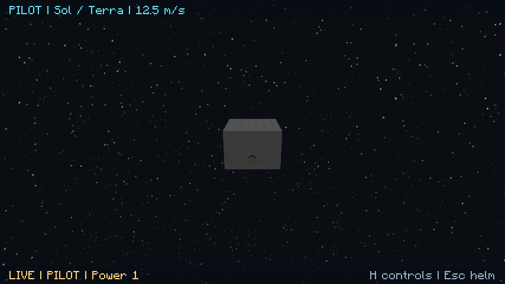

# Moon scale, pilot framing and air particles

Implemented fixes for the reported oversized Moon, large pilot-view border and lingering air-flow particles.

## Moon scale

The original scene placed a radius-600 Moon only about 3,080 units from a radius-2,200 planet's center. From parts of the planet surface, that made the Moon occupy a large fraction of the sky. The default companion layout now provides enough separation for a maximum apparent diameter of approximately **2 degrees** from the reference surface.

This moves the actual default body; surface skies, cameras, orbital views and server geometry share the same definition. Its radius, identity and materials remain intact. Regional generation uses the same spacing rule. A one-time saved-layout migration recognizes the original generated coordinates, bumps the definition revision and preserves customized geometry. The migration runs when normal play next reads the scene; verification did not open player saves.

## Pilot framing

The pilot and observer ship cameras now fill the window. Render-target dimensions follow the screen aspect ratio within the selected quality dimensions, so removing the letterbox does not stretch the image. Resizing or changing quality recreates the target only when its dimensions actually change.

Two slim translucent status strips replace the large reserved border and always-visible instructions. **H** toggles detailed controls. Orbit, zoom, thrust and Escape retain their previous behavior.

[Controls overlay](images/ship-pilot-controls.png) and [updated surface sky](images/luna-sky-scaled-companion.png) are additional graphical captures.

## Air effects

The solver previously emitted a full pump cloud for every tiny top-up needed to replace crew consumption, even when a room was already effectively full. Default cloud lifetimes also let old particles linger after flow ended.

Visual flow samples now suppress maintenance haze in sealed rooms at or above 99% nominal gas quantity. This is a visual threshold: spatial gas movement, supply, consumption and oxygen safety retain their existing simulation. Genuine vacuum escape remains visible even when the room is nearly full, and underfilled rooms continue showing supply and equalization.

The server sends an empty flow update when a source settles. The client owns its air-flow particle references and removes them on that update, without clearing unrelated native particles. Flow particles also expire after eight ticks if updates disappear, and are removed on world changes, disconnect or disabling the air-particle setting. Sources and live particles remain bounded.

## Verification

The unit additions sample the Moon's angular diameter across surface directions, preserve already distant bodies and repeated layouts, and test full-room crew top-ups, the final fill update and actual breach flow. Native tests check one-time default-layout migration, identity/revision preservation, customized bodies and all generated regional companions.

The graphical suite exercises real air-flow packets, explicit stop messages and missing-update expiry, captures the fullscreen pilot view and controls, and retains the existing terrain, sky, glass, transfer and GPU regression scenarios. Final run results and artifact details are recorded in [local verification](local-verification.md).

The [encounter/docking](space-encounters-and-docking.md) and [rendering workshop](space-rendering-workshop.md) documents remain proposals for review. These three fixes do not mark those larger features implemented.
